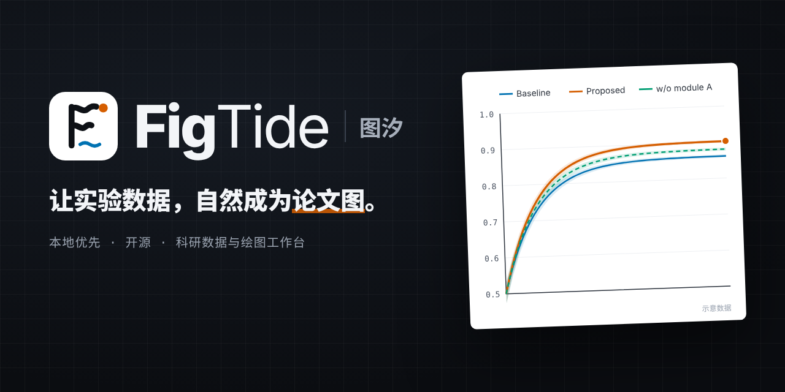
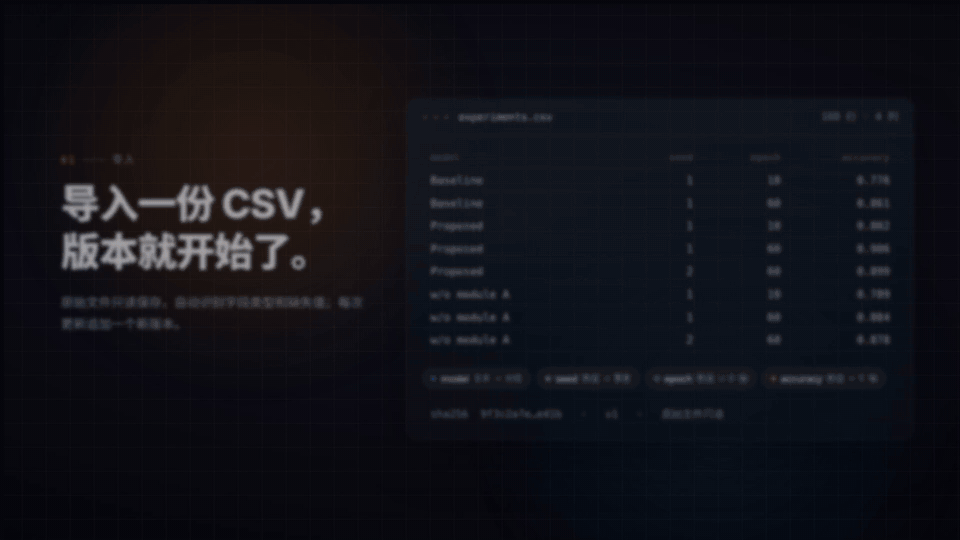

# FigTide 图汐

面向 AI / 机器学习研究者的本地实验数据管理与科研绘图工作台，从原始数据到可复现的论文图表。

[下载 Windows 版](https://github.com/chen0206a/figtide/releases/latest) · [使用指南](docs/GUIDE.md)



## 看看它如何工作

**绘图助手：描述需求，先预览，再确认应用。**


*演示使用示意数据，不代表真实研究结论。助手为可选功能，调用你配置的模型服务可能计费。*

**科研绘图：映射字段，实时调整，导出成果。**



*演示使用示意数据。普通导入、绘图与导出无需模型服务。*

## 功能

- 项目与实验记录：整理参数、指标、备注、数据关联和实验对比。
- 导入 CSV、TSV、TXT、XLSX、JSON、JSONL，先预览解析结果，再确认字段类型、角色与导入规则。
- 原始数据与解析版本不可变保存，保留内容指纹；过滤、分组和 mean / SD / SEM 汇总生成独立派生数据。
- 折线、分组柱、散点、热力、箱线、小提琴、直方、ECDF、ROC、PR、混淆矩阵绘图；支持实际误差数据与区间带。
- 实时调整序列、配色、字体、坐标轴、图例、注释和尺寸，撤销重做、本机草稿、图表版本保存与恢复。
- 按论文物理尺寸导出 SVG、PNG 和字体嵌入矢量 PDF；支持样式模板、字段映射复用、图表编排和项目备份恢复。
- 可选绘图助手：网页配置兼容模型接口，测试基础对话与工具调用，根据字段摘要推荐图型，用户选定后继续绘图。
- 自研 Java Agent Harness：工具校验、修改提案、用户确认、预算控制、取消与超时、运行审计及会话恢复。
- 可选 [MCP Server](docs/MCP.md)：让 Claude Desktop、Claude Code、Codex 或 Cursor 读取脱敏字段画像、预览图表修改，并在确认后保存新版本。

## 数据与隐私

FigTide 运行在你的电脑上。数据、图表和所有版本都保存在本机，我们没有用于接收这些数据的云端服务器，也不收集任何使用数据。只有在你配置模型并勾选同意后，绘图助手才会把图表配置和字段摘要发给你选择的模型服务，不会附带原始数据行和上传文件名。

如果你配置 MCP，AI 客户端所用的模型服务会看到工具返回的项目信息、字段名与统计画像、图表配置和你的提示词。MCP 不返回原始数据行、上传文件名或字段样例值，且没有删除工具；但项目名、标题、注释和字段名本身仍可能敏感。请先阅读 [MCP 隐私与边界](docs/MCP.md#边界与隐私)。

发送内容还包括你输入的描述、会话上下文和数据版本元信息。字段摘要包含字段名、类型、缺失数、数值范围、唯一值数和字段角色；版本元信息包含行数、版本标识与内容指纹。你主动写入标题、注释或对话的内容也会发送。模型服务可能计费。

导入、保存和解析由本机 FigTide 服务完成。模型连通性测试仅在你勾选测试同意并点击测试后发送两条固定测试消息，不包含实验数据。备份导出文件保存在你选择的下载位置。

备份导出文件保存在用户自己选择的位置。应用字体随前端打包；安装依赖与主动打开外部链接需要联网。独立公开展示页 `site/index.html` 使用 Google Fonts，不接触工作区文件。

当前为无认证的本地单用户模式，服务仅监听本机。请勿直接将后端暴露到公网；本机其他程序也可能访问本地 API。跨用户部署需要另行实现认证、授权和数据隔离。

## 下载 Windows 版

第一次使用请按[使用指南](docs/GUIDE.md)操作，包含导入、绘图、助手、导出与备份的真实界面截图。

从[最新 Release 下载 Windows 版](https://github.com/chen0206a/figtide/releases/latest)，选择同一版本的`FigTide-X.Y.Z-windows-x64.zip`和`SHA256SUMS.txt`，用`Get-FileHash`核对ZIP的SHA256。解压整个文件夹，再双击`FigTide/FigTide.exe`。请保留旁边的`app`与`runtime`目录，无需安装Java、MySQL、Node或管理员权限。第一版未签名，Windows可能显示SmartScreen提示，请先确认可信下载来源。如需 MCP，另下载并核对 `figtide-mcp.cjs`；该附件需要 Node.js 18+，详见 [MCP 接入说明](docs/MCP.md)。

macOS版和原生窗口在计划中。

- 工作台在独立窗口中打开（默认用 Microsoft Edge 应用模式，独立于浏览器标签页；找不到 Edge 时退回默认浏览器）。关闭窗口不会退出程序，使用通知区域的FigTide托盘菜单「退出」或「在浏览器中打开」。
- 数据保存在`%LOCALAPPDATA%\FigTide\data`，日志在`%LOCALAPPDATA%\FigTide\logs`。移走/删除程序目录不会删除数据；升级时退出旧程序后解压新版本，数据目录继续沿用。
- 首选端口默认17861，窗口地址始终为`http://127.0.0.1:<端口>/`。占用时临时换端口，不覆盖首选记录。未保存草稿和页面偏好存独立窗口自己的浏览器配置文件（`%LOCALAPPDATA%\FigTide\window`），换端口/换浏览器时不会自动迁移；正式保存的项目仍在本地数据库。独立窗口细节见[APP-WINDOW.md](docs/desktop/APP-WINDOW.md)。
- 项目菜单可导出备份，文件保存在你选择的下载位置；用备份恢复跨电脑转移。退出前请保存图表并备份重要项目。
- 旧MySQL工作区见[迁移指南](docs/desktop/MIGRATION.md)，迁移只复制项目，不删除旧数据；助手历史不迁移。
- [构建与发布](docs/desktop/PACKAGING.md)、[人工冒烟清单](docs/desktop/SMOKE-14-5.md)。当前交付是便携ZIP，没有安装向导、自动升级或原生窗口。

## 开发者

```powershell
# 本地生成自带运行时的便携包，需要Node、Maven和JDK21
./scripts/package-desktop.ps1
& './dist/desktop/FigTide-0.2.0-windows-x64/FigTide/FigTide.exe'
```

准备 Node.js 22.12+、Maven 3.6.3+、MySQL 8 二进制，以及 Git。后端使用 JDK 21；首次启动脚本会下载项目私有 JDK，首次安装 npm / Maven 依赖也需要联网。MySQL 应使用空闲端口 33316，脚本初始化项目独立实例，不连接既有 3306 实例。

```powershell
git clone https://github.com/chen0206a/figtide.git
cd figtide
powershell -ExecutionPolicy Bypass -File .\scripts\start.ps1
```

MySQL 安装位置不是默认值时：

```powershell
.\scripts\start.ps1 -MySqlBin 'C:\你的MySQL安装目录\bin'
```

打开 [本地工作台](http://127.0.0.1:5176)，空首页可以载入示例项目；也可导入自己的数据。后端健康检查：[本地 API](http://127.0.0.1:8086/api/health)。

- 数据保存在仓库的 `.runtime/mysql/`，不是浏览器缓存；请备份或导出项目后再迁移目录。
- 为兼容已有工作区，数据库仍名为 `labflow`，内部存储键和 `LABFLOW_*` 环境变量保持不变。
- 本地开发账号为 `labflow` / `labflow-local`，独立实例 root 密码为 `labflow-root-local`；仅用于当前本机模式。
- 已构建过可使用 `.\scripts\start.ps1 -SkipBuild`；停止使用 `.\scripts\stop.ps1`，保留数据。
- 模型设置可在网页中填写地址、模型 ID 与 API Key。密钥仅保存在后端进程内存；后端重启需重新配置。普通科研绘图不需要密钥。详见 [模型连接说明](docs/MODEL-CONNECTIONS.md)。
- 从 MySQL 网页版把项目搬到桌面版：见 [桌面版迁移指南](docs/desktop/MIGRATION.md)。

## 技术栈

| 层级 | 实现 |
|---|---|
| 工作台 | React 19、TypeScript、Vite、React Router、Tailwind CSS、自定义设计变量、Radix UI |
| 状态与表格 | TanStack Query、TanStack Table |
| 绘图与导出 | Plotly.js、jsPDF、svg2pdf.js；应用字体本地打包 |
| 后端 | Java 21、Spring Boot 3、JdbcTemplate、Bean Validation |
| 数据与解析 | MySQL 8（开发）/ H2文件库（桌面）、Flyway、Apache Commons CSV、Apache POI |
| 绘图助手 | 单 Agent 工具循环、自研 Java Harness、兼容 Chat Completions 模型适配 |
| MCP | TypeScript、官方 MCP SDK、Zod、stdio、esbuild 单文件 Node.js bundle |
| 验证 | JUnit、Spring Boot Test、Vitest、Testing Library、Playwright / Chrome |

## 测试

在仓库根目录，先启动本机 MySQL。常规测试及浏览器测试使用独立测试数据库与本机模型夹具，不调用收费模型。

测试脚本按以下顺序查找 MySQL 客户端：`-MySqlBin` 参数 → `LABFLOW_MYSQL_BIN` 环境变量 → `PATH` 里的 `mysql` → 默认安装目录 `C:\Program Files\MySQL\MySQL Server 8.0\bin`。都找不到时会报错并提示如何指定。

```powershell
# Java 单元与 MySQL 集成测试（需要 JDK 21 在 JAVA_HOME / PATH）
mvn -B -f backend/pom.xml test

# 前端组件、交互单测和生产构建
cd frontend
npm test
npm run build
cd ..

# 全量浏览器测试：隔离 Java 8087 / Vite 5178 / 夹具 18770 / labflow_e2e
.\scripts\test-agent.ps1 -All -FixturePort 18770

# 桌面版迁移端到端：隔离 MySQL 测试库 + 临时目录桌面 jar，不触碰真实工作区
.\scripts\test-migration.ps1

# 便携包真实EXE全量浏览器测试（临时H2、本地模型夹具）
.\scripts\test-agent.ps1 -All -Packaged -Application 'dist/desktop/FigTide-0.2.0-windows-x64/FigTide' -FixturePort 18770

# 生产构建的任务 09 专项（已从 .runtime 整理为受版本控制的入口）
.\scripts\test-refactor09.ps1 -FixturePort 18770
# 等价通用入口：.\scripts\test-agent.ps1 -Production -Specs @('visual-polish.spec.ts') -FixturePort 18770

# 历史图表修复 / 稳定隔离入口也已整理到 scripts，复用同一个运行器
# .\scripts\test-refactor01c.ps1 -FixturePort 18770
# .\scripts\test-refactor03-stable.ps1 -All -FixturePort 18770
# node scripts/compare-refactor09.cjs  # 历史设计稿对比，仅写 .runtime

# 独立静态展示页：390 / 768 / 1280 / 1440，使用本机 Chrome
node scripts/test-site.cjs
```

E2E 需要已安装的 Google Chrome，脚本会检查专用端口并清理本次创建的测试项目。详细结果见 [TEST-RESULTS](docs/TEST-RESULTS.md)。

仅需重新拍摄发布图时，设置 `LABFLOW_CAPTURE=1` 后运行发布专项；默认截图和下载产物保留在测试输出目录，不覆盖文档中的历史截图。

```powershell
$env:LABFLOW_CAPTURE = '1'
.\scripts\test-agent.ps1 -FixturePort 18770 -Specs @('release-brand.spec.ts')
node scripts/test-site.cjs
Remove-Item Env:LABFLOW_CAPTURE
```

[助手评测](docs/AGENT-EVALUATION.md)支持离线回放与显式开启的真实模型模式；回放通过不等于真实模型能力验收。更多协议与开发规则见 [CONTRIBUTING](CONTRIBUTING.md)。

## 项目结构

```text
frontend/       React 工作台、绘图管线、组件测试与 E2E
backend/        Java API、数据解析、图表校验与 Agent Harness
mcp/            本机 stdio MCP 转接器、单元与真实桌面集成测试
scripts/        本地起停、隔离验收、导出检查与评测入口
site/           独立公开展示页，可通过 GitHub Pages 发布
docs/           API、设计、隐私、评测与验收证据
samples/        明确标注的合成科研演示数据
docs/development/       重构任务与 FigTide 品牌源资产
```

## 许可证

本项目采用 [MIT License](LICENSE)。第三方依赖、字体与素材仍遵循各自许可证，授权说明以对应文件为准。
