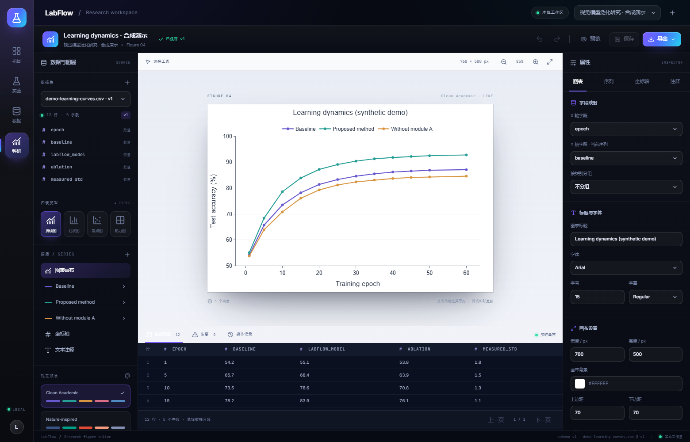

# LabFlow

面向 AI / ML 研究生的本地实验数据管理与科研绘图工作台。**第一阶段**：React 工作台 + Java 21 / Spring Boot 3 + 真实 MySQL 8，无 AI API、无订阅服务。



## 启动（本机 Windows）

在 PowerShell 中执行：

```powershell
cd 'D:\RAG-agent项目\LabFlow'
powershell -ExecutionPolicy Bypass -File .\scripts\start.ps1
```

首次启动需要联网下载免费 JDK 和 npm/Maven 依赖；依赖已安装后运行不需要外部服务。要求 Node 22.12+、Maven 3.6.3+、MySQL 8 二进制。脚本自动准备项目私有 JDK 21；如 MySQL 安装位置不同，添加 `-MySqlBin '你的MySQL/bin路径'`。

- 前端：<http://127.0.0.1:5176>
- API：<http://127.0.0.1:8086/api/health>
- 独立 MySQL：`127.0.0.1:33316`，数据库 `labflow`；集成测试数据库 `labflow_test`
- 本地开发用户：`labflow` / `labflow-local`。独立实例 root：`labflow-root-local`。仅用于本地开发。
- 数据存储：`.runtime/mysql`；日志：`.runtime/*.log`；不会访问现有 3306 数据库。

依赖和构建已准备好时可用 `scripts/start.ps1 -SkipBuild`。默认启动会重新构建并重启已跟踪的后端。服务以隐藏窗口运行。

```powershell
# 创建明确标注的合成演示项目（幂等；全部通过真实 API 保存）
node .\scripts\seed-demo.mjs

# 停止本项目进程，保留全部数据
powershell -ExecutionPolicy Bypass -File .\scripts\stop.ps1
```

## 手动开发启动

先运行上面的脚本建立私有 MySQL。若需独立调试，停止对应已跟踪服务后分别启动：

```powershell
$env:JAVA_HOME=(Get-ChildItem .runtime/java -Directory | Select-Object -First 1).FullName
$env:Path="$env:JAVA_HOME\bin;$env:Path"
mvn -f backend/pom.xml spring-boot:run

# 另一个终端
cd frontend
npm ci --cache ../.runtime/npm-cache
npm run dev
```

也提供 `compose.yaml` 作为 MySQL 的可选 Docker 启动方案。本轮实际验证使用原生 MySQL 8.0.42，未使用 Docker。原生实例和 Docker 不可同时占用 33316。Docker 测试库需另外创建 `labflow_test` 并授权。更换数据库使用 `LABFLOW_DB_URL`、`LABFLOW_DB_USER`、`LABFLOW_DB_PASSWORD`；更换 API 端口需要同步 Vite proxy 和来源白名单。

## 使用路径

1. 创建项目；数据管理上传 `samples/demo-learning-curves.csv` 或真实 UTF-8 CSV / 无宏 XLSX。
2. 检查字段类型、缺失值、版本与 SHA-256；点击“用于绘图”。
3. 左侧选择图表类型、数据版本、序列与预设；右侧映射字段并即时修改样式。
4. 点击曲线选择对应序列；点击轴标题切换坐标轴属性。画布缩放不影响导出大小。
5. 保存到 MySQL。刷新页面后从最近图表重新打开；历史快照载入后再保存，产生新版本。
6. 导出 SVG 或 1–4 倍 PNG。SVG 文本保留为文本，使用方需要相同字体；不包含生成式图像。

快捷键：`Ctrl/Cmd+S` 保存；非文本输入状态下 `Ctrl/Cmd+Z` 撤销、`Ctrl/Cmd+Shift+Z` 重做。

## 已实现的第一阶段

- 项目创建与概览、真实统计、实验创建/编辑、JSON 参数与指标、备注。
- CSV/XLSX 解析、分页预览、字段元数据、原文件下载、追加数据版本。
- 折线、分组柱状、散点、长表热力图；多序列、类别分组、真实误差列。
- 标题、字体/字重/字号、序列颜色/透明度/线型/点型、坐标范围/网格/对数、图例、画布与边距、文本注释。
- 三种独立视觉预设、撤销重做、恢复默认、可记录过滤、配置 schema v1、乐观锁版本保存、历史恢复。
- SVG / PNG 下载和浏览器回归测试。绘图引擎按需加载，不占用首页首包。

热力图按离散 X/Y 分类绘制，每个色块是 SVG 矩形，SVG 导出无需栅格图；最多 10000 个网格，超过时要求过滤。色标与单元格采用相同线性插值。热力图保留但不应用其他图表的对数轴设置。

## 数据与安全边界

本版本为 **无认证的单用户本地模式**，只绑定 loopback。来源过滤阻止其他网站直接发起浏览器写请求，但不能代替认证，任何有本机访问权限的程序仍可访问 API。禁止直接公网部署；公开部署前必须补齐身份认证、项目授权、用户隔离和审计。

原始文件和每次解析结果在 MySQL 中不可变保存，图表展示转换不修改原数据。CSV 要求 UTF-8（支持 BOM）；XLSX 仅第一张表，拒绝宏与公式；最多 10 MB、20,000 行、100 列、200,000 个数据单元格。空值保留为 null；NaN/Infinity 转为缺失并告警；不生成统计显著性。热力图重复坐标会告警并停止绘制，不静默聚合。

顶部图例会为标题自动保留最小安全边距，避免文字碰撞。很长标题、多达 20 条序列或极小画布仍应由用户预览检查并调整画布、字体或图例位置。数据预览显示原始解析值，过滤只影响画布并记录在配置中。

`samples/` 及预置工作区中的数值**全部为合成演示数据**，不代表真实机器学习结果。预设不是任何期刊官方认证。

本阶段未实现：认证、团队协作、PDF、多子图、箱线/小提琴图、显著性检验、Prompt 市场、论文写作 AI。无假按钮代表这些功能。

## 测试

启动服务后：

```powershell
powershell -ExecutionPolicy Bypass -File .\scripts\test.ps1
# 或分别运行
mvn -f backend/pom.xml test
cd frontend
npm test
npm run build
npx playwright install chromium
npm run e2e
```

Java 集成测试使用真实 `labflow_test`，不使用 H2。E2E 通过真实 Java API 在 `labflow` 创建明确命名的测试项目，并真实下载导出文件；不会使用前端 Mock。详细结果见 [测试记录](docs/TEST-RESULTS.md)。

## 代码与设计

- [产品、架构、ER 图与 UI 规范](docs/DESIGN.md)
- [API 协议](docs/API.md)
- [完整配置示例](docs/config-v1.example.json)
- `backend/src/main/java/dev/labflow/`：Controller / Service / Repository / Importer 分层。
- `frontend/src/editor/`：配置模型、历史 reducer、数据到 Plotly 的纯函数映射、工作台 UI。
- `frontend/src/components/ui/`：shadcn/ui 风格本地组件，使用 Radix Dialog/Slot、CVA 和 Tailwind。
- `scripts/`：独立启动、停止、测试和合成演示数据导入。

界面及布局为原创；图标使用 Lucide（ISC），React/Plotly/TanStack/Radix/Tailwind 等依赖遵循各自开源许可证。未复制商业软件界面或许可不明的素材。
