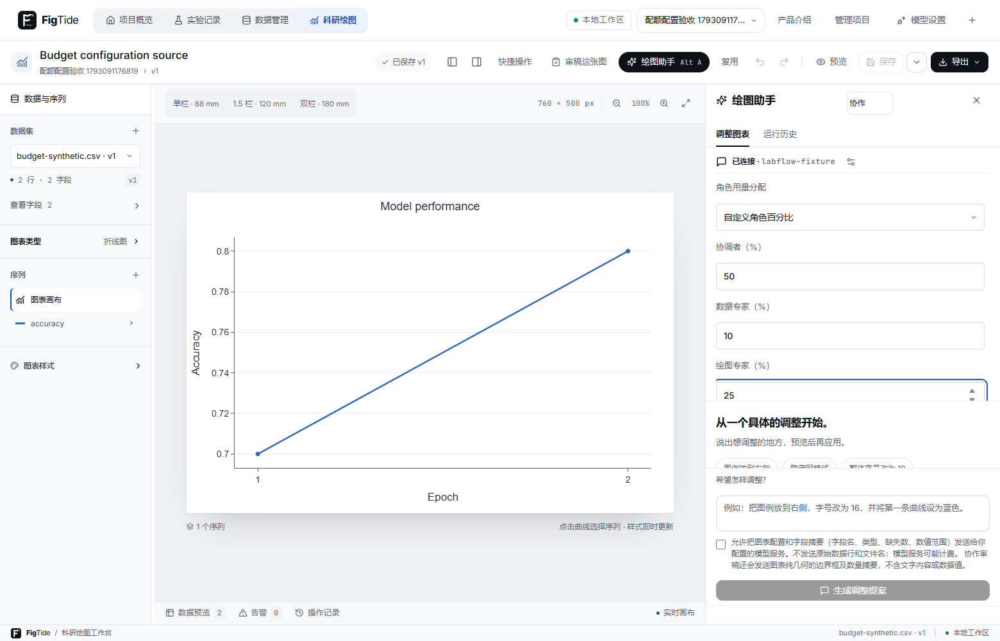
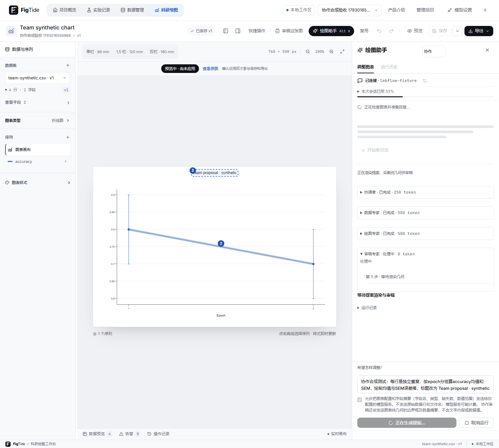
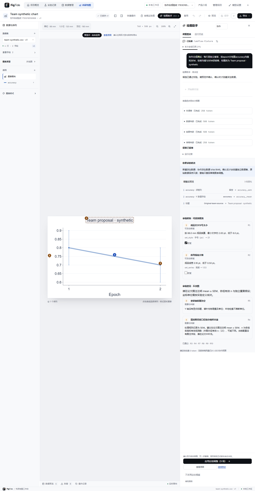
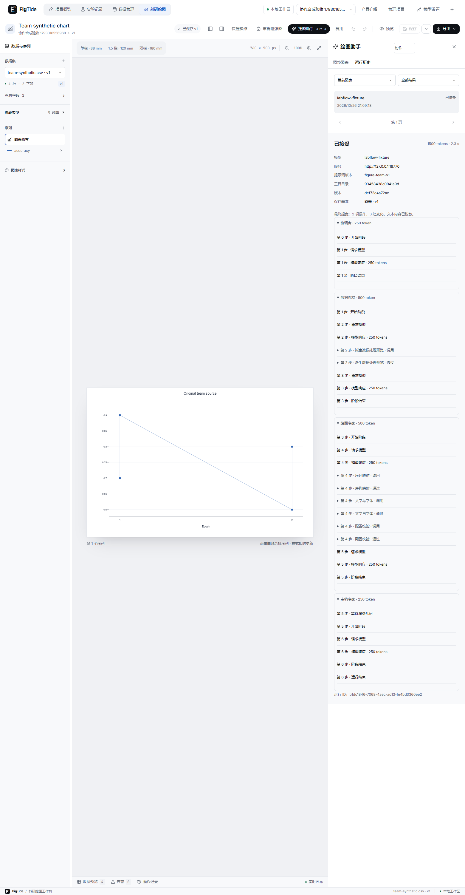

# 多 agent 协作（18-B，未发布）

2026-10-28后续优化使用`figure-team-v3`。协调者仍负责分派角色，但数据和绘图角色只接收角色分派与用户原请求，不接收协调者自行生成的目标文字，避免计划把未经要求的图例方向传成执行指令。审稿角色可看到原计划以核查差异，提示词明确其不是用户要求；模型规划和审稿仍可能出错，不能把这项隔离当成对所有语义偏差的确定性阻断。

协作提案的X/Y字段映射变化时，如果对应旧轴标题或同序列图例名称仍保留，服务端增加“请核对标签”的提示，显示在回复和审稿意见中；这只提示可能不一致，允许用户检查当前提案并决定是否明确要求更改，不自动修改标签，也不阻止确认。继承的标签即便仍正确也可能触发提示。

2026-10-27协作优化使用`figure-team-v2`，各角色提示词版本为`figure-team-<role>-v2`。此次先修复现有编排和工具契约，Jev尚未接入。工程回归与效果评估分开记录，上一批真实评测结果保持不变。

在绘图助手标题旁选择「单助手 / 协作」，默认单助手；选择仅记在本机偏好。全部角色共用一次运行和会话预算，只有用户确认才应用到草稿，保存仍由用户另行操作。原 `edit`、`recommend` 调用保持兼容，新增 `single`、`team`、`review`。

## 固定编排与工具边界

服务端按 planning → 可选 data → plotting → awaiting_render → reviewing → proposed 执行。协调者只读，输出最多 4 个目标；数据专家只生成 ProcessingRules；绘图专家只提出原有十种绘图操作；审稿专家没有写工具，只补充语义建议。各角色系统提示词版本单独记录，模型不能决定下一次状态迁移或绕过工具白名单。

协调者可以读取图型规范、字段摘要和当前配置；数据专家可以读取原始字段摘要及调用 propose_processing；绘图专家沿用十种绘图工具与三个读取工具；审稿专家只接收确定性问题、配置摘要和几何数量/边界框摘要。模型消息不含原始行、文件名、字段样例或派生数据行。图表标签仍会作为配置发送，启用模型前沿用明确同意。

v2中绘图只读轮不触发空操作预览，也不重复预览已校验的旧操作；新增绘图批次和最终提案仍通过原preview/lint及revision校验。只读取信息且没有操作时返回回答，不生成可应用提案。

propose_processing现在明确列出mode=aggregate/sort、error=sd/sem/none、display=bars/band、missingGroup=include/exclude及过滤/排序枚举、长度和数组约束。aggregate的观测单位必须来自用户明确说明，sort仅过滤/排序并保留逐行数据。字段以成功返回的元数据为准。一次运行仍只接受一份成功规则；400参数/数据校验失败返回固定错误和公开schema，允许当前数据角色修正后再次提交，不占成功规则名额。不回显后端原始异常；403/409/500、越权工具、取消或额度中止仍终止执行。每次纠错仍消耗原角色调用步数和用户用量，不增加隐式收费重试或额外调用额度。

协调者提示区分已明确要求、可沿用配置和真正阻塞的缺失信息：仅映射/样式不擅自引入汇总，仅过滤/排序不要求新增统计口径。绘图提示强调最小修改，不能因为换Y字段就改序列名或顺手调整图例方向。审稿角色新增原请求、任务目标、原配置摘要及服务端计算的实际before/after差异，先指出遗漏或额外修改，再给学术建议；最多40项差异，较长值以redacted摘要替代并标明截断。审稿仍只给建议，不自动阻断或修正语义偏差，因此不能宣称已消除额外修改。

awaiting_render 暂时暴露只读候选（status=running、persisted=false），用户尚不能确认；前端渲染后向原 review 接口提交纯几何，再执行一次模型审稿。这里用 phase 表示候选已就绪，HTTP status 维持 running，满足任务书「运行中一律 running」以及旧客户端只看 status 继续轮询的兼容要求。没有渲染客户端时最多等 5 秒，然后明确跳过 R7/R8；不是伪造通过。等待期间仍可取消/超时。最后才调用原 audit.finish 一次结算并持久化可确认提案。

## 预算与失败

2026-10-27调整：用户端默认各角色共同使用单次额度，不再强制协调者15%的阶段配额。绘图助手额度面板可填写单次2,000–60,000、新对话60,000–600,000额度；协作可选共同使用或自定义协调/数据/绘图/审稿四项百分比（各为正整数、总和100%），前序未使用额度顺延。设置记在本机；已有会话的总额度仍需明确开始新对话才能更改。独立深度审稿也可调整单次额度，默认32,000。

HTTP可选role_budget_percentages为四角色所占百分比对象；省略/显式null默认共同使用（服务端兼容开关labflow.agent.team.role-budget-limits-enabled=true可让省略时沿用旧15/30/40/15分配，显式null仍共同使用）。自定义值例如50/10/30/10，对应累计50/60/90/100%。单次和会话预留/结算仍共用原实现，整体用量额度、8步及120秒的用户运行上限仍生效，单助手原默认行为不变。额度按保守UTF-8字节计数，与服务报告token分开。

内部评测另有EVALUATION_UNBOUNDED执行策略，由评测代码显式构造，通过scripts/evaluate-team.ps1 -Mode live -Live -NoCostLimit -UnrestrictedEvaluation启用。该策略真正跳过单次/角色用量、调用步数、角色轮次和整次时长限制，并省略模型请求max_tokens以使用供应商输出能力；HTTP不接受execution_policy等绕过字段。取消与原工具白名单、数据校验、用户确认仍生效；单次网络通信仍有120秒等待，缺少浏览器几何仍等最多5秒后跳过R7/R8。评测不复用用户会话，账本沿用INT_MAX字段容量预留以复用原审计，这不是执行中的额度判断；实际用量继续记录，未知用量不填写有限费用估算。旧批评测报告保持其当时配置，不据此改写历史结果。

每次请求前先检查角色、整次预算和截止时间；超限使用原 incomplete 终态，并以 phase=budget_limited/timeout 区分。账本不会突破本次预留；若服务报告的用量超过剩余预留，则记为不完整用量，原审计保守结算保留整次预留，不能把异常响应记成免费。

协调者、数据、绘图任一阶段失败不交出可应用提案；模型审稿服务失败时仍交付已校验候选与确定性报告，注明「深度审稿未完成」。取消与全局超时、步数/运行预算耗尽不会降级为成功。审稿最多一轮，不用模型反复修复。每一步 trace 带 role，详情按角色汇总 steps/tokens/status/summary/prompt_version；历史页可按角色展开。

## 派生数据的确认

propose_processing 复用现有处理算法，在内存保留完整结果，模型只能看到派生字段摘要。提案 config 的 datasetVersionId 是 `$derived`，另附 processing（来源版本、名称、规则、preview_hash）；前端本机预览可读取 preview_dataset，这些行不会进入模型消息或审计。

内存候选使用与保存相同的字段、误差、分类等校验；没有新增公开 lint 接口。原 figure-tools/preview 仅新增可选 agent_run_id，将未落库候选绑定到可信运行；客户端不能替换其提案或来源。单助手和 MCP 的旧预览请求完全不变。

确认前检查原提案指纹、修复报告、修复 ID、图表 revision 和运行状态。以运行 ID 锁定审计行，调用原 ProcessingService.commit 创建一次派生数据，并把版本 ID 写入已有 accepted_fixes_json.processing_commit。随后替换 `$derived`，应用所选修复并重新 lint，再走原决定接口。重复确认沿用相同版本，不会创建第二份。

数据创建使用独立事务：若后续 lint/决定失败，合法派生数据保留，运行仍待决定，审计记录 processing_commit 及失败状态；重试复用此版本。接受不保存图表。撤销只撤回图表草稿，已经明确确认创建的独立派生数据仍在数据页。

未应用的派生数据提案可以在协作模式续改，处理规则与内存结果随候选保留；替换规则仍基于原始来源。续改沿用原会话预算、父子提案替换和手动冲突检查。服务重启后仅保留审计与预算，不从审计还原原始配置/数据；过期提案继续按原规则要求重新生成。

## 独立深度审稿

「审稿这张图」默认仅运行本机确定性检查。深度审稿默认不选，需要另行勾选同意，才启动 mode=review 的一次运行，仅调用审稿角色；界面显示模型用量和取消按钮。关闭面板会取消尚未结束的独立调用。原始行不发送，模型服务可能计费。实际计费由主人所配置服务决定，开发验收只调用人工协议夹具。

## 共享方法扩展

- AgentRunService：mode 兼容分派、新角色驱动和几何等待；start 仍调用原 audit.begin，结束仍调用原 audit.finish；原单助手 execute 循环保留。
- AgentAuditService/Repository：记录 mode、读取角色汇总、独立审稿结果及派生数据确认映射；原预留/结算和决定条件不变。
- WorkspaceService.validateAndReport、FigureToolService：新增内部内存数据重载，复用保存校验；原 HTTP lint 不支持客户端提供数据行。
- ProcessingService：新增只读完整内存预览，确认时仍调用原 commit；不修改算法或原始数据。
- ProposalReviewService/ReviewEndpointService：可信内存数据审稿与确认后保留 processing_commit；没有放宽修复/冲突/版本校验。

评测结果与真实模式运行方式见 [AGENT-EVALUATION.md](AGENT-EVALUATION.md)。完整双库与桌面验收在 18-B 总验收记录中提供；本节实现不等于真实模型效果已得到证明。

## 实际界面

以下为隔离 H2 和人工协议夹具的真实浏览器截图。用量是合成夹具计数，不能当作真实服务成本。

