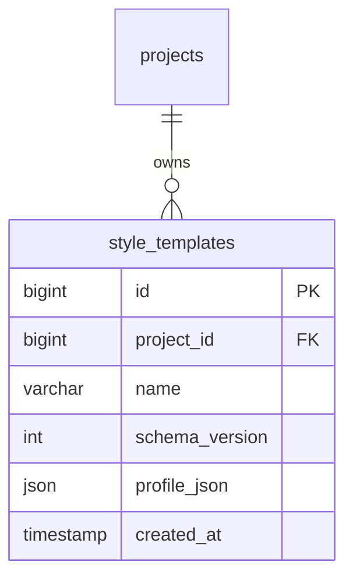
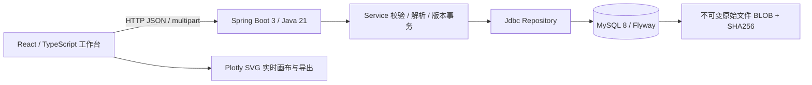
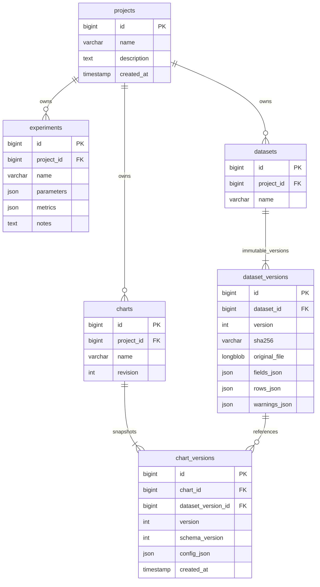

# FigTide · 产品与当前前端设计

## 产品边界与核心路径
单用户本地研究工作区。创建项目 → 添加实验 → 上传 CSV/TSV/TXT/XLSX/JSON/JSONL → 确认解析与字段 → 可选推荐、用户选图 → 映射图表 → 即时编辑 → 保存 MySQL 版本 → 重开 → 复用与导出 SVG/PNG/PDF。
目前支持 11 类科研图，并包含模型评估、同类分面、可追溯数据处理、样式模板和项目备份。可选绘图助手提供模型适配、Java 循环、会话预算、审计与恢复；核心工作台不依赖模型。未包含团队权限、推断检验或显著性标记，预设不代表期刊认证。下文 ER 与核心 API 保留基础关系，助手增量见 [模型配置](AGENT-PROVIDER.md)、[审计](AGENT-AUDIT.md) 与 [评测](AGENT-EVALUATION.md)。

第九批优化前端体验：官方 Cartesian 分包、增量布局更新、输入/绘图调度、草稿合并写入、自动适配画布和首页列表分批显示。界面样式只作用于应用外壳，不覆盖图形 SVG；保存、导出及统计继续使用原有配置与数据合同。后端及 ER 关系不变。细节和测量方法见 [第九批记录](BATCH-9.md)。

第八批新增 `DeliveryController → StyleTemplateService / BackupService → WorkspaceRepository`，备份/恢复与图表服务共享项目归属及配置校验。PDF 转换只在本机浏览器按需加载，原始数据继续由 Java/MySQL 管理。Flyway V4 增加如下关系：



备份清单独立于数据库版本，格式为 labflow-project-v1，保留数据库 JSON 原文、原文件及所有版本。恢复在单事务中创建新项目，重建明确引用，不对实验参数或指标进行数字替换。模板仅提取外观白名单，完整图表复制必须显式映射字段；两者使用不同的 UI 路径。

## 系统架构

2026-10-21 新增确定性绘图工具层：`FigureToolController → FigureToolService → FigureOperations / WorkspaceService → WorkspaceRepository`。目录使用独立 protocol_version=1 与 JSON Schema，继续产生 schema_version=1 图表配置；预览只读，应用由编辑器统一写入撤销栈，正式版本沿用已有保存 API。工具预览层本身只读，不自动保存图表；可选 Agent 在该工具层之上调用并产出提案，用户确认后才进入草稿。完整合同见 [绘图工具协议](FIGURE-TOOLS.md)。

请求使用 TanStack Query；编辑草稿使用 React reducer 历史栈，保存后服务端版本为基准。Plotly.react 更新现有图形，使用 SVG traces 避免散点 WebGL 导出栅格化。数据表使用 TanStack Table。Tailwind + shadcn 风格 Radix primitives 组成可访问控件。

## 数据库 ER 图

数据版本为 append-only；同一 dataset 下新增版本明确由用户触发。图表保存包含完整配置快照与数据版本引用，乐观锁 revision 防止覆盖；历史恢复创建新版本而不覆盖旧版本。原文件保存在数据库，避免文件系统和 SQL 事务不一致。

## API v1 合约
前缀 `/api`，JSON UTF-8，错误 `{message, code}`；参数错误 400，资源不存在 404，版本冲突 409，过大 413。ID 为正整数。

| 方法 | 路径 | 语义 |
|---|---|---|
| GET / POST | /projects | 项目列表 / 创建 {name,description} |
| GET / POST | /projects/{p}/experiments | 实验列表 / 创建 {name,parameters,metrics,notes} |
| PUT | /projects/{p}/experiments/{id} | 更新实验 |
| GET | /projects/{p}/datasets | 列出所有版本与元数据 |
| POST | /projects/{p}/datasets | multipart file，新数据集 |
| POST | /projects/{p}/datasets/{id}/versions | 上传新的不可变版本 |
| GET | /projects/{p}/data/{versionId} | 字段、类型、缺失计数、数据行、警告 |
| GET | /projects/{p}/data/{versionId}/original | 下载原始文件 |
| GET / POST | /projects/{p}/charts | 列表 / 创建 {name,config} |
| GET / PUT | /projects/{p}/charts/{id} | 当前快照 / 保存 {name,revision,config} |
| GET | /projects/{p}/charts/{id}/versions | 历史快照列表 |

`config.schema_version=1`；包含 datasetVersionId、type、x、group、series[{id,y,name,color,opacity,width,dash,symbol,size,error}]、axes、style、legend、annotations、transforms。第一版只接受明确的 filter 转换，不修改原始行。所有字段引用均验证归属；未知 schema 拒绝。创建更新时间由服务器记录。

## 信息架构与视觉规范

应用外壳统一为桌面端 64px 全宽顶栏，包含项目概览、实验记录、数据管理、科研绘图、项目选择与模型连接；窄屏允许换行。工具页面使用 PageHeader，小标题、说明和当前动作在一个紧凑区域内，不再使用旧首页大标语。

首页 A 是研究工作区：最近图表用真实保存配置和数据版本渲染大预览；旁边提供近期图表与助手入口，下方是项目表、最近实验和快速开始。项目数量、图表、数据版本来自真实 API；不虚构缩略图或更新时间。公开产品介绍独立放在 site/，不与工作台混在同一路由视图，也不是缺少后端的在线 Demo。

实验页默认表格，支持卡片切换、字段频率推断、按项目保存列设置、双向排序（空值始终最后），以及状态与标签筛选、参数/指标/备注、固定数据版本关联及 2–8 项对比。选择栏仅在有选择时以深色浮动胶囊呈现，复用原有基线和对比流程。数据页为无外框版本列表与单层详情卡片，提供解析确认、字段画像、表格预览与显式派生规则；派生数据明确标记。实验对比与无数据空状态的标签使用 lf-kicker。

编辑器采用专业工作台：顶部保存/菜单/撤销/导出，左侧数据与图层，中间自适应白色科研画布，右侧随所选元素切换的属性，底部折叠数据/告警/记录。左/右栏默认约 236/292px，可调整和收起；缩放只改变查看比例，导出画布尺寸仍来自配置。论文尺寸分段按钮提供88/120/180mm预设，外观页唯一PublicationPanel提供同一组控件及自定义，开启时显示10mm标尺；沿用publicationMetrics/renderConfig按成品尺寸换算字号，不改变保存的像素宽高。新建单个无分组序列图默认隐藏图例，旧配置不变。入口 Editor.tsx 负责查询与加载，workbench/Workbench.tsx 组合状态、hooks、面板与对话框。

视觉规范：

- 冷灰应用底色 --lf-bg，白色表面 --lf-surface，轻灰面板 --lf-surface-2；画布区域 --lf-canvas，图纸保持白色。
- 墨黑主按钮 --lf-primary；链接与选中态 --lf-link / --lf-selected。朱红 --lf-accent 只用于少量关键数字，每屏一两处；图表数据编码使用独立色板，不套用 UI 灰色。
- UI 字体为 Inter 与 JetBrains Mono，中文使用系统回退。编号、版本、规格和时间使用等宽样式；数据页版本列表文件名使用普通字体500字重并完整换行。不再加载 Newsreader 或使用衬线标题。图表中的出版字体由图表配置单独管理。
- 设计变量唯一来源是 frontend/src/styles/tokens.css；组件直接引用 --lf-*，过渡别名已删除。Tailwind @theme 只转接这些 token。正文维持现有 15px / 1.6，避免迁移造成无意收紧；既有 11.5/12.5/13.5/16/18px 规格有明确的字号 token。
- shell.css 负责导航和页面骨架；styles.css 保留基础控件；styles/table.css 统一lf-table表头、数字列和缺失值样式，不再以全局th规则影响组件；styles/dialogs.css 负责弹窗、导入/备份；data/data-page.css、experiments/experiments-table.css、editor/workbench/workbench.css 分别负责所属页面。旧 navigation/refinements/experience 覆盖层已移除，组件状态和响应式规则留在各自范围内。
- 圆角、间距、阴影与颜色引用 token；边界轻、留白清晰。导航保留轻微 hover / 按压反馈，加载、空状态、错误与保存状态有明确反馈。遵循 prefers-reduced-motion，缩短动画和过渡。

助手停靠面板分为固定模型/预算顶部、可滚动对话与提案中段、固定输入/同意/发送底部及确认栏。接入模型需明确同意；提案经校验和预览后由用户确认，确认只改草稿，可一步撤销，正式保存仍需用户决定。

交互约定保持不变：Ctrl/Cmd+S 保存；非文本输入时 Ctrl/Cmd+Z 撤销、Ctrl/Cmd+Shift+Z 重做；Ctrl/Cmd+K 快捷操作。文本输入保留原生撤销。点击曲线选序列；本机草稿、乐观锁冲突、离开保护和助手恢复机制不因样式清理而变化。

## 安全与数据语义
仅绑定 loopback，无认证。禁止直接公网部署；未来必须添加认证、项目授权、用户隔离、CSRF 策略与审计。前端 dev proxy 同源访问，无宽泛 CORS。
支持六类格式，解析确认合同见 [DATA-TO-FIGURE.md](DATA-TO-FIGURE.md)。上传限 10MB、20000 行、100 列；UTF-8 BOM/严格 UTF-8 CSV；错误编码提示转码；重复/空表头拒绝；缺失值为 null；NaN/Infinity 警告并转 null；XLSX 只读取首个 sheet，不执行公式，公式单元格拒绝，拒绝宏格式。异常行宽拒绝。文件名只用于元数据，原文件从不执行。
误差棒只能映射实际非负数值列。热力图要求 x/y 唯一坐标，重复坐标明确提示，不静默求平均。对数坐标非正数显示警告。演示 CSV 明确标为合成数据。

## 测试与交付
Parser 单测覆盖 BOM/中文/缺失/非有限/重复表头/超限/公式；真实 MySQL 集成测试验证项目隔离、版本保存恢复、冲突。组件测试验证编辑/撤销/字段映射；Playwright 浏览器完成主路径与导出，保留截图和导出样本。所有测试报告按实际执行结果记录。Git 本地提交，不推送。

## 目录
```
LabFlow/
  backend/       Maven · controller/service/repository/importer
  frontend/      Vite · components/editor/lib/tests
  docs/          产品架构、API、测试记录与截图
  samples/       明确标记的合成实验 CSV
  scripts/       本地环境启动/停止与验证
  .runtime/      忽略提交：独立 JDK/MySQL 数据/日志
```

参考技术文档：[Spring Boot](https://docs.spring.io/spring-boot/3.5/system-requirements.html)、[Plotly export](https://plotly.com/javascript/plotlyjs-function-reference/)。原创界面，无第三方商业素材。
