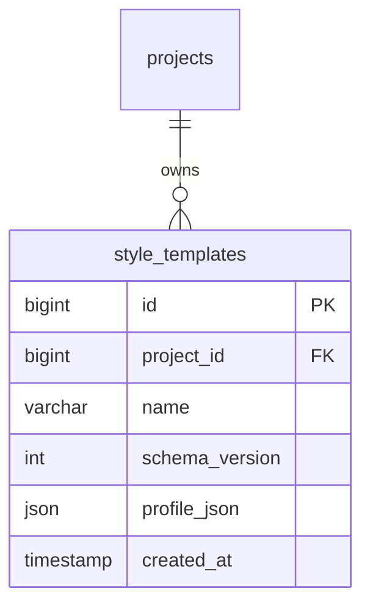
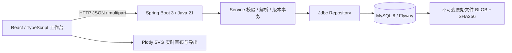
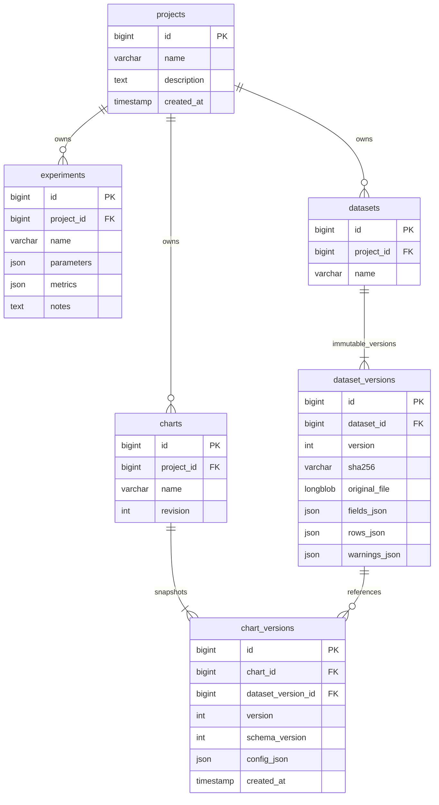

# LabFlow · 第一阶段产品设计

## 产品边界与核心路径
单用户本地研究工作区。创建项目 → 添加实验 → 上传真实 CSV/XLSX → 检查字段与缺失值 → 映射图表 → 即时编辑 → 保存 MySQL 版本 → 重开 → 复用与导出 SVG/PNG/PDF。
目前八批增量已扩展分布、模型评估、同类分面、可追溯数据处理、样式模板和项目备份。未包含 AI 服务、团队权限、推断检验或显著性标记；预设不是期刊认证。下面保留首版架构，具体增量合同见各批文档。

第八批新增 `DeliveryController → StyleTemplateService / BackupService → WorkspaceRepository`，备份/恢复与图表服务共享项目归属及配置校验。PDF 转换只在本机浏览器按需加载，原始数据继续由 Java/MySQL 管理。Flyway V4 增加如下关系：



备份清单独立于数据库版本，格式为 labflow-project-v1，保留数据库 JSON 原文、原文件及所有版本。恢复在单事务中创建新项目，重建明确引用，不对实验参数或指标进行数字替换。模板仅提取外观白名单，完整图表复制必须显式映射字段；两者使用不同的 UI 路径。

## 系统架构

请求使用 TanStack Query；编辑草稿使用 React reducer 历史栈，保存后服务端版本为基准。Plotly.react 更新现有图形，使用 SVG traces 避免散点 WebGL 导出栅格化。数据表使用 TanStack Table。Tailwind + shadcn 风格 Radix primitives 组成可访问控件。

## 数据库 ER 图

数据版本为 append-only；同一 dataset 下新增版本明确由用户触发。图表保存包含完整配置快照与数据版本引用，乐观锁 revision 防止覆盖；历史恢复创建新版本而不覆盖旧版本。原文件保存在数据库，避免文件系统和 SQL 事务不一致。

## API v1 合约
前缀 `/api`，JSON UTF-8，错误 `{message, code}`；参数错误 400，资源不存在 404，版本冲突 409，过大 413。ID 为正整数。

| 方法 | 路径 | 语义 |
|---|---|---|
| GET / POST | /projects | 项目列表 / 创建 {name,description} |
| GET / POST | /projects/{p}/experiments | 实验列表 / 创建 {name,parameters,metrics,notes} |
| PUT | /projects/{p}/experiments/{id} | 更新实验 |
| GET | /projects/{p}/datasets | 列出所有版本与元数据 |
| POST | /projects/{p}/datasets | multipart file，新数据集 |
| POST | /projects/{p}/datasets/{id}/versions | 上传新的不可变版本 |
| GET | /projects/{p}/data/{versionId} | 字段、类型、缺失计数、数据行、警告 |
| GET | /projects/{p}/data/{versionId}/original | 下载原始文件 |
| GET / POST | /projects/{p}/charts | 列表 / 创建 {name,config} |
| GET / PUT | /projects/{p}/charts/{id} | 当前快照 / 保存 {name,revision,config} |
| GET | /projects/{p}/charts/{id}/versions | 历史快照列表 |

`config.schema_version=1`；包含 datasetVersionId、type、x、group、series[{id,y,name,color,opacity,width,dash,symbol,size,error}]、axes、style、legend、annotations、transforms。第一版只接受明确的 filter 转换，不修改原始行。所有字段引用均验证归属；未知 schema 拒绝。创建更新时间由服务器记录。

## 信息架构与视觉规范
全局窄导轨：概览 / 实验 / 数据 / 绘图。项目选择固定在顶部工具栏。
概览：研究项目列表、真实数量统计、六项主要能力介绍、最近图表与创建入口。
实验：列表和编辑表单，参数/指标 JSON 与备注，项目数据文件可跳转。
数据：上传、数据集版本列表、类型摘要、分页预览、缺失及异常提示。
编辑器：62px 顶栏；236px 左侧数据/图层；自适应中央画布；288px 右侧属性；底部可折叠表格与告警。

视觉方向（第三版 · 编辑 / 杂志风格）：暖纸、衬线、发丝线、单一强调色。
纸色 `#f7f4ee`；卡片 `#fffdf9`；墨色 `#1c1a17`；次级文字 `#4b453c` / `#8a8276`；发丝线 `#e4ddd1`。唯一强调色为陶土 `#b65c3a`，只用于编号、斜体标题行与图版标签；鼠尾草绿、石板蓝仅出现在图版配色里。
字体：Newsreader Variable（衬线标题、统计数字）、Inter Variable（正文与控件）、JetBrains Mono Variable（刊号、导航编号、图注规格、时间）。
版式：58px 报关头（wordmark + 刊号 + 项目选择）+ 40px 目录导航（01–04，当前项 1.5px 墨线下划线）；1px 发丝线分隔区块；无投影、无渐变、无发光；圆角仅 2–4px。
首页：Hero（衬线大标题 + 陶土斜体行 + 单行说明 + 主按钮/文字链接）＋ Contents 目录 ＋ 规格行（Stack / Figures / Dependencies）＋ 统计条 ＋「PLATES 图版」双列图版 ＋「CAPABILITIES 能力」双列条目 ＋ 研究项目与最近图表 ＋ colophon 页脚。
图版：6 幅手绘 SVG，分别按 Nature（89 mm 单栏、5–7 pt Arial、a–d 面板字母、Okabe–Ito 色盲安全配色）、Science（183 mm 双栏、误差棒）、Cell（单元格标注热力图）、NeurIPS（散点回归 + r²）、eLife（箱线 + 抖动散点）的规范渲染；数值取自合成演示数据，不嵌入任何受版权保护的论文图。
编辑器：纸色外壳 + 白纸画布（`#fff` + 点阵网格 + 双层柔和投影），左右面板 `#f2eee6`、发丝线；图表标题用衬线体，控件保持 8–11px 小字号，暗色仅用于「导出」主按钮。
交互：页面入场 0.45s 上移 8px，`prefers-reduced-motion` 下关闭；hover 只改变边框与底色，不做缩放或辉光。
状态：明确加载、空数据引导、错误可重试、未保存/保存中/已保存/冲突反馈。Ctrl+S 保存；Ctrl+Z 撤销；Ctrl+Shift+Z 重做。文本输入保留原生撤销。点击曲线选择序列；点击轴名称/标题选择对应属性。

## 安全与数据语义
仅绑定 loopback，无认证。禁止直接公网部署；未来必须添加认证、项目授权、用户隔离、CSRF 策略与审计。前端 dev proxy 同源访问，无宽泛 CORS。
上传限 10MB、20000 行、100 列；UTF-8 BOM/严格 UTF-8 CSV；错误编码提示转码；重复/空表头拒绝；缺失值为 null；NaN/Infinity 警告并转 null；XLSX 只读取首个 sheet，不执行公式，公式单元格拒绝，拒绝宏格式。异常行宽拒绝。文件名只用于元数据，原文件从不执行。
误差棒只能映射实际非负数值列。热力图要求 x/y 唯一坐标，重复坐标明确提示，不静默求平均。对数坐标非正数显示警告。演示 CSV 明确标为合成数据。

## 测试与交付
Parser 单测覆盖 BOM/中文/缺失/非有限/重复表头/超限/公式；真实 MySQL 集成测试验证项目隔离、版本保存恢复、冲突。组件测试验证编辑/撤销/字段映射；Playwright 浏览器完成主路径与导出，保留截图和导出样本。所有测试报告按实际执行结果记录。Git 本地提交，不推送。

## 目录
```
LabFlow/
  backend/       Maven · controller/service/repository/importer
  frontend/      Vite · components/editor/lib/tests
  docs/          产品架构、API、测试记录与截图
  samples/       明确标记的合成实验 CSV
  scripts/       本地环境启动/停止与验证
  .runtime/      忽略提交：独立 JDK/MySQL 数据/日志
```

参考技术文档：[Spring Boot](https://docs.spring.io/spring-boot/3.5/system-requirements.html)、[Plotly export](https://plotly.com/javascript/plotlyjs-function-reference/)。原创界面，无第三方商业素材。
