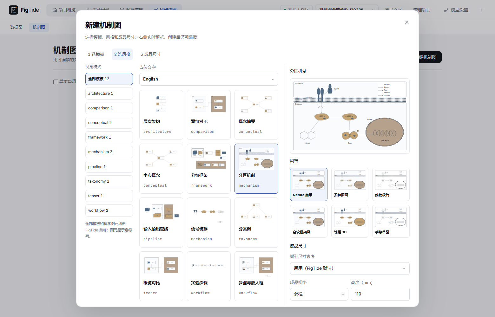
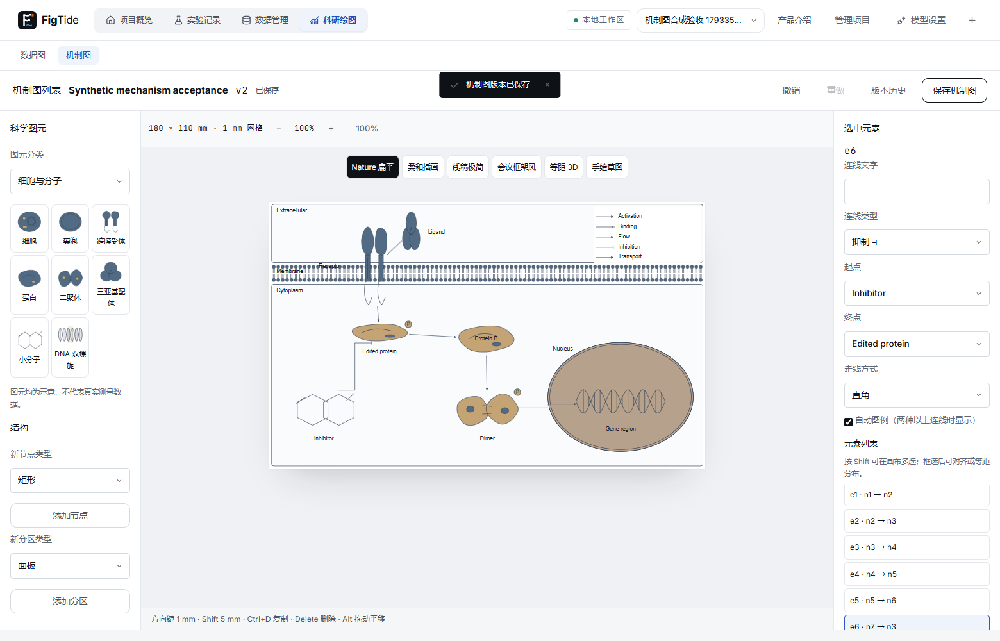

# 机制图（任务19-A，开发中）

基线：任务18经PR #5全部CI通过后合并main c90ec1d；feature/diagrams仅本地开发。19-A涵盖毫米坐标文档、独立编辑器、六种风格、自制模板、矢量/位图导出及确定性审稿；19-B的AI与19-C素材暂不启用。

本文件随各节补充。图表模块及其schema v1不变；机制图使用独立schema v1、V10表和草稿命名空间。不自动保存、不发送模型请求、不读取数据行。

## 数据与版本（19-1）

`DiagramDoc`的全部坐标为成品mm，画布10–2000mm；分区≤30、节点≤120、连线≤200、注释≤120、标签≤200个Unicode字符、序列化UTF-8≤2MiB。所有对象拒绝未知字段。ID全局唯一；端点、分区、注释和放大引用须有效；节点在所属分区及画布内。19-A拒绝图标和artwork，不提供位图或外部URL载荷。`meta.brief`≤10000字符，facts≤200项、每项≤1000字符。

Java `DiagramValidator`无I/O，TypeScript类型见`frontend/src/diagram/model.ts`。风格ID固定为六个预设，overrides使用受限属性集合；资源目录是风格参数唯一来源。

V10新建diagrams/diagram_versions；MySQL文档为JSON、H2为CLOB，显式UTC时间。每次保存、恢复和归档创建新文档版本；归档提升revision以防并发覆盖。409不自动重试。API详见API.md。

项目备份保留文档及完整历史，恢复重映射机制图ID；机制图内部元素ID不变，不依赖数据集。旧备份完全没有新两表时按空表恢复；缺半张表、悬空引用、历史缺口或无效文档均拒绝。迁移规范化按内容和历史识别同名副本，不丢失重复项。

共享改动仅在BackupService的表清单、CLOB编码、旧格式兼容、引用/历史校验和恢复映射，以及迁移工具的规范化与计数。旧迁移未改。两个既有迁移探针的版本排序改为数字顺序，并补V10期望项，已有V1–V9断言保持原样。

## 风格（19-2）

六种预设参数只存在后端`diagram/styles/*.json`，`GET /api/diagram-catalog`下发副本、期刊尺寸表及当前模板/skill/图标目录。Nature扁平、柔和插画、线稿极简、会议框架、等距3D、手绘草图；均为矢量。预设基准6.5pt、线宽≥0.5pt；每个分区/强调调色板任意两色在三种色觉缺陷下CIEDE2000≥20，由既有ColorVision逐项验证。UI颜色仍使用lf tokens，图形颜色来自预设。

`style.overrides`只接受字体、字号/线宽/圆角、箭头/填充、阴影/sketch/iso开关、分区/强调调色板和文字/线色。换预设只改preset；overrides继续保留，用户可显式清空。字体单项限制为目录使用的Arial/Helvetica、Inter或内嵌Noto Sans SC组合，避免任意URL。

roughjs 4.6.6用纯generator产生路径，ID经固定哈希生成正种子，不用时钟或Math.random；同一元素同一文档重复输出一致。新直接及传递依赖均MIT，确切版本和许可全文见根THIRD_PARTY_NOTICES。

方法来源（实际核实2026-10-30，均MIT；只借鉴方法并用中文重新表述，不复制代码或模板）：

| 上游 | 固定提交 | 参考部分 |
|---|---|---|
| lgwrightlab/schematic-figure | 09d8b6e98d04b91de6e8b6632b3356b9fc237417 | .claude/skills/schematic-figure/reference/principles.md：阅读顺序、区域分组、放大框定位 |
| bpoult/scientific-figure-design | 8494bfcd45432281d1d915a37ddba4f621e68273 | references/color.md、references/elements.md：颜色可分辨、成品文字和图例 |
| Agents365-ai/drawio-skill | 57270820d3cd71cbdf4fb6b2f7091d4fb37bb019 | skills/drawio-skill/references/autolayout.md：分组与布局后检查 |

Gallery 77a7d84570a6a9f3e63c22bb31b9fb59757e3dab的LICENSE文本为代码专用MIT（GitHub识别NOASSERTION），论文图片不在该许可内；仅外链，不下载素材。未读取或参考无许可仓库。science-illustrations-skill核实为MIT、1cbc1c0846bd17c1a093bbb4f8cab3d622fa9db7，其方法用于未来19-B，本段不引入内容。

## 新版科学图元（19-2b）

以2026-10-30新版任务书为准：节点kind使用box/pill/ellipse/glyph/text；旧草稿方案中未发布的cell/molecule类型撤换为glyph。glyph节点必须指定服务端清单中的glyph ID，非glyph节点不得夹带glyph。可选label_pos为center/below/above/left/right（缺省center）、boxed为布尔值、badges为至多8个不重复标记（phospho/frozen/trainable/number:1至number:99）。未添加这些可选字段的方框文档继续有效。

内置30种自制参数化矢量图元，目录通过diagram-catalog的glyphs下发：细胞、囊泡、受体、蛋白、二聚体、配体、小分子、DNA；输入帧、编码器、语言模型、注意力、token、堆叠层、数据集、结果柱、文字输入；试管、烧瓶、细胞群、激光、透镜、分束器、样品台、探测器、能级；P、冻结、可训练、编号。每种至少主体/细节两层，成品pt转换为mm描边，不通过缩放描边模拟尺寸；手绘路径仍由固定seed的rough generator生成。分区膜额外使用显式磷脂头/成对疏水尾，核膜为双层椭圆膜。

图元是图示符号，不代表真实测量数据、化学结构鉴定或注意力矩阵；示意结果柱使用等高柱，不编码虚构数量。外部图标暂不启用。提供的设计原型只读参考其视觉组织，图元以TypeScript重新编写并补测试，未执行原型或将其直接用于产品。

## 编辑器与模板（19-3）

科研绘图增加数据图/机制图切换，机制图列表位于`/projects/:p/diagrams`，编辑器位于`/projects/:p/diagrams/:id`。独立保存历史和归档。新建使用自制12模板，覆盖9种视觉模式，中英文各一份；可按视觉模式浏览，右侧实时预览六种风格和期刊单/双栏或自定义尺寸。提供设计稿的三列组织，沿用现有Dialog/PageHeader/tokens。19-A用图元领域分类，实际skill包与AI尚未接入。

唯一纯SVG渲染器供画布、缩略图、未来导出和几何事实采集。图元标签在节点框内预留位置，连接点根据图元本体范围计算；boxed时连接框本身。受体/双膜/DNA为分层矢量，DNA双链不填成实心、基因区域只做低透明度高亮。标签文字转义，文档不改变原始数据。

编辑器支持拖动、框选、Alt/中键平移、缩放、连接点拖线、节点/分区/连线/标记属性、自动图例、分区连同节点移动、对齐/等距分布；方向键1mm、Shift方向键5mm、Delete、Ctrl+D、Ctrl+Z/Shift+Z/Y及Ctrl+S。排版按固定ID顺序调用dagre并在各分区独立排版，空间不足明确报错，不丢弃节点或悄悄压缩尺寸。排版可一次撤销。

本机草稿使用`figtide-diagram-draft-v1:项目:机制图`，复用DraftWriter合并写入、离开/刷新前flush；损坏草稿不阻止读取服务器版本。恢复旧revision草稿保留原revision，避免覆盖别人更新。409保留本机草稿，只有用户明确重新载入才替换。保存中编辑继续保留，服务器仅存点击保存时的快照；恢复/归档均使用base_revision。

GET diagram-catalog新增模板。POST diagrams兼容`{name,template,style,label_language?}`，与`{name,doc}`互斥；同一校验器处理两条路径。仅desktop profile新增固定`POST /api/desktop/diagram-gallery`，用户点击外链才调用已有DesktopUi系统浏览器入口，不接受自定义地址；开发环境退回普通外链。系统默认浏览器的实际打开需主人手动确认。

新增布局依赖@dagrejs/dagre 1.1.5、@dagrejs/graphlib 2.2.4，均MIT并固定版本，声明见THIRD_PARTY_NOTICES。共享改动为新路由的识别/记忆和数据图/机制图切换；数据图页面/路由原有返回值及草稿命名空间不变。

