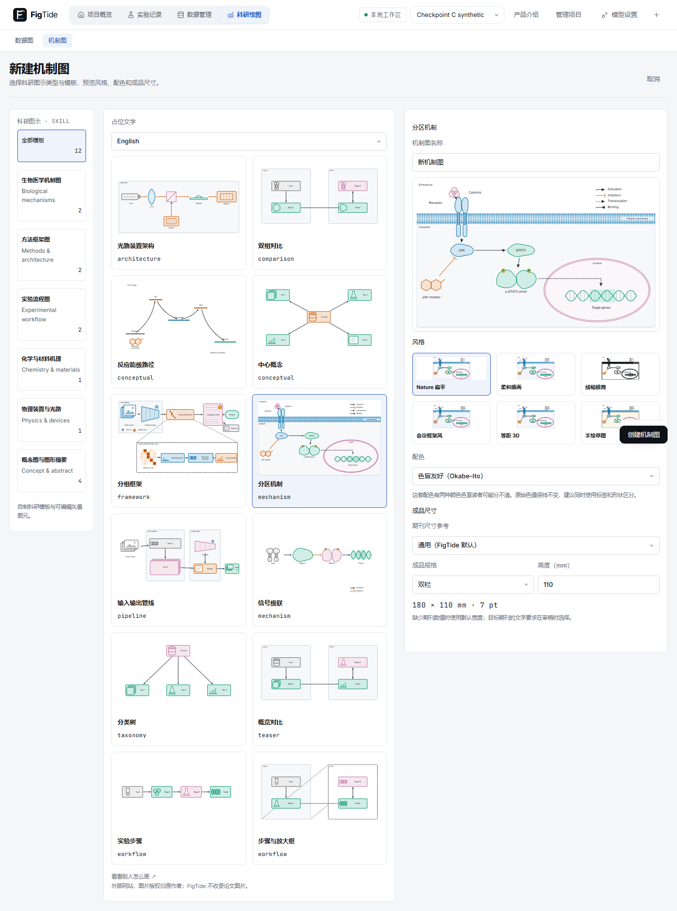
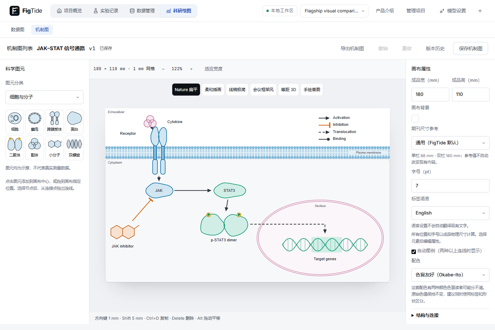

# 机制图（任务19-A/B/C）

基线：任务18经PR #5全部CI通过后合并main c90ec1d；feature/diagrams仅本地开发。19-A涵盖毫米坐标文档、独立编辑器、六种风格、自制模板、矢量/位图导出及确定性审稿；当前19-B的AI结构提案、19-C素材和外部连接已在开发分支启用，尚未发布。

本文件随各节补充。图表模块及其schema v1不变；机制图使用独立schema v1、V10表和草稿命名空间。不自动保存、不发送模型请求、不读取数据行。

## 数据与版本（19-1）

`DiagramDoc`的全部坐标为成品mm，画布10–2000mm；分区≤30、节点≤120、连线≤200、注释≤120、标签≤200个Unicode字符、序列化UTF-8≤2MiB。所有对象拒绝未知字段。ID全局唯一；端点、分区、注释和放大引用须有效；节点在所属分区及画布内。19-A基线拒绝图标和artwork；19-C以兼容扩展启用内置许可图标ID与净化artworks，不提供位图或外部URL载荷。`meta.brief`≤10000字符，facts≤200项、每项≤1000字符。

Java `DiagramValidator`无I/O，TypeScript类型见`frontend/src/diagram/model.ts`。风格ID固定为六个预设，overrides使用受限属性集合；资源目录是风格参数唯一来源。

V10新建diagrams/diagram_versions；MySQL文档为JSON、H2为CLOB，显式UTC时间。每次保存、恢复和归档创建新文档版本；归档提升revision以防并发覆盖。409不自动重试。API详见API.md。

项目备份保留文档及完整历史，恢复重映射机制图ID；机制图内部元素ID不变，不依赖数据集。旧备份完全没有新两表时按空表恢复；缺半张表、悬空引用、历史缺口或无效文档均拒绝。迁移规范化按内容和历史识别同名副本，不丢失重复项。

共享改动仅在BackupService的表清单、CLOB编码、旧格式兼容、引用/历史校验和恢复映射，以及迁移工具的规范化与计数。旧迁移未改。两个既有迁移探针的版本排序改为数字顺序，并补V10期望项，已有V1–V9断言保持原样。

## 风格（19-2）

六种预设参数只存在后端`diagram/styles/*.json`，`GET /api/diagram-catalog`下发副本、期刊尺寸表及当前模板/skill/图标目录。Nature扁平、柔和插画、线稿极简、会议框架、等距3D、手绘草图；均为矢量。预设正文7pt、轮廓1pt、连线1.25pt、分区0.75pt；语义角色色来自可选style.palette，色觉检查复用既有ColorVision；原始配色并非所有使用色对都能满足严格的ΔE≥20门槛，按2026-11-02规则，<10的色对在界面提示、10–20仅审稿info。UI颜色仍使用lf tokens，图形颜色来自预设。

`style.overrides`只接受字体、字号/线宽/圆角、箭头/填充、阴影/sketch/iso开关、分区/强调调色板和文字/线色。换预设只改preset；overrides继续保留，用户可显式清空。字体单项限制为目录使用的Arial/Helvetica、Inter或内嵌Noto Sans SC组合，避免任意URL。

roughjs 4.6.6用纯generator产生路径，ID经固定哈希生成正种子，不用时钟或Math.random；同一元素同一文档重复输出一致。新直接及传递依赖均MIT，确切版本和许可全文见根THIRD_PARTY_NOTICES。

方法来源（实际核实2026-10-30，均MIT；只借鉴方法并用中文重新表述，不复制代码或模板）：

| 上游 | 固定提交 | 参考部分 |
|---|---|---|
| lgwrightlab/schematic-figure | 09d8b6e98d04b91de6e8b6632b3356b9fc237417 | .claude/skills/schematic-figure/reference/principles.md：阅读顺序、区域分组、放大框定位 |
| bpoult/scientific-figure-design | 8494bfcd45432281d1d915a37ddba4f621e68273 | references/color.md、references/elements.md：颜色可分辨、成品文字和图例 |
| Agents365-ai/drawio-skill | 57270820d3cd71cbdf4fb6b2f7091d4fb37bb019 | skills/drawio-skill/references/autolayout.md：分组与布局后检查 |

Gallery 77a7d84570a6a9f3e63c22bb31b9fb59757e3dab的LICENSE文本为代码专用MIT（GitHub识别NOASSERTION），论文图片不在该许可内；仅外链，不下载素材。未读取或参考无许可仓库。science-illustrations-skill核实为MIT、1cbc1c0846bd17c1a093bbb4f8cab3d622fa9db7，其方法用于未来19-B，本段不引入内容。

## 新版科学图元（19-2b）

以2026-10-30新版任务书为准：节点kind使用box/pill/ellipse/glyph/text；旧草稿方案中未发布的cell/molecule类型撤换为glyph。glyph节点必须指定服务端清单中的glyph ID，非glyph节点不得夹带glyph。可选label_pos为center/below/above/left/right（缺省center）、boxed为布尔值、badges为至多8个不重复标记（phospho/frozen/trainable/number:1至number:99）。未添加这些可选字段的方框文档继续有效。

内置30种自制参数化矢量图元，目录通过diagram-catalog的glyphs下发：细胞、囊泡、受体、蛋白、二聚体、配体、小分子、DNA；输入帧、编码器、语言模型、注意力、token、堆叠层、数据集、结果柱、文字输入；试管、烧瓶、细胞群、激光、透镜、分束器、样品台、探测器、能级；P、冻结、可训练、编号。图层数量以规范为准（蛋白为单层轮廓，受体三层等），不为凑图层数添加装饰，成品pt转换为mm描边，不通过缩放描边模拟尺寸；手绘路径仍由固定seed的rough generator生成。分区膜额外使用显式磷脂头/成对疏水尾，核膜为双层椭圆膜。

图元是图示符号，不代表真实测量数据、化学结构鉴定或注意力矩阵；示意结果柱使用等高柱，不编码虚构数量。外部图标暂不启用。设计原型现为主人提供的规范，纯几何按TypeScript移植；产品不执行参考JS，测试逐项对照规范路径和badge坐标。

## 编辑器与模板（19-3）

科研绘图增加数据图/机制图切换，机制图列表位于`/projects/:p/diagrams`，编辑器位于`/projects/:p/diagrams/:id`。独立保存历史和归档。新建使用自制12模板，覆盖9种视觉模式，中英文各一份；可按视觉模式浏览，右侧实时预览六种风格和期刊单/双栏或自定义尺寸。提供设计稿的三列组织，沿用现有Dialog/PageHeader/tokens。19-A用图元领域分类，实际skill包与AI尚未接入。

唯一纯SVG渲染器供画布、缩略图、未来导出和几何事实采集。图元标签在节点框内预留位置，连接点根据图元本体范围计算；boxed时连接框本身。受体/双膜/DNA为分层矢量，DNA双链不填成实心、基因区域只做低透明度高亮。标签文字转义，文档不改变原始数据。

编辑器支持拖动、框选、Alt/中键平移、缩放、连接点拖线、节点/分区/连线/标记属性、自动图例、分区连同节点移动、对齐/等距分布；方向键1mm、Shift方向键5mm、Delete、Ctrl+D、Ctrl+Z/Shift+Z/Y及Ctrl+S。排版按固定ID顺序调用dagre并在各分区独立排版，空间不足明确报错，不丢弃节点或悄悄压缩尺寸。排版可一次撤销。

本机草稿使用`figtide-diagram-draft-v1:项目:机制图`，复用DraftWriter合并写入、离开/刷新前flush；损坏草稿不阻止读取服务器版本。恢复旧revision草稿保留原revision，避免覆盖别人更新。409保留本机草稿，只有用户明确重新载入才替换。保存中编辑继续保留，服务器仅存点击保存时的快照；恢复/归档均使用base_revision。

GET diagram-catalog新增模板。POST diagrams兼容`{name,template,style,label_language?}`，与`{name,doc}`互斥；同一校验器处理两条路径。仅desktop profile新增固定`POST /api/desktop/diagram-gallery`，用户点击外链才调用已有DesktopUi系统浏览器入口，不接受自定义地址；开发环境退回普通外链。系统默认浏览器的实际打开需主人手动确认。

新增布局依赖@dagrejs/dagre 1.1.5、@dagrejs/graphlib 2.2.4，均MIT并固定版本，声明见THIRD_PARTY_NOTICES。共享改动为新路由的识别/记忆和数据图/机制图切换；数据图页面/路由原有返回值及草稿命名空间不变。

## 导出（19-4）

当前草稿直接经同一渲染器导出，不创建版本。SVG尺寸写成mm，字体保留预设值，全部图形为矢量，无外部图片。PNG按mm×dpi/25.4四舍五入计算像素，并写入pHYs物理密度（300dpi=11811像素/米，600dpi=23622）；超大画布的PNG超过64M像素或单边16384时明确要求改用较低dpi或SVG/PDF，不偷偷缩小。

PDF复用jspdf+svg2pdf.js与现有Noto Sans SC本地子集/字形检查及文字定位冻结逻辑；英文用Helvetica，中文/其他非ASCII标签内嵌Noto子集，缺字明确报错。原文档和SVG的字体不被改写。共享pdf.ts仅导出原有字体加载/文字定位函数，文字定位可选字体参数默认仍为原Noto值；原图表调用行为不变。

导出对话框列出成品mm尺寸、最小字号、PNG像素和dpi；有审稿error时提示，但仍允许导出。字体和图形均在本机处理。示意图元不代表真实测量结果。

## 配色修订（按主人视觉反馈）

移除初版棕色/灰色实心方案。默认图元改为蓝/绿语义轮廓及由调色板与白色插值得到的浅填充；橙色仅作强调和抑制标记。细胞核白色内腔配双层彩色膜，分组面板大面积留白，色彩只出现在窄标题带，避免整块染色。膜的磷脂头尾随主色，普通文字仍为深色。可在属性中分别设置语义角色和配色，不把视觉强调强行改成语义角色。

新分区编码色白/浅蓝的三种色觉缺陷最小ΔE00=20.1059，蓝/绿/橙编码色任意对最小值≥22.1060，维持既有20阈值，未降低断言。实际填充是浅色图示，语义颜色由轮廓、边界和标题带共同表达；不把相同底色当作不同类别。

## 操作与修复链（19-6）

为了19-5修复能够从第一天走完整校验链，先完成其前置操作层。纯Java DiagramOperations提供12种白名单操作、严格目录schema及逐项JSON Pointer差异；先深拷贝输入，整个批次完成后用DiagramValidator验证，失败不返回半成品。最多400操作/2MiB，移除节点会清理连线/注释，移动分区时带着节点一起移动。set_style覆盖项合并，null明确清空。

预览接口只读，不创建版本，并检查可选diagram_id归属和base_revision。客户端makeDiagramOperation只按服务端目录读取参数名/必填项，不维护第二套操作字段名。审稿修复会使用同一个构造器和预览接口，确认后才编辑本机草稿；正式保存仍需用户操作。

## 视觉返工（19-A，2026-10-30）

设计原型现为仓库主人提供的规范；TypeScript移植保持路径和badge坐标，并用规范函数逐项对比。正文默认7pt、轮廓1pt、连线1.25pt、分区0.75pt；手绘轮廓/连线乘1.3。快照仅证明稳定性，视觉仍待用户验收。

style.palette为新增可选字段，省略使用okabe-ito，旧文档无需迁移。六配色数值统一维护在backend/src/main/resources/diagram/palettes.json，TypeScript直接引用同一JSON；隔离桌面构建复制该资源。NPG/AAAS/NEJM/Lancet/JAMA只引用规范中整理的ggsci配色色值，未复制ggsci实现代码。界面全部标“风格（非官方）”。色值来源说明见各项source，参考https://nanx.me/ggsci/。

（19-A历史规则，现已由文末2026-11-02两档规则覆盖。）palette_audits曾使用原ColorVision和MIN_DELTA_E=20，按六配色×六风格枚举语义角色轮廓色对及三种色觉缺陷，界面只保留当前图实际使用的角色；低于20的色对返回真实minimum_delta_e并在界面提示，不改变色值、不降低阈值。“色盲友好”是Okabe–Ito惯用名称，不等于本图所有选用色对均满足严格20门槛。

## A–C返工交付状态

返工实现与相关验证完成，最终材料见[test-evidence/diagram-checkpoint-c/README.md](test-evidence/diagram-checkpoint-c/README.md)。主人已通过A–C主体验收。19-A-7收尾见test-evidence/diagram-19-A-7，19-5已恢复；最终自动验收与截图以test-evidence/diagram-19-A-acceptance/README.md为准，不等同科学内容或期刊人工验收。

六风格默认圆角/文字色/线色已按原型复核；黑线风格保留白色遮挡与轮廓以避免叠层穿透及无描边填充图元隐形。图元由原30种兼容扩展为31种，新增result-bars-low来自原型chartlow。小分子在旗舰模板进一步收窄到不超过JAK，遵循05 #6；会议标题采用可读深色文字并保留浅标题带。正文7pt；原型分区小字/徽标在19-5恢复时仍须按真实几何和期刊门槛审查，不降低检查阈值。

六配色仅使用固定原值；风格控制形状/填充，不绑定某套期刊配色。旧颜色overrides字段合法保留以兼容旧文档格式；本轮规范渲染以style.palette的语义色映射为准，字体/线宽/圆角覆盖继续生效。新增palette不要求迁移，旧文档省略时使用okabe-ito。

zoom_of已有字符串引用兼容节点与分区；节点删除清理放大来源，不增加新必填字段。渲染器提供显式矢量箭头和data-edge-tip数值端点；PDF不依赖marker缩放。机制图PDF的斜体通过矢量倾斜保留，500/600权重映射到现有常规/粗体字体，避免中文回退。仅改机制图导出，数据图PDF代码与既有行为不变。

## 审稿与修复（19-5）

顶栏“审稿这张图”打开复用的ReviewIssues面板；选择目标期刊和成品宽度后显式运行。collectDiagramFacts从同一个纯SVG渲染器离屏测量真实文字框和几何，包含内嵌P/数字符号；传输仅坐标/颜色/字号和数组索引，无标签或ID。面板编号与共享NumberMarker画布标记对应，忽略/恢复不改变文档。

D1按目标宽度换算成品最小字号（默认6pt）；正文默认7pt，分区小字和二聚体P默认6pt，随字号覆盖同比缩放。D2检查轮廓及存在的细节线，默认底线0.5pt，线宽覆盖同比控制连线、分区、膜头和P圆。D3只比较实际使用角色的轮廓；填充模式覆盖也保留角色轮廓；standalone P/编号/冻结/训练符号不作为语义角色。默认Okabe–Ito的失败色对不自动改配色。D4实际文字框溢出为error，重叠为warning；仅安全放大节点可修复。D5无关节点穿越、重叠段>2mm、箭头间距<1.5mm、交叉>6次给意见，直角走线仅作可预览候选。D6忽略无图例语义的Flow，至少两种其他连线时建议打开图例。D7检查流程类孤立节点，不猜测关系；悬空端点引用在DiagramValidator阶段直接拒绝，不能伪装为可修复的有效图；装饰/语义标记不计。D8/9明确跳过。

修复默认勾选可修复项；先“预览选中修复”调用原操作目录和只读校验接口，画布显示只读候选、底部列出字号/线宽等具体前后变化。取消不修改；“应用修复”一次加入撤销栈，Ctrl+Z一次可撤销整批。预览、应用均不自动保存，只有“保存机制图”写新版本。文档、revision、期刊/尺寸变化会使报告和候选失效，迟到请求结果被丢弃。导出显示最近有效报告的error数，未审稿不假称通过；error不阻止用户显式导出。

## 真实示例与文字

12模板均有中英文具体示例：JAK–STAT、视频问答、光路、野生型/EGFR敲除平行实验、反应能垒示意、单细胞图谱、视频表征/动作分类、EGF–EGFR–RAS–RAF–MEK–ERK、Transformer方法家族、共享视频输入的方法比较、单细胞测序、文库步骤与细胞条形码/UMI放大。所有图元仍为示意，未伪造测量结果。英文只在空格或用户手动换行处换行，长单词保持完整并交由D4报告；中文可按字换行。Beam splitter已加宽，144种模板/风格/语言组合用真实浏览器几何审稿要求0 error。

局限：几何规则不证明科学关系正确，D5也不寻找全局最优布线；严格色觉门槛可能提示同色编码角色，保留标签/形状辅助，是否修改规范配色由主人决定。目标期刊数值来自现有版本化规则表，未知值仍用默认门槛，不假定已符合投稿要求。AI事实追溯和外部素材署名分别在19-B/C启用。

数据图编辑器的类型切换入口放在主顶栏空位，保留原有editor/paper/toolbar毫米及像素几何；机制图页面仍使用已验收的独立切换行。原refactor09布局基线和既有数据图断言不更新。

## 19-A-7单屏补验（2026-10-31）

1440×960创建页右栏完整可见：260px预览、六风格局部缩略图一行、六套配色芯片一行、规格/高度（自定义含宽度）同排、固定底部创建区。色觉明细按需展开，默认仍提示5组；期刊配色只表示非官方风格。光路pattern改conceptual；级联斜向填补下方留白、实验图元放大、Visual encoder标签避开连线。旧文档和原palette值/ΔE20不变。最新报告与视口/六风格标记/全部6色对结果见test-evidence/diagram-19-A7-final/README.md。19-5已复验，最后桌面全量101通过、3迁移专用跳过；无推送。

## 19-B0 运行绑定方案（2026-11-01）

采用方案A：V11为agent_runs/agent_sessions增加可空diagram_id，将dataset_version_id改为可空。机制图模式复用现有预算预留结算、幂等、取消、超时和恢复，模型仅接触当前文档及选定skill，不读数据版本。完整实施前位置清单与验证计划见[19-B0审计](development/19-B0-AUDIT.md)。

## 19-B：skill与结构提案

六个版本化skill通过diagram-catalog下发，内置20个合成科研示例。规划按简报、带原文引句的事实、语义结构组织；用户可以删除或明确修改事实后继续。模型没有数据集、其他图表或文件工具，也不能指定节点/分区坐标与尺寸；当前文档、规则和模板目录只读。

运行采用mode=diagram、diagram_stage=brief/structure，复用AgentRunService队列、请求幂等、超时和取消，以及AgentAuditService的会话预留、结算和重启恢复。V11在两个数据库中为运行/会话增加diagram_id并允许数据版本为空；skill_id、skill_version、prompt_version写入审计。共享completeRun是原协作模型调用与用量核验代码的提取，旧协作调用方式和额度规则保持原样。

简报运行结束后等待用户确认事实；结构运行共用同一会话用量，语义候选经现有前端排版、实际渲染事实和确定性审稿后才显示为可应用提案。D8只核对AI产生且尚未由用户改写的节点标签，依据是用户原文和确认的事实，不把模型自己写的简报当科学依据。缺少几何仍明确标记D4/D5跳过，不能称通过。

蓝色编号为结构候选，审稿修复默认选中并可取消或忽略。先预览，再确认；确认重新检查revision、提案指纹和修复集合，只进入一次撤销的草稿编辑。保存仍需用户执行。支持按已有画布继续提出需求；不自动调用模型，也不因切换面板发请求。恢复对话只恢复当前进程内匹配画布的候选，重启后的历史只能追溯。

兼容扩展：meta可选source_text、fact_sources和ai_labels，旧文档无这些字段时照常打开，D8显示不适用。持久运行审计只保存脱敏摘要和指纹；完整事实保留在用户明确保存的图文档中。

## 参考风格（19-C）

通过“参考风格”选择自有PNG/JPG/SVG，参考图仅在浏览器本地分析。位图使用确定性加权k-means、排除边界背景与透明像素、最多6色；SVG统计显式颜色/安全CSS及物理线宽、圆角和字体。不保留图像、原文、文件名或像素，只保存经确认的风格参数到既有style_templates（profile.kind=diagram）。未内置字体明确提示并保留当前字体。

可选style.role_colors含actor/process/data/model/output/note六个明确色值，覆盖角色轮廓但不修改内置期刊调色板；无此字段的旧文档渲染保持原样。D3比较同一组实际轮廓值，使用三种模拟，<10警告、10–20仅审稿info，保留原始色对，不偷改提取色值。选择内置配色会明确取消自定义覆盖。预览、保存风格参数和应用为独立动作；应用一次可撤销，不自动保存机制图。

## 外部绘制与可编辑draw.io导出

七个机制图MCP工具见[MCP.md](MCP.md#让外部-agent-画机制图19-c)。获取简报后由外部agent画SVG，再经共享净化器导入；新增版本保留原图层。artworks为可选字段，每层包括id/name、毫米x/y/w/h、locked/hidden和规范化svg；只支持整体移动/缩放/锁定/隐藏。内部文字不能单独编辑；D4/D5检查原生图层渲染事实，不会分析artwork内部科学含义或文字排版。

导出对话框可选择draw.io。输出为未压缩mxfile XML，毫米以96dpi转换为mxGeometry像素；分区为容器，原生节点为分组，图形和可编辑标签为子元素。关联边使用单独mxCell：激活普通箭头、抑制ERone单横端点、间接作用虚线。图元/科研图标使用同一SVG渲染器嵌入，外部artwork仍是整体图像；不把图中数据转换成测量值。颜色、字号、物理尺寸保留，draw.io字体取决于本机字体，细节可能随其渲染器变化。

样例见 `docs/test-evidence/diagram-19-C/exports/jak-stat.drawio`。XML数量/父子关系/特殊字符/下载已自动检查；主人还需按desktop/SMOKE-14-5.md确认打开后编辑体验。导出不保存新版本，图标署名规则同SVG/PNG/PDF。

## 2026-11-02：机制图D3两档提示

机制图只比较当前实际使用的语义角色轮廓（含style_ref或自定义role_colors），不比较浅填充；排除纯文字和独立标记。仍使用既有ColorVision三种Machado严重度1.0模拟及CIEDE2000，取三种模拟中的最小ΔE00。低于10为warning，配色区注明两个角色与数值；10≤ΔE00<20仅在审稿报告列为info，配色区及画布不提示，无自动修复；达到20不报告。相同色值的不同角色仍按0报告，不去重或偷改映射。默认分区机制图（nature-flat/Okabe–Ito）四角色经Java ColorVision复核最小ΔE00=11.72481721271584：actor #0069A4 / model #BC6F9A（protan）；六色对中5组info、0组warning，因此配色区不提示。其他模板若包含同色角色仍按规则报告。

数据图R3不变，ColorVision.MIN_DELTA_E仍为20；配色原色值、旧文档和用户确认/保存流程不变。

## 2026-11-02：图标按需加载与导出

前端仅打包151个许可图标的ID（验证草稿所需），catalog仅下发清单。面板缩略图进入可视范围才通过原GET /api/diagram-icons/{id}.svg请求SVG；内存缓存共享成功与在途请求，切换风格、画布与预览复用缓存。缓存入口校验固定ID和安全SVG，失败可显式重试，不能用任意路径加载资源。

纯渲染器接收显式IconAssets参数，不发网络请求；画布与参考预览在载入后重绘，缺失时显示占位和失败提示。审稿几何与SVG/PNG/PDF/draw.io导出先等待文档所用全部图标，载入失败会报错，不静默省略。所有导出仍内联矢量，不含本机API链接；图标SVG不写入机制图文档。

本轮构建前后字节数记录在diagram-19-C/icon-loading-benchmark.json，机制图异步chunk从约2.71MB下降至约207KB；完整原始许可资源仍由本地后端提供。

## 2026-11-02：助手与素材面板视觉收尾

简报压为“要点 / 不能暗示”两行，点击文字编辑。事实逐行显示勾选框、可编辑文字与灰色原文出处；取消即在只读预览及服务器确认结果中排除对应结构，重新勾选恢复，共享节点保留。编辑文字后须重新生成。结构提案分为蓝色编号的事实结构、默认勾选且可取消/忽略的审稿修复、需要确认的意见（含D8）；每阶段一个主按钮，结束与恢复为文字操作。候选应用仍一次可撤销，不自动保存。

助手默认不提出低于当前风格7pt/1pt的有效字号/线宽；只有用户在设置中明确勾选允许才能降低。审稿修复目标也至少为风格默认，实际投稿物理尺寸要求更大时采用更大值。此规则不禁止用户手动编辑较小字号。全图审稿编号按网格错开，不绘制无意义的零尺寸框；相同色值提示明确写“××和××用了相同颜色”，D3的10/20两档及数据图R3均不变。

图标清单151项（132 CC0、19 CC BY 4.0），新增可辨认的CC0整只小鼠，原150个ID全部保留。分类下拉可无搜索浏览；净化SVG载入后测量实际绘制边界，以2.5%留边收紧viewBox，等比例居中填满正方格，不拉伸形状。图标仍按需缓存，导出内联并声明viewBox调整。新增来源固定到上游提交并记录SHA与许可。

2026-11-02最终小修：提案“需要你确认”只显示需判断的warning/error和D8，D3的10–20 info仍保留在完整审稿报告，不进入提案。D8逐项列出具体节点及关联原文；“改为原文用词”展开原句输入，由用户选取连续原文后确认（不推断化合物名称），“有依据，保留”明确保留原标签。待处理的D8须选择后才能应用；可改变选择并预览，仍为一次撤销、手动保存。保留选择不伪造新事实，后续独立审稿仍可提示描述中没有该词。

内置图标与净化SVG统一LF规范字节；清单SHA按Git实际保存的LF计算，净化/哈希断言保留，避免Windows工作副本与干净Linux/Windows检出的摘要不一致。只改变换行，不改变图元或配色。
