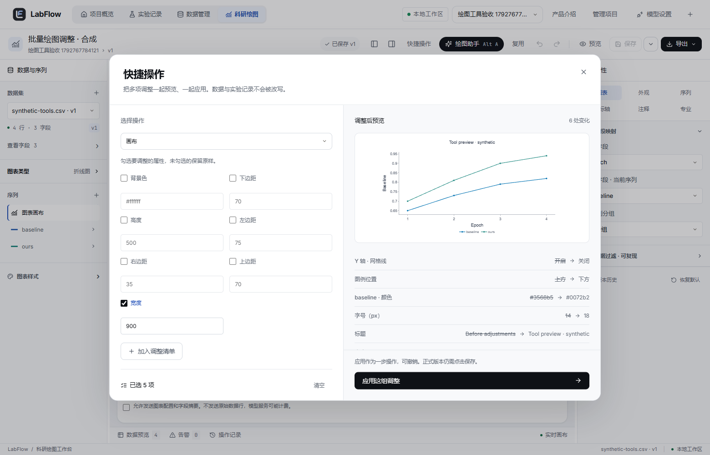

# 绘图工具协议与快捷操作（2026-10-21）

本轮承接“编辑器稳定 → 工具接口 → 模型接入”的顺序，实现可被未来 Agent 调用的确定性工具层，并用真实快捷操作界面验收。没有接入模型、聊天界面、API Key、自动执行循环、任意 Python 或第三方 Skill；不是完整 Agent/Harness。

工具面分两组：**外观（presentation）**只改呈现，**结构（structure）**改“图从哪几列取数”。结构组在 2026-10-21 第二批补齐，同一份 `protocol_version=1`，目录里用 `category` 区分；两组的校验链完全相同（预览 → 差异 → 用户确认 → 一步撤销 → 原“保存”写版本）。

## 执行流程

用户在编辑器点“快捷操作”，或按 Ctrl/Cmd+K。选操作、勾选属性、加入清单；一次最多 30 项。前端将当前草稿快照与操作清单交给 Java，Java 校验并返回配置与逐字段差异，浏览器使用同一 Plotly 渲染器预览。确认应用后统一进入现有撤销栈，可一步撤销/重做。正式 MySQL 版本仍由原“保存”创建。

界面从 Java 返回的目录读取参数类型、选项和范围，不另造一套前后端字段命名。结构仍使用 schema_version=1，新的工具协议独立使用 protocol_version=1。保留原数据、映射、过滤、误差列、统计阈值、类别和输出设置；允许的展示文字除外。

后端分层：`FigureToolController → FigureToolService → FigureOperations / WorkspaceService → WorkspaceRepository`。`FigureOperations` 是无 I/O 的批量变换与差异计算；服务使用现有项目归属、配置/字段校验和数据库读取。预览事务标记只读，没有增加数据库表。

## 协议

`GET /api/figure-tools/catalog`：返回协议版本、配置版本、`execution: "preview-only"`、`categories` 与十个工具的名称、中文标签、`category` 及 `input_schema`，另附只读的 `read_tools` 列表。所有参数对象拒绝额外属性。

| 工具 | 分类 | 接收的属性 |
| --- | --- | --- |
| `set_style` | 外观 | title / font / fontSize / fontPt / bold |
| `set_axis` | 外观 | axis（x/y，必填） / title / min / max / dtick / log / grid |
| `set_legend` | 外观 | show / position / orientation |
| `set_series` | 外观 | seriesId（必填） / name / color / opacity / width / dash / symbol / size / visible |
| `set_canvas` | 外观 | width / height / top / bottom / left / right / background |
| `set_chart` | 结构 | type（必填，11 种图表类型） |
| `set_mapping` | 结构 | x / group / heatY / heatZ |
| `map_series` | 结构 | seriesId / y（必填） / error |
| `add_series` | 结构 | id / y（必填） / name / error |
| `remove_series` | 结构 | seriesId（必填） |

`minProperties` 由服务端按“目标标识不算调整”计算：`set_axis`、`set_series` 至少再带一项属性；`set_chart`、`map_series`、`add_series`、`remove_series` 的必填项本身就是载荷，只带必填即成立。客户端 `makeToolOperation` 与服务端使用同一条规则，否则界面能拼出服务端拒绝的操作。

`GET /api/projects/{p}/data/{v}/profile`：返回某数据版本的字段画像与首批行数据，供模型或界面在改映射前“读一眼”数据。响应含 `dataset_version_id, dataset_id, filename, version, sha256, row_count, fields[], head[][], truncated{columns, rows}`；`fields` 每项是 `name, type, inferred_type, missing, unique, constant, role, suggested_role, samples, min, max`（数值列才有 min/max，样本截断 40 字符）。最多 80 列、10 行，画像直接复用导入时算好的 `fields_json`，不重算、不重读原文件，也不写库。

`POST /api/projects/{p}/figure-tools/preview`：

```typescript
{
  protocol_version: 1,
  chart_id: number | null,       // 新图表为 null，也可省略
  base_revision: number,         // 已保存图表的当前 revision；新图为 0
  config: Config,                // 编辑器的完整当前草稿，含 schema_version
  operations: Array<{ tool: string, arguments: Record<string, unknown> }>
}
```

示例操作清单：

```json
[
  {"tool":"set_style","arguments":{"fontSize":18,"title":"Model comparison"}},
  {"tool":"set_legend","arguments":{"position":"bottom","orientation":"h"}},
  {"tool":"set_axis","arguments":{"axis":"y","min":0.5,"max":1,"grid":false}}
]
```

坐标范围接收 JSON 数值，`null` 明确恢复自动；服务端转换为现有 Config 的字符串范围。空参数、纯目标标识、未知工具、路径/字段、非有限数值、错误类型、非法选项、颠倒范围、非正对数范围及覆盖整张画布的边距都返回 400。整批在深拷贝上完成，任一失败不返回半成品、不修改输入或数据库。最终配置继续通过现有服务的字段/数据归属和科研配置校验。

成功响应包含 `protocol_version, config, changes, operation_count, base_revision, source`。`changes` 是按 JSON Pointer 路径排列的 `{path,before,after}`，仅用于差异展示，不是接收任意路径写入的入口。`source` 含 `dataset_version_id,sha256`；不返回上传文件内容。保存版本已更新时返回 409，跨项目来源或图表返回 404。

## 生效范围与专业图表

- 论文尺寸启用时用 `fontPt` 调整成品字号；`fontSize` 会被拒绝，避免只改了被物理排版覆盖的值。未开启时不接受 fontPt。
- ROC/PR 标题写入各自的 evaluation 轴标题，矩阵标题写入 classification，直方图/ECDF 写入 empirical 的展示标题；不改变标签列、正类、阈值、分箱或统计方法。旧分布图缺少 empirical 配置时，需先在专业属性中设置。
- ROC/PR 和矩阵的固定范围、刻度、对数设置不作为快捷操作暴露；分布图的类别 X 轴、分面自动轴也限制范围/对数操作。矩阵网格由单元格决定，色阶在原专业属性中调整。
- 矩阵不提供序列/图例工具；柱图与直方图不提供点大小/点形/序列线宽，散点不提供线宽，虚实线只在实际使用该属性的类型中提供。后端同样拒绝无效组合，不能靠绕过前端获得一个无效成功响应。
- 外观工具仅改现有序列外观，不增加序列、不换字段、不生成误差、显著性或曲线。结构工具见下节，同样不生成数据。

## 结构工具：改映射，不猜配置

结构操作只回答“图读哪几列、有几条序列”，绝不代造专业配置：

- `set_chart` 切换类型时不补齐配置：切热力图要求 `heatY`/`heatZ` 已指定，切 ROC/PR 要求 `evaluation` 已存在，切混淆矩阵要求 `classification` 已存在，否则 400 并提示先完成对应配置。
- `set_mapping` 只写给出的字段；`group` 允许写空串清空分组，`x` 在直方图/ECDF/ROC/PR/混淆矩阵下拒绝修改（X 由图形结构决定）。
- `map_series` 改指定序列的 `y`/`error`；`error` 写空串即取消误差列。
- `add_series` 的 `id` 由调用方生成（前端用自增且不复用的 `sN`），服务端只查重；新序列**深拷贝首条序列的外观**再改 `id`/`y`/`name`/`error`，因此一定通过配置校验，也保证新增序列不会凭空引入新颜色或新线型。
- `remove_series` 拒绝删除被 `classification.seriesId` 引用的序列，也拒绝删到 0 条。
- 列名合法性（是否属于该数据版本、Y 是否数值、误差列是否非负）不在工具层重写，统一交给既有 `WorkspaceService.validateAndReport`，避免两套规则漂移。

`changes` 对结构操作返回粗粒度路径（`/type`、`/x`、`/series`），前端 `sameProtectedFigure(before, after, allowed)` 据此只放行这些路径：`/series` 命中时按 `id` 比对存活序列的七个外观键（color/opacity/width/dash/symbol/size/visible），新增或删除放行，偷改外观仍然被判为篡改。

## 读类工具：先看规范，再校验配置

目录里另有 `read_tools`（`category: "read"`），它们不进入 `operations` 批次，也不改任何状态：

| 工具 | 接口 | 用途 |
| --- | --- | --- |
| `get_figure_spec` | `GET /api/figure-tools/spec[?type=line]` | 十一类图的必填角色（`x/y/heatY/heatZ`）、可选角色（`group/error/band`）、所需专业配置块、固定 X 的类型与硬规则；附 `roles`、`series.min/max` |
| `lint_figure` | `POST /api/projects/{p}/figure-tools/lint` | 用保存时同一套 `validateAndReport` 做只读体检，把失败当成数据返回 |
| `get_dataset_profile` | `GET /api/projects/{p}/data/{id}/profile` | 列画像与前 10 行（见上文接口表） |

`lint_figure` 接收与预览相同的信封 `{protocol_version, chart_id?, base_revision?, config}`（没有 `operations`），返回 `{protocol_version, ok, issues[], base_revision, source?, report?}`：

- 合法配置返回 `ok: true`、`issues: []`，带 `source{dataset_version_id,sha256}`；ROC/PR/混淆矩阵额外带回与保存时相同的统计 `report`。
- 配置不合法**不抛 400**，而是返回 `ok: false` 与 `issues[0] = {code: "invalid_figure", message}`——消息与保存时用户看到的完全一致。这样模型可以「提案 → 自检 → 修正」，不用靠解析错误码。
- 信封错误仍按原语义拒绝：协议版本不是 1、未知请求字段、`chart_id` 与 `base_revision` 不匹配、跨项目图表都返回 400/404/409；`config` 不是对象返回 400。
- 只读：不写图表、不写版本、不写数据。事务标记 `readOnly = true`。

`get_figure_spec` 只描述「这类图需要什么」，不携带任何默认值——默认值只存在于前端 `model.ts`，避免两套默认值漂移。规范与校验的一致性由集成测试守住：`heatmap` 的 `required_roles` 是 `heatY/heatZ`，用缺 `heatZ` 的配置调 lint 必须失败。

## 批量是原子的

一次 `operations` 数组在深拷贝上依次应用，最后统一走一次 `validateAndReport`：

- 任一项失败 → 400，不返回半成品、不修改输入配置、不写库；客户端拿不到「前面几项已经生效」的中间结果。
- 全部通过 → 返回一个完整配置与一份 `changes`，前端只进一次撤销栈，撤销一步回到批次前。
- 已保存图表：失败批次不会 bump `revision`、不会新增 `chart_versions`；成功也不会自动保存，仍由用户点「保存」。

集成测试 `aMixedBatchIsAllOrNothingAndLeavesNoPartialPreview` 覆盖这两面：混合批次 400 后单独提交其中合法项仍能成功（证明没有半应用），带 `chart_id/base_revision` 的失败批次之后图表 `revision` 与版本数不变。

## 草稿与冲突保护

前端预览不直接调用 reducer。用户确认时核对图表 ID、revision、名称与草稿的本地快照标识；期间发生编辑或保存就要求重新预览。收到结果还要核对数据版本、内容指纹，以及除展示白名单之外的所有配置字段均未改变。

跨窗口在预览前保存新版本时，Java 拒绝旧 revision。预览之后另一窗口才保存的情况继续由正式保存 API 的 revision 检查处理，不能覆盖新的服务端版本。工具应用后的修改沿用本机草稿机制，退出模块不自动写 MySQL。

后续 Agent 适配器只接受模型给出的 `operations`。`config/chart_id/base_revision/source` 必须由可信编辑器或 Harness 绑定，不能把模型自带的完整配置透传成当前草稿。未来可在这个协议之上增加模型适配、任务状态、取消/超时、预算和持久化审计；当前操作日志仍是编辑器会话内日志。

接口仍属于原本地单用户模式，未增加认证、用户授权或公开部署隔离。所有工具均不执行 shell、代码、任意文件路径或模型输出的 SQL。

## 验证与运行

Java 测试覆盖严格参数、整批失败不变、自动范围、目标序列、物理字号、专业图标题、固定轴拒绝、未来字段保留、真实 MySQL/MockMvc 只读预览、跨项目与旧版本拒绝；结构部分覆盖改映射/改取数/增删序列、模板外观继承、悬空绑定的六种拒绝（删最后一条、重复 ID、切 ROC 缺评估、清空 heatY/heatZ 后切热力图、ROC 下改 X、删除被分类配置引用的序列），以及字段画像与结构预览都不写库。

浏览器覆盖五种外观操作合并、预览未应用时原图/数据库不变、一步撤销/重做、保存重开、原文件逐字节一致、SVG、错误范围、并发版本冲突、成品 pt、ROC 真实轴标题及窗口布局；结构部分覆盖新增序列一步应用一步撤销、切换图表类型后保存重载仍生效、删除最后一条序列被拒且不产生预览。第二轮补读类工具后另有：`get_figure_spec` 的十一类型/角色/过滤与未知类型 400、`lint_figure` 合法与不合法两条路径（不合法返回 `ok:false` 且不写库、协议错误仍 400）、混合批次原子性与失败后 revision/版本数不变。最终计数见 [验收记录](TEST-RESULTS.md)。

```powershell
# 仓库根目录，使用便携 Java 21
$env:JAVA_HOME=(Get-ChildItem .runtime/java -Directory | Select-Object -First 1).FullName
$env:Path="$env:JAVA_HOME\bin;$env:Path"
mvn.cmd -f backend/pom.xml test

# frontend 目录
npm.cmd test
npm.cmd run build
npm.cmd run e2e
```


