# FigTide 图汐使用指南

面向第一次使用的科研用户。普通导入、绘图和导出完全在本机完成，不需要模型账号。本指南截图来自Windows v0.2.0打包后的真实EXE，只使用内置合成示例，不能作为真实研究结论。助手截图使用本地协议演示服务，没有调用收费模型。

## 1. 下载与解压

打开[下载Windows版](https://github.com/chen0206a/figtide/releases/latest)，下载`FigTide-0.2.0-windows-x64.zip`及同版本`SHA256SUMS.txt`。在PowerShell使用`Get-FileHash 文件路径 -Algorithm SHA256`，与校验文件核对。请使用可信发布来源。

解压整个ZIP，再双击`FigTide/FigTide.exe`。不要只复制EXE，旁边的`app`和`runtime`都是必需文件。不需要另装Java、MySQL或Node。程序打开后，可在首页底部“关于FigTide”核对版本：

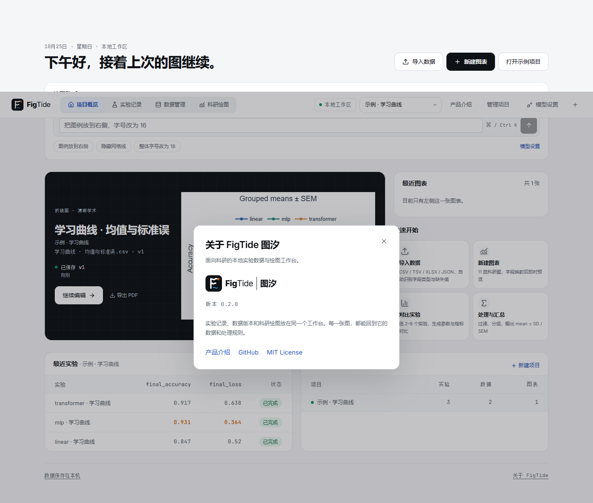

此图是程序自己的版本信息，不是文件资源管理器或下载页面截图。

## 2. 第一次打开与Windows提示

第一版未签名，Windows可能显示SmartScreen。确认文件来自可信Release且校验一致后，若界面提供该选项，可点“更多信息 → 仍要运行”。单位安全策略可能禁用此选项，请联系管理员，不要关闭系统防护。

启动会在一个独立的窗口中打开`http://127.0.0.1:端口/`（默认用 Microsoft Edge 的应用模式；找不到 Edge 时退回默认浏览器，托盘会提示）。窗口和数据目录共用固定端口，浏览器本地草稿与页面偏好可以跨重启沿用。新工作区可以直接载入示例项目；介绍页中的“开始创作”会进入工作区。

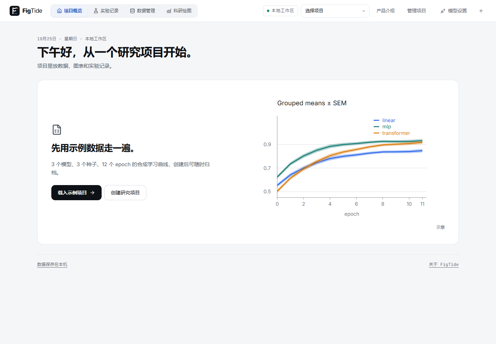

SmartScreen属于Windows系统界面，本指南用文字说明，没有伪造截图。

## 3. 托盘与退出

关闭窗口不会退出FigTide。通知区域的FigTide图标可能收在“显示隐藏图标”里。右键菜单可重新打开工作台（独立窗口）、在浏览器中打开、打开数据文件夹、打开日志文件夹，以及退出程序。第二次双击同一工作区会再开一个窗口，并复用已有后端。如果从旧版本升级且之前在浏览器里有未保存草稿，第一次启动会提示一次：草稿不自动迁移，可从托盘“在浏览器中打开”找回。

退出前先保存图表。使用托盘“退出”正常关闭，再移动程序文件或升级。托盘由系统显示，下面是重新打开后能看到的工作区，不代表托盘截图。

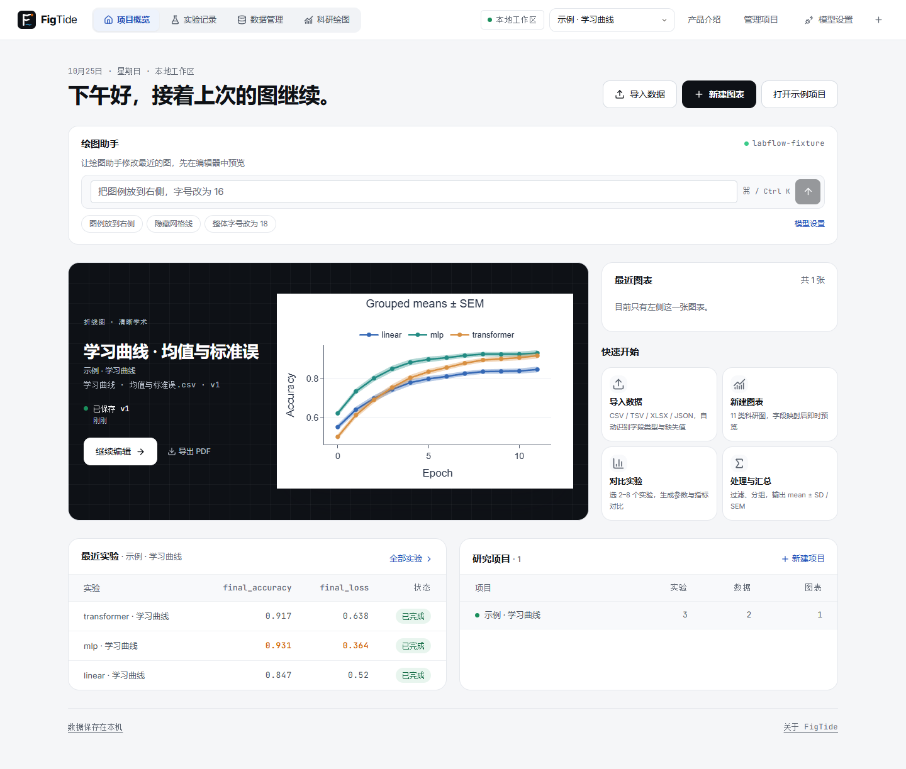

## 4. 载入示例项目，认识界面

空首页点“载入示例项目”。程序创建“示例 · 学习曲线”，包含三个模型的实验、学习曲线数据和真实计算的均值/标准误区间。以后可点“打开示例项目”继续，不会反复创建。

顶部导航进入实验、数据与绘图；编辑器左侧是数据与序列，中央是画布，右侧是属性。先观察图例、SEM区间和各坐标轴；示例中的SEM来自重复观测，不是凭空生成的误差。

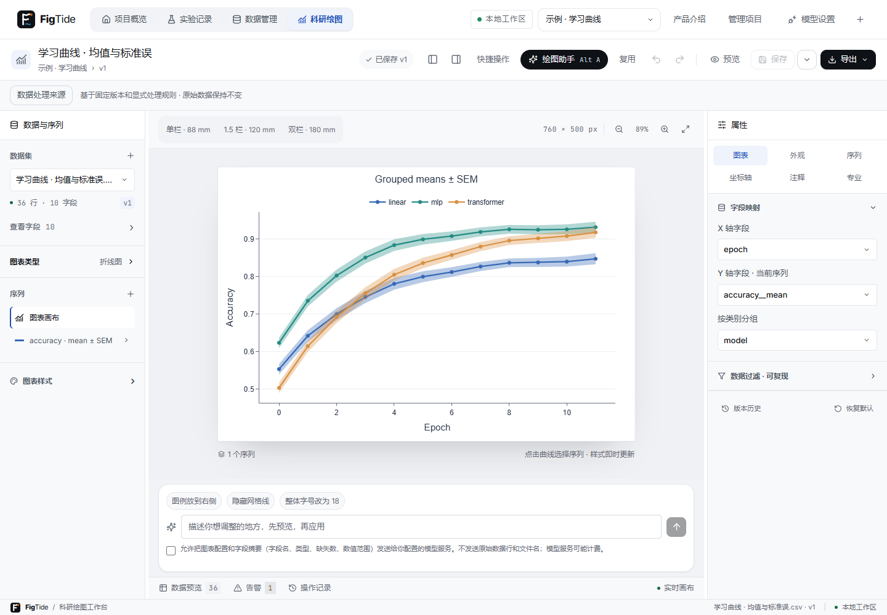

## 5. 导入自己的CSV

在已有项目内点“导入数据”，选择CSV。没有数据时可以下载[可直接导入的合成示例CSV](guide/learning-curves.csv)。该文件只用于体验。也支持TSV、TXT、XLSX、JSON和JSONL，复杂文件需核对结构。

先看预览，再确认类型、缺失符号与角色。例如`epoch`作为X轴，`accuracy`作为Y序列，`model`作为分组。误差列必须来自实际计算。调整解析不会修改原文件；确认前不会把预览当作正式数据集。

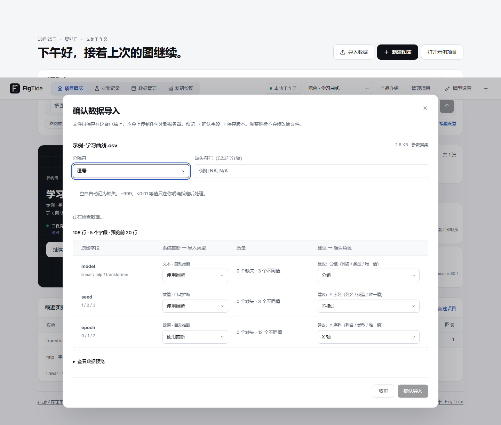

确认导入后进入数据页，可以检查字段、行数与版本。过滤、排序或汇总会形成独立派生数据，保留原始数据。

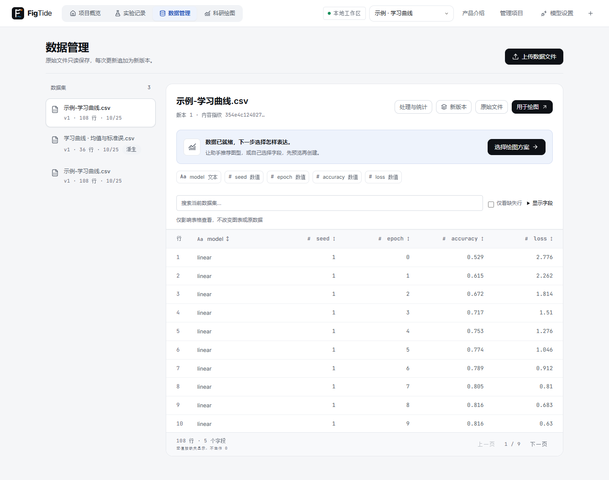

## 6. 选择图型、映射字段、调整样式

在数据页点“用于绘图”，或在编辑器选择数据版本。按问题选择折线、分组柱、散点、热力、箱线、小提琴、直方、ECDF、ROC、PR或混淆矩阵。ROC/PR需要真实标签和分数，混淆矩阵需要真实/预测标签，不要把任意数值列当成这些图的输入。

核对每个序列的X/Y、分组与实际误差字段。在右侧“外观”调整字体、颜色与标题，在坐标轴面板调整范围和网格。修改即时预览；Ctrl+Z撤销，Ctrl+S保存。草稿不等于正式保存，重要图表请保存并备份。

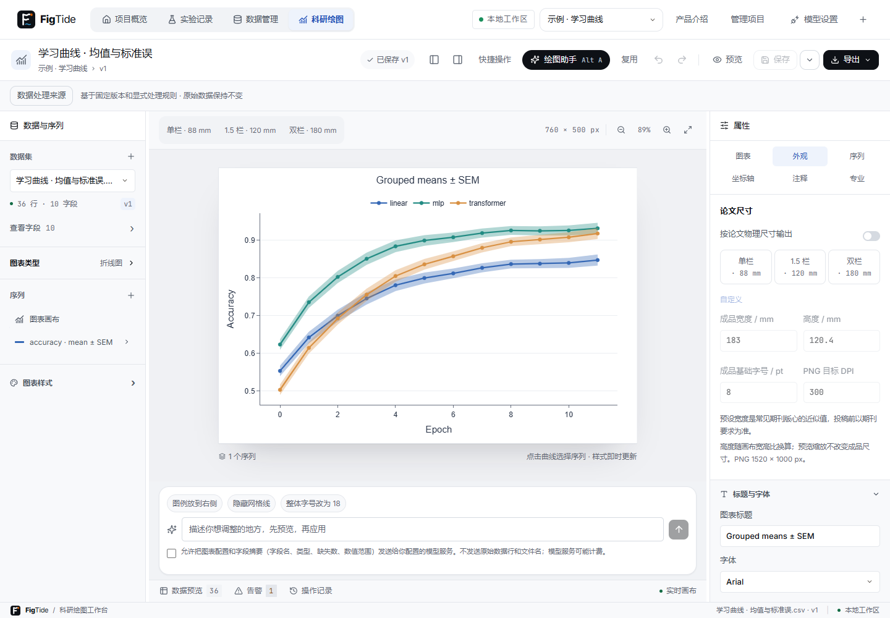

## 7. 可选绘图助手

打开顶部“模型设置”，填写你选择的兼容接口地址、模型ID和API Key。勾选测试同意后点“测试连接”，对话与工具调用都通过后“应用连接”。本图的`labflow-fixture`和本地地址只用于指南演示，不是公共模型服务，也不应填入你的日常设置。

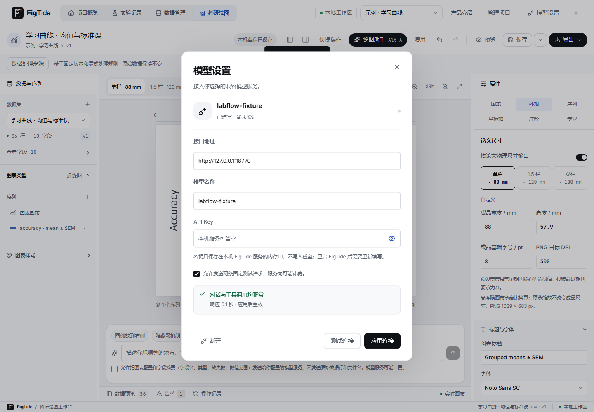

在编辑器点“绘图助手”，描述调整并勾选发送同意。发送包含描述、图表配置、会话上下文与字段摘要等元信息，不附带原始数据行和上传文件名。主动写进标题、注释或对话的内容也会发送，模型服务可能计费。详见[数据与隐私](../README.md#数据与隐私)。

助手先产出提案和差异预览，核对后点“应用这组调整”；不满意可拒绝，应用后也可以一步撤销。提案不会自动正式保存。密钥不会显示在截图中；后端重启后，网页填写的连接密钥需要重新配置。

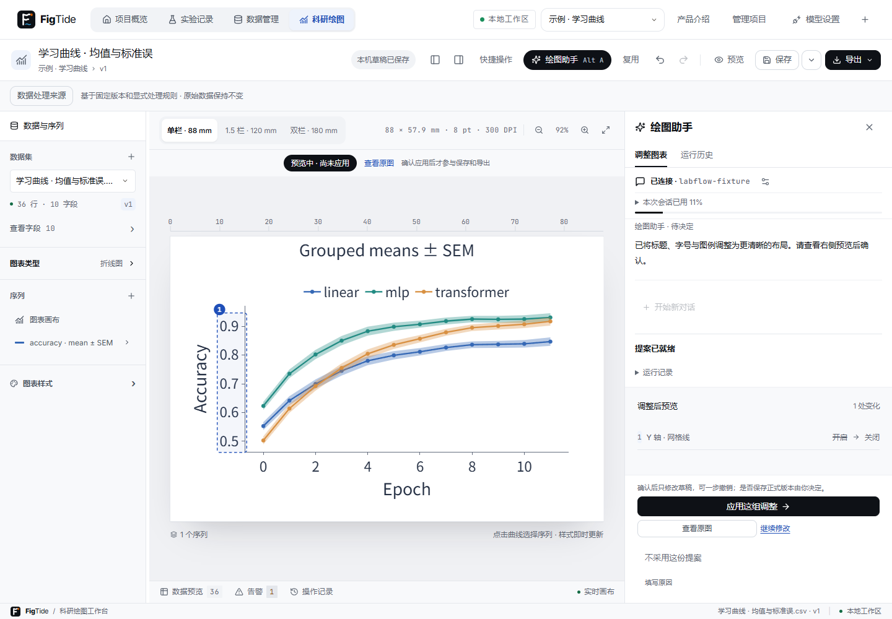

## 8. 论文尺寸与PDF / SVG / PNG导出

打开图型/模板选择区，选择论文尺寸，例如单栏88mm或双栏180mm。按目标会议或期刊的实际要求调整宽度与字号，这些是尺寸预设，不是官方认证。

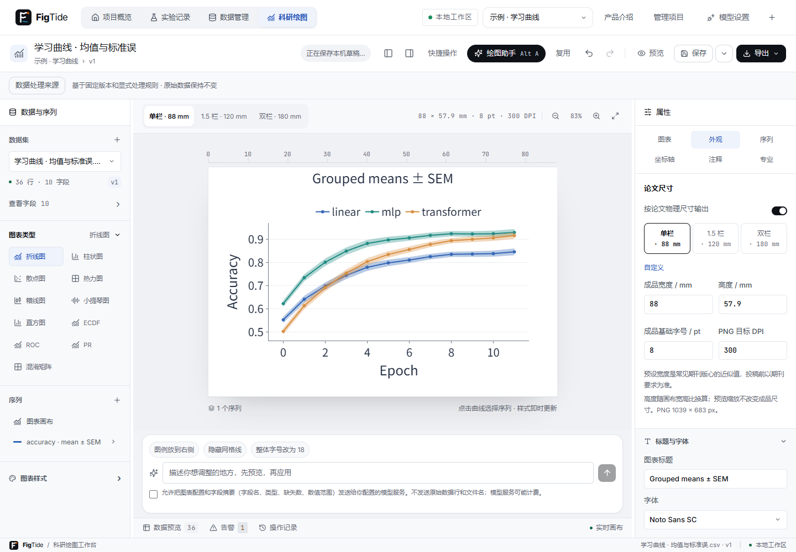

点击“导出”，选择PDF、SVG或PNG并下载。PDF使用可嵌入字体；提示时先切换为Noto Sans SC并检查版式。SVG保留文本，接收设备需有对应字体；PNG是位图，注意输出DPI。导出使用与画布相同的配置，接收软件的字体替换仍可能影响SVG显示。

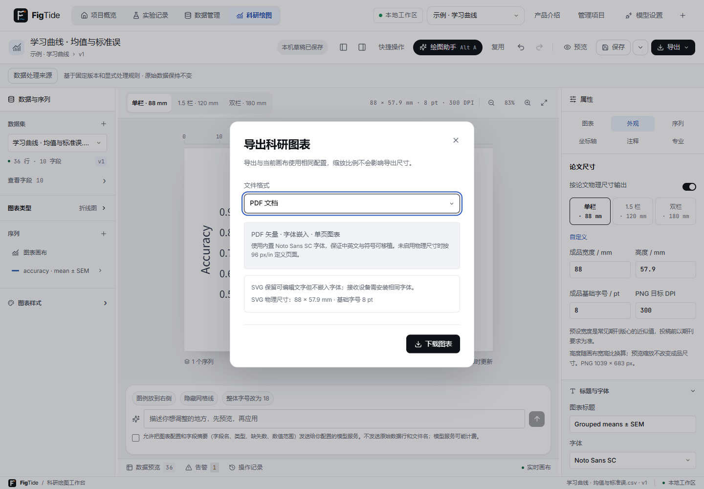

## 9. 备份、恢复与旧版迁移

点“管理项目”，在“项目备份与恢复”中选择项目并“下载项目备份”。保存在自己选择的位置，建议工作区目录以外。恢复时选择备份ZIP、检查预览并填写名称，最后点“恢复为新项目”。恢复是新建项目，原项目不被覆盖。

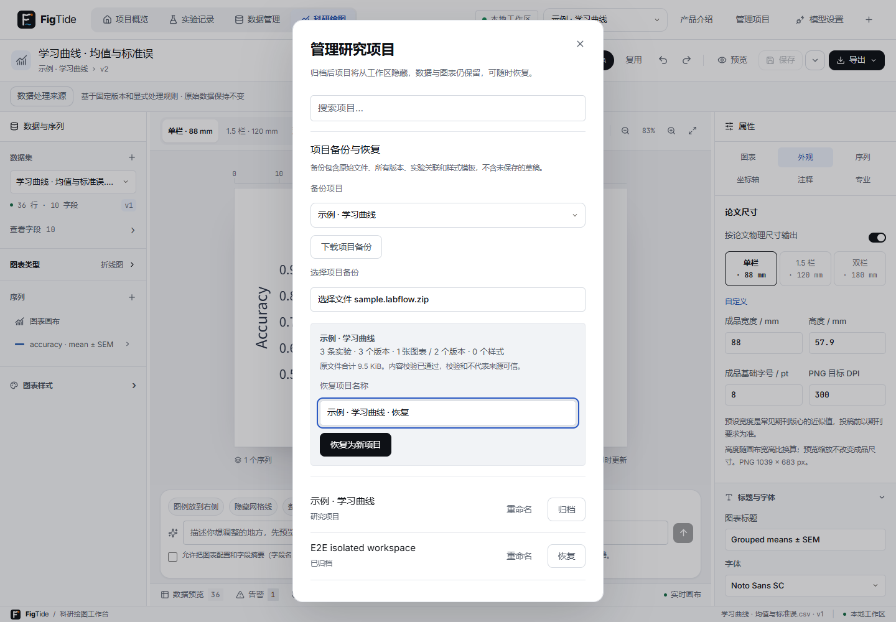

备份不包含未保存草稿，助手运行历史也不随项目迁移。旧MySQL版用户请按[迁移指南](desktop/MIGRATION.md)使用导出、恢复和自动核对工具，不要手动把MySQL文件复制为H2数据库。

## 10. 升级

先保存、备份并退出旧程序，下载新版ZIP到新目录完整解压，再启动新版。数据目录与程序目录分离，正常升级不需要移走数据库。到首页“关于FigTide”核对新版本，确认之前保存的项目存在。


页面偏好和未保存草稿依赖独立窗口使用的同一浏览器配置文件与固定origin；换浏览器、清理浏览器数据或临时换端口不会自动转移这些状态。跨电脑请使用项目备份。遇到新版数据库迁移错误，不要直接用旧版打开新库，请保留日志和原备份排查。

## 11. 常见问题

**安装目录可以包含中文或 emoji 吗？** 中文和空格可以，安装目录不要包含 emoji。当前 JDK 21 在含 emoji 的程序路径下可能无法加载应用；请把整个程序文件夹解压到不含 emoji 的位置，例如`D:\科研工具\FigTide`，不要只移动 EXE。中文用户名和数据路径的启动修复需要 Windows 10 1903 及以上或 Windows 11，无需更改系统区域设置。

**端口被占用是什么意思？** 默认首选17861，占用时本次使用临时端口，原首选记录不变；下次仍重试原端口。数据仍在同一数据库，但临时origin读不到原端口的未保存草稿与页面偏好，提示不是数据已被删除。

**杀毒软件拦截怎么办？** 先确认可信下载来源、SHA256和软件版本，保留错误/隔离记录。不要直接关闭防护；联系安全管理员，或提交脱敏日志排查。

**数据和日志在哪？** 默认`%LOCALAPPDATA%\FigTide\data`和`%LOCALAPPDATA%\FigTide\logs`。从托盘可打开对应文件夹。若使用了`--labflow.data-dir`，以实际覆盖目录为准。应用的数据说明入口在首页底部：


**怎么彻底卸载？** 先导出所有重要项目并退出程序，再删除解压的程序目录。仅删除程序目录会保留数据；确定不再需要时，再手动删除自己的FigTide数据/日志目录。备份下载文件和浏览器中的草稿/页面偏好需要分别处理，删除不可恢复前请再次核对。

## 截图复现（开发者）

所有图片由真实便携EXE + Playwright产生，`reducedMotion: "reduce"`，数据目录为独立临时H2，本地协议夹具不调用收费模型：

```powershell
$env:LABFLOW_CAPTURE='1'
./scripts/test-agent.ps1 -Guide -Packaged -Application 'dist/desktop/v02/FigTide-0.2.0-windows-x64/FigTide' -FixturePort 18770
Remove-Item Env:LABFLOW_CAPTURE
```

独立的guide测试项目不改变常规E2E用例数量。系统托盘、SmartScreen与解压操作使用文字说明，没有用应用截图冒充系统操作。
