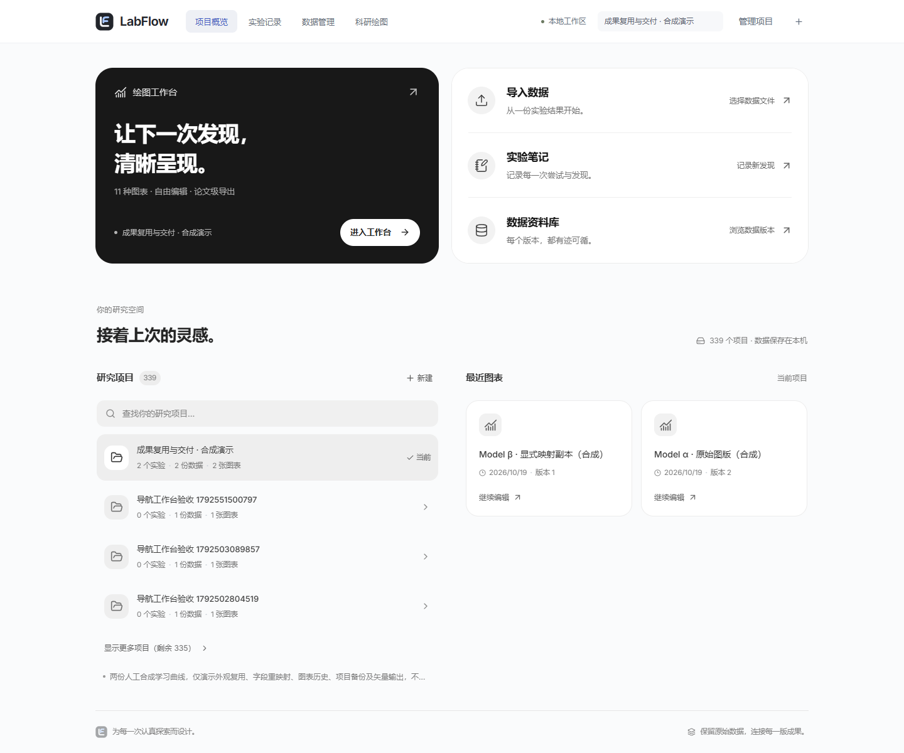

> 2026-10 前端重构后首页已替换，本文仅作历史记录，当前设计见 [DESIGN.md](DESIGN.md)。

# 首页功能入口与研究工作区（2026-10-21）

这轮保留首页的黑白功能入口与有色科研图廊，重新调整用户截图中的入口和本地工作区。

## 页面组织

- 四张等大的入口卡片改为一个绘图主入口与三个紧凑的快捷入口。绘图卡显示真实当前项目，三个快捷入口继续调用原来的上传、实验与数据操作。
- 移除序号装饰，用比例、字号和圆角组织层次；轻量悬停、按下、键盘焦点与系统减少动画偏好仍有效。
- 项目区取消固定高度与内部滚动。首屏展示 4 个项目，当前项目置顶；每次展开再显示 8 个，搜索仍覆盖全部项目。
- 最近图表改为文档卡片，展示真实名称、更新时间与版本，点击继续编辑。首屏最多 4 张，每次展开再显示 8 张；没有虚构曲线缩略图。
- 搜索图标与输入文字保持间距，修正全局表单选择器覆盖首页输入样式的问题。
- 空状态、错误重试、加载和导入忙碌状态继续保留；没有选中项目时，各入口打开创建项目。

新样式集中在 `frontend/src/components/home-workspace.css`，图廊样式文件移除入口卡片的旧覆盖。后端、API 字段、图表配置、实验数据均未改变。

## 验证

- Vitest：15 个文件，92/92 通过。新增忙碌时防止重复导入、无项目时四个入口创建项目的交互验证。
- Chrome E2E：7/7 通过，25.9 秒。包含原有首页、独立工作台和图廊回归，以及新增工作区流程：真实项目查询 → 搜索 → 切换 → 显示更多 → 宽度适配。
- 宽度覆盖 390/900/1280/1440/1920/2560 px；检查无全页横向溢出、无项目列表内部滚动、搜索图标与文字不重叠，以及减少动画后的交互。
- TypeScript / Vite 生产构建通过，保留已有大分包提示。
- 后端 Java/MySQL 实际运行；本轮未重跑 Java 测试或全量科研绘图 E2E。

执行命令（`frontend` 目录）：

```powershell
npm run test
npm run e2e -- e2e/home-workspace.spec.ts e2e/home.spec.ts e2e/showcase.spec.ts e2e/navigation.spec.ts
npm run build
```

截图来自真实本地 API 与已有演示项目，没有使用 Mock：


