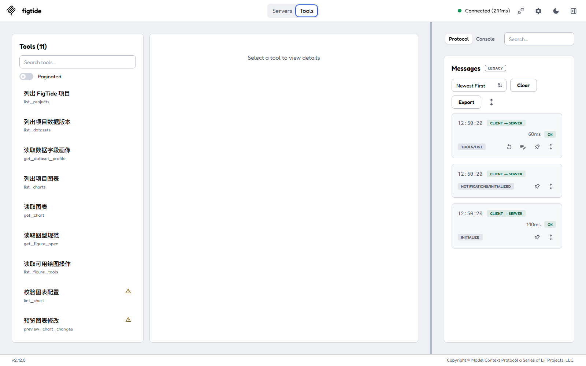

# FigTide MCP Server

FigTide MCP Server 是一个本机 `stdio` 转接器，让 Claude Desktop、Claude Code、Codex 和 Cursor 能通过现有 FigTide HTTP API 读取项目与图表、检查配置、预览修改，并在明确调用写入工具时创建图表或保存新版本。MCP 进程不连接数据库，也不复制 FigTide 的校验规则。

## 能做什么

- 列出本机 FigTide 项目、数据版本、字段画像和已保存图表。
- 读取图表完整配置、当前 revision、图型规范与动态绘图操作目录。
- 使用 FigTide 同一套 lint 规则检查配置，并在不写库的情况下预览配置和差异。
- 用最新 `base_revision` 保存新版本，或以完整 schema v1 配置创建图表；成功时返回可打开的编辑器链接。

## 边界与隐私

MCP 没有删除工具，不读取原始数据行，数据工具也会删除上传文件名和字段样例值。`preview_chart_changes` 只预览；`save_chart_version` 总是新增版本，不覆盖旧版本；旧 revision 冲突会直接报错，不自动重试。

`lint_chart` 与内置助手一样省略分类计算报告，避免报告中的上传文件名、观测分组值和样本行号进入 AI 客户端；校验问题及安全的数据版本标识仍会返回。

但是，**AI 客户端所使用的模型服务会看到工具返回的内容**。这包括项目名与描述、字段名/类型/缺失数/数值范围/角色、数据版本元信息，以及图表配置中的标题、注释和字段映射。你的提示词和工具调用也由客户端处理。在连接前请根据自己选择的客户端、模型供应商和组织政策判断是否适合发送。

FigTide 服务仍只监听本机，MCP 只允许 `http://127.0.0.1`、`http://localhost` 或 `http://[::1]` 等回环地址。它不为跨用户、远程或公网部署增加认证。

## 准备

1. 启动 FigTide 桌面版，并保持托盘进程运行。
2. 从同版本 Release 下载单独的 `figtide-mcp.cjs` 和 `SHA256SUMS.txt`，核对 SHA-256。
3. 安装 Node.js 18 或更高版本，在 PowerShell 中用 `node --version` 确认。
4. 下面的 `C:\\Users\\YOU\\Downloads\\figtide-mcp.cjs` 必须替换为你机器上的绝对路径。

服务器默认先读取 `%LOCALAPPDATA%\FigTide\data\app.port`，找不到时尝试 `http://127.0.0.1:17861`。只有本地开发服务端口不同时，才需要显式设置例如 `FIGTIDE_URL=http://127.0.0.1:8086`。

## Claude Desktop

Windows 配置文件为 `%APPDATA%\Claude\claude_desktop_config.json`。保存后完全退出 Claude Desktop（不只是关闭窗口）再重开：

```json
{
  "mcpServers": {
    "figtide": {
      "command": "node",
      "args": ["C:\\Users\\YOU\\Downloads\\figtide-mcp.cjs"]
    }
  }
}
```

## Claude Code

PowerShell 中执行：

```powershell
claude mcp add --transport stdio figtide -- node "C:\Users\YOU\Downloads\figtide-mcp.cjs"
claude mcp get figtide
```

进入 Claude Code 后可用 `/mcp` 检查连接和工具列表。

## Codex

编辑 `%USERPROFILE%\.codex\config.toml`：

```toml
[mcp_servers.figtide]
command = "node"
args = ["C:\\Users\\YOU\\Downloads\\figtide-mcp.cjs"]
```

也可在 PowerShell 中添加，然后用 `codex mcp list` 检查：

```powershell
codex mcp add figtide -- node "C:\Users\YOU\Downloads\figtide-mcp.cjs"
codex mcp list
```

Codex CLI、Codex IDE 扩展和同一 Codex host 上的桌面客户端共享这份配置。格式依据 [OpenAI Docs 的 MCP 配置文档](https://learn.chatgpt.com/docs/extend/mcp)。

## Cursor

全局使用时编辑 `%USERPROFILE%\.cursor\mcp.json`；仅当前项目使用时创建项目根目录下的 `.cursor/mcp.json`：

```json
{
  "mcpServers": {
    "figtide": {
      "command": "node",
      "args": ["C:\\Users\\YOU\\Downloads\\figtide-mcp.cjs"]
    }
  }
}
```

在 Cursor 的 MCP 设置中启用 `figtide`，并确认可见 11 个工具。

## 可用工具与后端接口

| MCP 工具 | 类型 | FigTide HTTP API |
|---|---|---|
| `list_projects` | 只读 | `GET /api/projects` |
| `list_datasets` | 只读 | `GET /api/projects/{project_id}/datasets` |
| `get_dataset_profile` | 只读 | `GET /api/projects/{project_id}/data/{dataset_version_id}/profile` |
| `list_charts` | 只读 | `GET /api/projects/{project_id}/charts` |
| `get_chart` | 只读 | `GET /api/projects/{project_id}/charts/{chart_id}` + `GET .../versions` |
| `get_figure_spec` | 只读 | `GET /api/figure-tools/spec?type=...` |
| `list_figure_tools` | 只读 | `GET /api/figure-tools/catalog` |
| `lint_chart` | 只读 | `POST /api/projects/{project_id}/figure-tools/lint` |
| `preview_chart_changes` | 只读预览 | `POST /api/projects/{project_id}/figure-tools/preview` |
| `save_chart_version` | 写入新版本 | 先 `POST .../figure-tools/lint`，再 `PUT /api/projects/{project_id}/charts/{chart_id}` |
| `create_chart` | 写入新图表 | 先 `POST .../figure-tools/lint`，再 `POST /api/projects/{project_id}/charts` |

建议流程是先 `get_chart` 取得完整配置与最新 revision，再 `list_figure_tools` → `preview_chart_changes` → 让用户核对差异 → `save_chart_version`。不要跳过预览和确认。

## MCP Inspector 验证

下图来自 MCP Inspector 2.12.0 实际启动 `node mcp/dist/figtide-mcp.cjs` 的连接；状态为 Connected，`tools/list` 返回 11 个工具。



## 常见问题

**报“无法连接 FigTide”或 `ECONNREFUSED`**：先启动 FigTide，不要只打开之前的浏览器标签。桌面版运行时，托盘中应有 FigTide 图标。

**桌面版临时换了端口**：重启 AI 客户端，MCP 会重新读取 `app.port`。如果是开发服务，在配置的 `env` 中增加 `"FIGTIDE_URL": "http://127.0.0.1:8086"`；不要填入局域网或公网地址。

**保存返回 409 / revision 冲突**：这表示图表已被浏览器或另一客户端保存。重新调用 `get_chart`，基于最新配置再预览，经用户确认后用新 revision 保存。MCP 不会替你覆盖或重试。

**工具列表为空或服务器立即退出**：用 `node --version` 确认 Node 18+，确认 `args` 是存在的绝对路径，然后完全重启客户端。不要用其他程序向 MCP 进程的 stdout 写日志。
# 18-A：只读审稿工具

新增 `review_chart({project_id,config,chart_id?,target?:{width_mm?,journal?}})`，通过现有 HTTP 客户端调用只读审稿接口，无数据库访问或模型调用。返回确定性问题、可预览的修复操作、通过与跳过项。MCP 不提交渲染事实，因此 R7/R8 显示「需要编辑器中的渲染信息」，不能视为通过。不会返回源文件名、原始数据行或样例；应用修复须继续走 `preview_chart_changes` 与用户确认。

