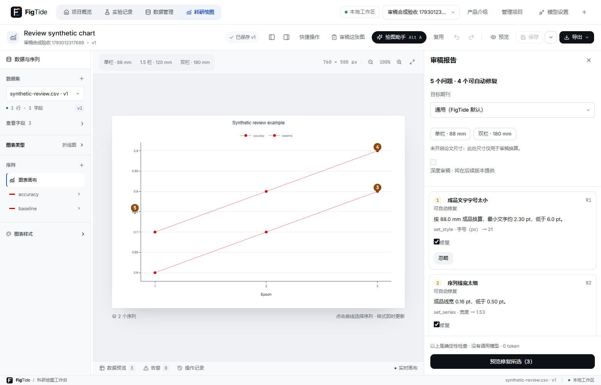
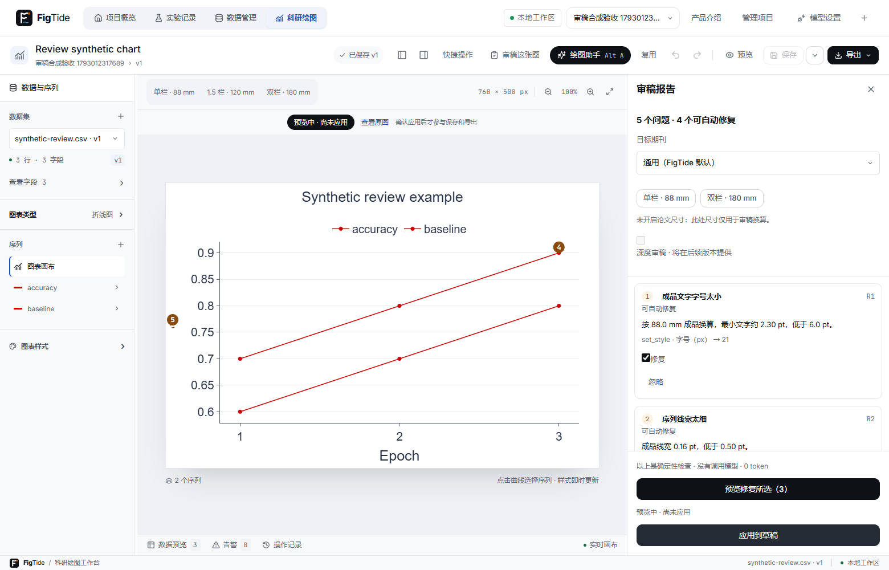
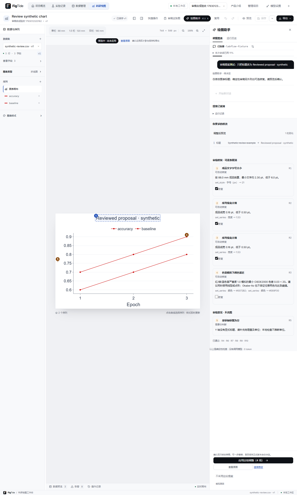

# 确定性审稿（18-A）

任务 18-A 的实现与验收逐节进行。没有调用模型，不消耗模型 token；最终验收记录见 TEST-RESULTS.md。

## 期刊数值规则

核实日期：2026-10-26。只存数值及来源，不复制作者指南原文；具体期刊和投稿阶段优先于出版社通用指南。`null` 表示所查页面没有明确给出这一项，审稿回退到 FigTide 通用值（88/180 mm，6 pt，0.5 pt），不会冒充出版社要求。

| 规则范围 | 单栏 / 双栏 mm | 字号 pt | 最小线宽 pt | 官方来源 |
| --- | --- | --- | --- | --- |
| 通用（本产品默认） | 88 / 180 | ≥6 | 0.5 | 本产品约定 |
| Nature 主刊最终稿 | 89 / 183 | 5–7 | 未记录 | [Nature artwork guide](https://www.nature.com/documents/nature-final-artwork.pdf) |
| IEEE Journals 通用图形指南 | 88.9 / 182 | 未注明 | 未注明 | [IEEE Resolution and Size](https://journals.ieeeauthorcenter.ieee.org/create-your-ieee-journal-article/create-graphics-for-your-article/resolution-and-size/) |
| PLOS ONE | 未注明 | 8–12 | 未注明 | [PLOS ONE Figures](https://journals.plos.org/plosone/s/figures) |
| Elsevier 通用图形指南 | 90 / 190 | 普通正文建议7 | 未注明 | [Elsevier Artwork sizing](https://www.elsevier.com/about/policies-and-standards/author/artwork-and-media-instructions/artwork-sizing) |
| ACS Chemical Research in Toxicology | 84.6667 / 177.8 | ≥4.5 | 0.5 | [ACS author guidelines](https://researcher-resources.acs.org/publish/author_guidelines?coden=crtoec) |

PLOS 页面给出总宽度范围与正文对齐建议，没有单栏/双栏的定义，因此没有将范围端点当成栏宽。Elsevier 将普通正文 7 pt 称为建议，上下标另有 6 pt；审稿检查普通文字采用 7 pt。ACS 单栏使用页面更精确的 240 pt × 25.4 / 72，双栏使用 504 pt，都是上限。Nature 数值只适用所列主刊指南，不泛指 Nature Portfolio。

后端资源 `review/journal-rules-v1.json` 是版本化规则表；前端持有同内容的离线快照，`JournalRulesTest` 比较两者，避免桌面构建或离线使用时漂移。新增配置只有可选的 `publication.journal`，没有该字段时保持原有通用尺寸与渲染行为。

## 规则与阈值

- R1：`px × width_mm / canvas_width × 72 / 25.4`；论文模式沿用 publicationMetrics 的 pt→px 逆换算。渲染文字存在时取更小字号，缺失时按配置估计（图例比基础字号小 1 px）。修复使用 set_style，物理字号为期刊下限 + 0.5 pt，像素模式向上取整并给图例留 1 px；工具范围不足时只给意见。
- R2：可绘制线的序列宽度按同一物理比例换算，使用期刊下限或默认 0.5 pt；不把柱宽、散点大小当作线宽。
- R3：sRGB 去伽马 → Machado 2009 严重度 1.0 的红/绿/蓝三种模拟矩阵 → 裁剪线性 RGB 到 [0,1] → D65 CIELAB → CIEDE2000（参数均为 1）。任一颜色对在任一种模拟下 ΔE00 < **20** 即建议调整；20 是本产品的保守启发式阈值，不是论文或出版规范的达标线。修复按序列顺序建议 Okabe–Ito，超过 8 色只给意见。
- R4：序列超过 8 条，建议分面或合并，不修改序列或数据。
- R5：确定性部分只查显式轴标题是否为空；物理量和单位可在 18-B 可选深度审稿中由模型给出建议，不能当作已验证的事实。
- R6：原始误差列一律要求确认，不根据列名猜 SD/SEM/CI。派生数据从处理规则及有效 n 信息核查；当前无图注字段，因此仅附建议文字，不重写标题。分组 n 不同或缺失时不声称有统一样本量。
- R7：用图例框与抽样点几何求交；四角中选零重叠的位置，同分按左上、右上、左下、右下固定顺序；四角都重叠或放不下时不自动修。保留原有 top/bottom/right，仅给 set_legend 增加四角位置，旧配置行为不变。
- R8：文本边界框两两相交及画布外溢；最多列出约 100 对重叠，避免重复诊断淹没报告。不分析文字内容，不自动移动。
- R9：对数轴标题需含 log 或「对数」，仅提示；不会推断截断是否合理或数据含义。
- R10：同项目其他图表的最新保存版本中，同名序列配色不一致时列出图表名，仅提示。

每条修复只使用现有十种 FigureOperations 操作，实际字段名为 `arguments`（沿用正式协议，任务书示意中的 `args` 不另起协议）。操作先经过 ConfigValidator；不支持的图型/范围降级为意见，应用时仍须经过正式 preview/lint 和用户确认。缺少几何事实时 R7/R8 明确 skipped。

色觉算法来源：[Machado et al. 2009](https://doi.org/10.1109/TVCG.2009.113)、[作者补充矩阵页面](https://www.inf.ufrgs.br/~oliveira/pubs_files/CVD_Simulation/CVD_Simulation.html)、[Colour 项目的矩阵文档](https://colour.readthedocs.io/en/latest/generated/colour.CVD_MATRICES_MACHADO2010.html)。作者页面本次连接超时，数值交叉依据公开矩阵实现；单测覆盖三种模拟的基色分量与 [Sharma 等 CIEDE2000 校验样例](https://hajim.rochester.edu/ece/sites/gsharma/ciede2000/)。

局限：色觉模拟近似，忽略屏幕、透明叠加、笔画形状和实际观察条件；Okabe–Ito 的每一对颜色也不保证都达到 ΔE00=20。R8 是矩形相交，可能误报旋转文字，也不能发现所有字形或曲线遮挡。采样检查没有报问题不代表整张图满足投稿要求。

R6 的 n 来自对应统计列在派生数据中的记录，不会重新执行图表层的筛选；若图表筛选只显示部分组，报告可能包含未显示组的 n。请按实际展示的组核对图注，不能把报告中的 n 集合直接当成图中统一样本量。

## 几何事实与隐私

`RenderFacts` 只允许画布/绘图区/图例框、受控文字角色/边界框/字号、trace 索引/像素点和带轮廓；不包含文字、字段、类别或数据值。前端在 Plotly 完成渲染后读取 SVG 几何，使用确定性等间隔采样（点标记最多每 trace 200；无标记的线按路径等间隔取 200 个几何点；带最多 100 个顶点），统一保留三位小数，并去除无效值。线段采样可能把线段间隙附近也标成潜在遮挡，应人工检查。

只读审稿请求总量限文字 300、点 3000、带 20；后端所有嵌套对象严格拒绝未知键，数量超限和不合法数值返回 400。几何只用于本机确定性检查，18-A 没有模型发送流程。编辑器未提供事实时明确跳过 R7/R8。

## 助手提案审稿与确认

`POST /api/projects/{p}/agent/runs/{id}/review` 接收 `{render_facts?,target?}`。只有本进程仍保留、已完成且尚未决定的 proposed 运行可以审稿；正在续改、历史记录或已决定返回 409。提案配置从服务端缓存读取，客户端不能替换。相同提案、几何、目标的规范化指纹返回原审稿结果，0 次模型请求、0 预算消耗。

编辑器先显示没有几何的确定性结果，再在原提案渲染完成后提交纯几何，补齐 R7/R8；等原提案的几何采集完成才预览自动修复，避免把修复后的几何误当成原提案。用户要求的变更路径与修复路径相交时，整条修复降为意见，并注明冲突。

决定接口兼容扩展：`accepted_fixes?: string[]` 和可选的 `review_hash`。新版界面同时提交所选 ID 与报告指纹；报告变化、无效/不可修复 ID 或最终 lint/revision 失败返回 409。未传 accepted_fixes 的旧客户端完整保留原流程。后端仅从持久化报告取操作，依次应用并重新 lint，调用原 AgentAuditService.decide；决定及修复指纹在同一事务提交，写入失败一起回滚。同样修复 ID 的重复接受幂等，不同 ID 409。

新决定响应在本进程仍有提案时附最终 `config`、`accepted_fixes`、`final_config_hash`，前端核对预览后只编辑一次草稿。完整 config 不落审计，不调用图表保存；接受不等于已保存，撤销也不撤回接受记录。

V9 配对迁移增加 mode（默认 single，18-A 不启用协作）、review_json 和 accepted_fixes_json。review_json 只存结果及提案/上下文指纹，不存几何原文；accepted_fixes_json 存所选 ID 与最终配置哈希。报告可包含项目中图表的名称及现有操作参数，保存在本机审计中，不发送模型。原始行、文件名、样例值及完整配置仍不存入这些列。原项目 ZIP 继续不包含助手审计。

## 界面与证据

开发验收命令与结果见 [测试记录](TEST-RESULTS.md)，协作功能见 [协作说明](AGENT-TEAM.md)。真实模型评测报告及逐例原始结果按要求保留在本地，不随功能集成发布。

独立审稿支持单栏/双栏、目标期刊、默认勾选修复、当前会话忽略/恢复、预览、应用和一步撤销。未开论文尺寸时报告尺寸仅作换算；已开物理模式时尺寸按钮明确修改草稿宽度，可撤销。18-B 新增可选深度审稿，需另行同意调用模型，模型用量计入运行/会话预算；下面保留 18-A 阶段截图，协作与深度审稿界面见 AGENT-TEAM.md。

