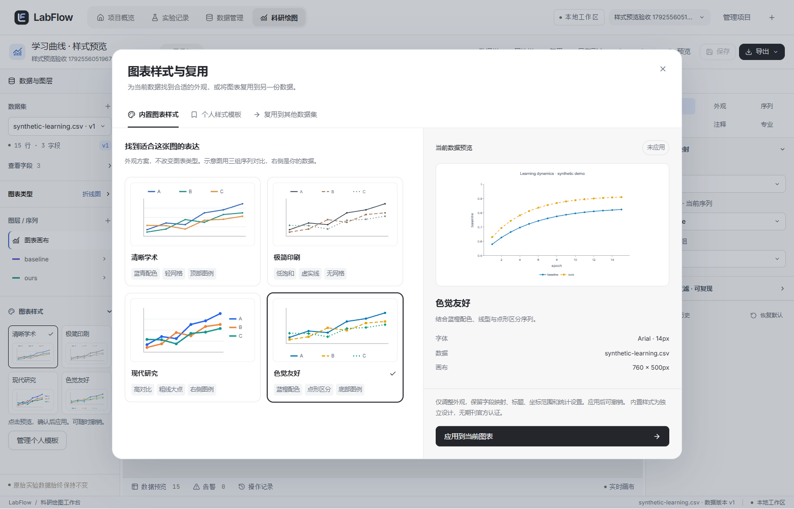
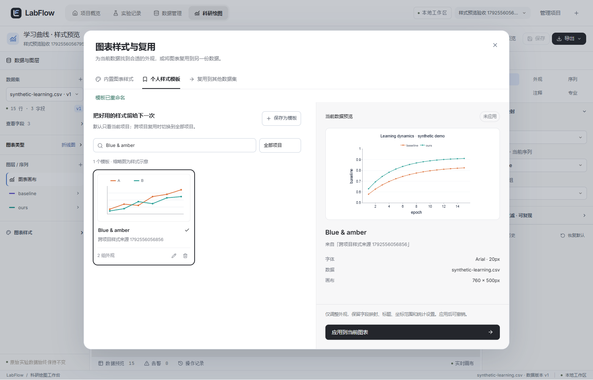
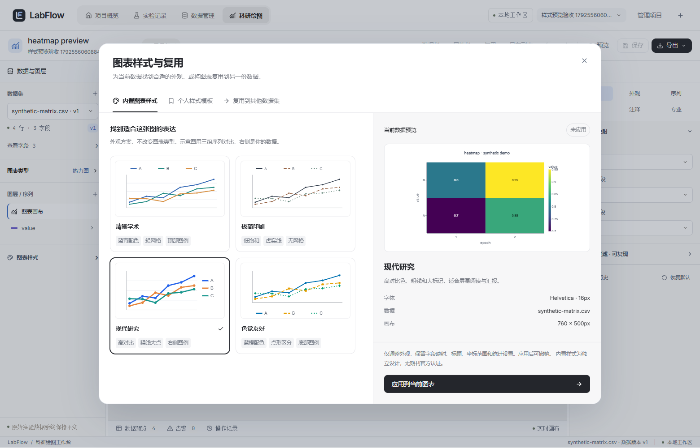
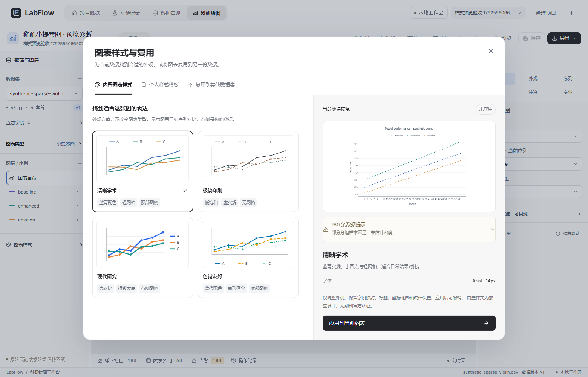

# 图表样式、预览与模板管理（2026-10-21）

## 页面结构

编辑器原“视觉预设”改为“图表样式”，四个带图形示意的入口：清晰学术、极简印刷、现代研究、色觉友好。点击打开样式库，不直接修改画布。原有英文 preset 键保留，不破坏历史配置；预设不是期刊官方认证。

2026-10-21 补充修正：原示意图跟随当前序列数量，单条曲线时几乎无法比较。现在内置卡片统一展示三组示意序列，使用与真正应用一致的配色、线宽、虚实线、点形和图例位置；不把示意几何当成实验数据。

| 样式 | 可见区别 |
| --- | --- |
| 清晰学术 | 蓝青配色、小圆点、轻网格、顶部图例 |
| 极简印刷 | 低饱和配色、细线与虚实线、无网格 |
| 现代研究 | 高对比色、粗线大点、右侧图例 |
| 色觉友好 | 蓝橙配色、不同点形与虚实线、底部图例 |

预设同时给出对应热力图色板，但保留色阶范围、中心、数值标注开关；图例可见性沿用用户设置。应用新预设才修改图表，既有保存配置不会因默认预设调整而被重写。

样式库分为“内置图表样式”“个人样式模板”“复用到其他数据集”。左侧选择与管理，右侧展示当前真实数据的效果及来源、字体、尺寸；确认应用后才进入原编辑器撤销栈。关闭或切换预览不会写入图表快照。

缩略图是明确标注的样式示意，不是实验结果。右侧使用编辑器已加载的完整数据版本及同一个 `buildPlot`/Plotly 渲染链路，保留过滤、统计、分面和论文尺寸设置；不是用数据列表中的元信息替代行数据，也不调用 AI 生成曲线。按实际宽高等比缩放，窗口变化重新适配，底部应用按钮保持可达。

绘图诊断从图形容器移出，默认仅显示数量与简短摘要；展开后独立滚动、每次显示 30 条，保留全部原始提示。小提琴图样本不足时仍只使用真实观测，不生成密度或补造样本。右栏内容与应用区域分别布局，长提示不会覆盖按钮。用 60 个类别、3 条序列的真实导入合成数据复现 180 条诊断，验证 1280×800 和 1560×1000 下的布局。

## 模板管理

- 默认显示当前项目，跨项目使用时主动切换“全部项目”。按模板名或来源项目搜索，初始最多九项，按需追加九项。
- 保存当前样式、选择预览、应用、重命名、确认删除均使用真实 Java API。操作有忙碌、成功、失败和空状态。
- 重命名只更新名称；来源项目、样式 JSON 与已保存图表不改变。删除前展示明确确认，已有图表不受影响。
- 内置预设保留数据 ID、字段、标题、轴范围/对数、画布尺寸、误差列、区间及统计配置；修改字体、字号、配色、线型/点形、大小、线宽、网格、图例位置和热力图色板。
- 个人模板沿用已有 schema_version=1 的外观白名单，包含画布和论文输出外观；保留数据语义。确认应用仍可撤销，正式图表保存仍由用户触发。
- 整图复用仍逐项核对所有字段绑定，数值字段校验不变，另存新图而不覆盖原图。

## 测试数据边界

历史“交付风格 …”来自此前浏览器验收与备份恢复。此次没有按名称批量删除历史数据库记录，也没有将它们伪装成内置样式。它们仍可通过全部项目查找和管理。

交付验收和新增样式验收记录本次创建的项目 ID，结束后仅删除这些项目下本次生成/恢复的模板。这样后续运行不会继续往用户模板列表积累测试样式；不触碰其他项目的已有模板。Java 集成测试使用独立 `labflow_test` 数据库。

## 接口与验证

新增 `PATCH /api/style-templates/{id}`，请求 `{ "name": "论文样式" }`，返回 `{ "id": 1, "name": "论文样式" }`。名称限制 1–120 个字符、去除首尾空白，空白或超长返回 400，不存在返回 404；同名更新允许重试。不新增数据库迁移。

单测覆盖预览与应用隔离、范围/搜索/分批展示、重命名、删除确认、失败保留与重试，以及四种预设保留科学语义。Java 通过真实 MySQL 与 MockMvc 验证新接口、名称校验、同名重试与 JSON/项目归属不变。

Chrome 验收覆盖折线/分组柱/散点/矢量热力图预览、关闭不应用、撤销/重做、真实 MySQL 保存重开、SVG、跨项目模板、搜索框布局、重命名持久化、删除取消/确认、键盘页签切换及 1280/1920 窗口适配。其余导入、统计、PDF/PNG 和备份恢复继续完整回归。最终结果见 [验收记录](TEST-RESULTS.md)。

```powershell
# 仓库根目录；使用本机 Java 21
$env:JAVA_HOME=(Get-ChildItem .runtime/java -Directory | Select-Object -First 1).FullName
$env:Path="$env:JAVA_HOME\bin;$env:Path"
mvn.cmd -f backend/pom.xml test

# frontend 目录
npm.cmd test
npm.cmd run build
npm.cmd run e2e
```

本轮未引入第三方仓库代码、素材、新依赖或付费模型调用。Agent 和论文灵感画廊仍未接入。








