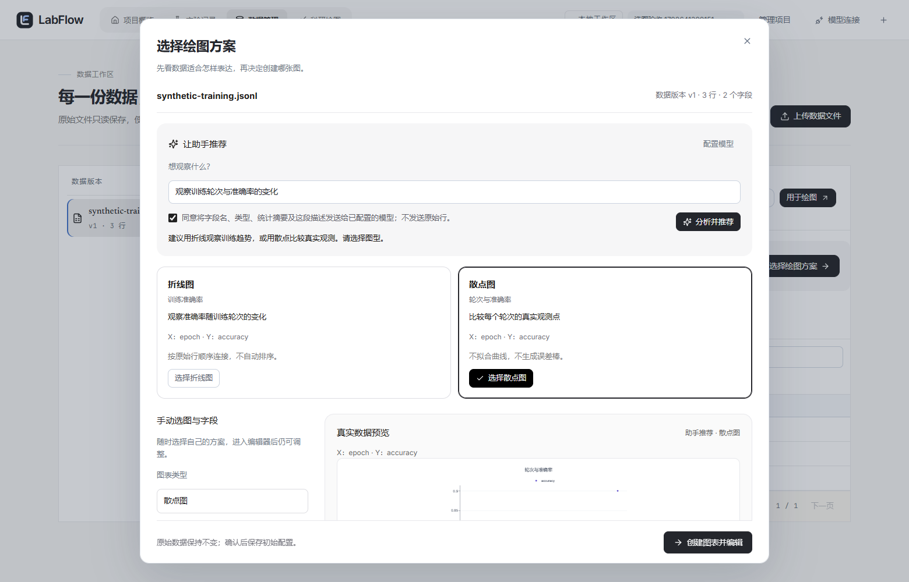

# LabFlow 测试与验收记录

## 2026-10-23 · 10-7b 助手面板、编号标记与视觉一致性

- `npx tsc -b --force` 0 错（新增 `agentShortcut`、`proposalMarkers` 的类型收窄）；`npx vitest run` **43 文件 / 238 通过**（`AgentAssistant.test.tsx` 28 条含 5 条续改用例、`proposalMarkers.test.ts` 5 条）；`npm run build` 通过（13.31s，`index-*.js` 仍 >500 kB，属既有分包提示）。
- 面板遮挡（第 6 项）用探针 `tmp/probe-dock.cjs` 在隔离栈实测，1440×1000 与 1440×720 各一组：
  - 修复前：`.quick-actions-body` 在 1000 高下 325.8px（scrollTop 295）、在 720 高下只剩 **45.8px**，「提案已就绪」整块滚出可视区（`overlapTop:true`）；composer 常驻 197.2px。
  - 修复后：body **511px / 231px**，composer 默认收起（`composerPresent:false`），两种视口 `overlapTop:false`，页脚只剩「继续修改 / 应用这组调整 / 查看原图 / 拒绝提案」。
  - 根因两条：`.agent-dock .quick-actions-body` 只有 `min-height:24px` 被顶部行与常驻 composer 挤扁；滚动 effect 固定 `scrollIntoView` 到提案预览区，把上方状态行推出视口。不是 sticky 头部、也不是负 margin（`agent-assistant.css` 的 sticky 只对 dialog 模式生效）。
- 第 7 项：无提案时「应用这组调整」不渲染（非禁用）——`AgentAssistant.test.tsx` 与 `agent.spec.ts` 的取消/拒绝两条断言由 `toBeDisabled()` 改为 `toHaveCount(0)`。
- 第 8 项：有待确认提案时页脚只留主按钮、原图/预览切换、不采用链接；输入框收起为「继续修改」文字按钮，点开才出现输入框与同意勾选；重复的灰色「继续修改提案」大按钮已删除，发送/同意/单次请求逻辑未改，`agent.spec.ts` 三轮续改用例改为先点「继续修改」再断言输入框 `toHaveCount(0)`。
- 第 9 项：`/series/{i}/*` 标记改到曲线中点（`getPointAtLength(totalLength/2)` + `getScreenCTM` 手算，jsdom 无 `matrixTransform`），`/title` 与 `/style/title` 映射到 `.gtitle` 包围盒；`proposalMarkers.test.ts` 重写 5 条覆盖。
- 第 10 项：`welcome.css` 新增 ≤640px 断点（顶栏单行、隐藏导航、按钮 36px 高），`site/index.html` 镜像同一段；`scripts/test-site.cjs` 增加 `headerHeight ≤64` 与 `navVisible === false` 断言，实跑 **PASS 4/4**（390/768/1280/1440 无溢出）。
- 第 11 项：`HomeSide.tsx` 模型已配置时链接文案为「模型设置」，未配置仍为「配置模型连接」（`provider.data?.available`）。
- 第 12 项：介绍页首屏示意曲线 y 轴改 0.5–1.0，Proposed 终点与 chip 对齐 CSV 的 0.903，`site/index.html` 同步。
- E2E（本轮专项）：主栈 `intro` 4/4 + `home` 2/2 + `navigation` 2/2 + `refinements` 1/1（25.1s）；隔离栈 `agent` 8/8 + `assistant-layout` 1/1（43.8s，清理 9 个测试项目）。
- 截图重拍：`refactor-10-home.png`、`refactor-10-intro-390.png`、`refactor-10-assistant-idle.png`、`refactor-10-assistant-preview.png`；其余被 E2E 顺带重写的截图已还原，未进提交。

## 2026-10-23 · 10-7a 导航与入口

- `npx vitest run`：**235 通过**（新增 `agentShortcut.test.ts` 4 条、`ProductIntro.test.tsx` 2 条）；`npm run build` 通过（10.66s，`index-*.js` 578.93 kB）。
- `intro.spec.ts` **4/4**、`refinements.spec.ts` **1/1**（主工作区栈，8086/5176）：首访 `/` 重定向到 `/welcome`（replace）→ 开始创作后 URL 为 `/` 且写入标记 → 后退回到介绍页且顶栏按钮显示「进入工作区」→ 前进回到工作区 → 刷新仍是工作区；侧栏「产品介绍」入口可点进介绍页；深链接与存储被禁两条用例保持通过。
- `home.spec.ts` 2/2、`navigation.spec.ts` 2/2（主栈）。
- `agent.spec.ts` **8/8**、`assistant-layout.spec.ts` **1/1**（隔离栈：夹具 18769 + 后端 8087 + dev 5178，清理 9 个测试项目）。主栈跑这两条会因 `provider.model !== "labflow-fixture"` 自动 skip。
- `refinements.spec.ts` 在 `goto("/")` 后新增 `await expect(page.locator(".home")).toBeVisible()`，断言数不变。

## 2026-10-23 · 10-6 动效与验收

- `npx vitest run`：42 文件 / **229 通过**；`npm run build` 通过（18.13s，`index-*.js` 578 kB，`ProductIntro-*.js` 18.8 kB 仍为独立懒加载 chunk）。
- 新增 `frontend/e2e/motion.spec.ts`（3 条，全过）：① 默认动效下首页 `data-entrance="full"`、`h1` 用的是 `lf-up` 入场、入场过程中 `.home-intro-actions` 按钮 `click({trial:true})` 可点、结束后 h1/按钮/展台/底栏 `opacity` 全为 1；② 点「继续编辑」进入 `/projects/:id/figures/:chart`、`[data-testid=plot]` 可见、全程无 console error / pageerror；③ `reducedMotion:"reduce"` 下 `data-entrance="none"`、无 `lf-motion-on`、h1 与展台 `animation-name=none`、`opacity=1`（无需等待入场）。
- 完整隔离 E2E **70 passed / 1 failed（5.9 分钟，71 条）**：唯一失败是 `e2e/refinements.spec.ts:3` 在满载并行时等 `getByTestId("file-upload")` 90s 超时；单独重跑该 spec **1 passed (9.2s)**，本次任务未改导入链路，判为既有的并行争用抖动（建议后续在 goto 后先等首页外壳再上传）。
- 性能证据 `docs/test-evidence/refactor10-perf.json`（Chrome CDP trace，1440×900，已选好一个项目）：
  - dev（5178）：FCP 288ms，入场起点 296ms；全程 2 个 >50ms 任务（114ms/59ms、175ms/87ms），**入场窗口内 0 个**。
  - 生产构建（`vite preview`，4399）：FCP 140ms，入场起点 143ms；1 个 >50ms 任务（67ms/60ms），**入场窗口内 0 个**。
  - 注：在 Playwright 打开 trace 录制时，首帧渲染会多出约 250ms 的主线程任务（录制开销），无录制时不存在；因此该断言不放进 E2E，作为 trace 证据单独记录。
- 截图：本次新增 `docs/screenshots/refactor-10-editor-assistant.png`（1440×900，按 `Alt+A` 打开助手并显示画布提案）；首页沿用 10-3 的 `refactor-10-home.png`（重拍字节一致，未产生 diff）；站点两张见 10-5。
- 与设计稿逐项对照（`docs/test-evidence/refactor10-parity.json`，设计片段 `refactor/design/09-10/static/*.html` 仅含局部片段，故比对可测量的排印与组件规格）：

| 项目 | 设计片段 | 实现 | 说明 |
| --- | --- | --- | --- |
| 首页 h1 字号/字重/字距 | 36px / 800 / -1.08px | 34px / 700 / -0.68px | 实现只用令牌 `--lf-text-3xl`（34px）+ `--lf-tracking-tight`；要 36/800 需改令牌，会影响全站标题 |
| kicker | 片段无 | 12px / 0.48px 字距 / `--lf-ink-3` | 片段未包含该元素 |
| 主按钮高度/圆角/内边距 | 42px / 11px / 18px | 44px / 11px / 18px | 高度差来自 `--lf-control-h`（44px）令牌 |
| 深色展台 | 片段用 `.paper` 示意 | 828×411，`#0e1116`，圆角 18px，内边距 24px | 与 10-3 说明一致 |
| 画布纸面 | 片段 `border-radius:4px` + 重投影 | `border-radius:0`、无阴影 | 编辑器画布改为整幅铺满（白纸满铺），不再做卡片化纸面 |
| 助手停靠宽度 | 片段无 dock 类 | 432px，白底，左侧 1px `#e4e7ec` | 设计片段用 `.pill/.msg-in` 等局部类，未定义整栏宽度 |

- Firefox：**未执行** —— 本机没有 Firefox，`%LOCALAPPDATA%\ms-playwright` 也没有安装浏览器（Playwright CDN 在该网络不可达），只用系统 Chrome 跑。
- 偏差：任务允许「用 Firefox 再跑一遍」是可选分支，此处无法执行；其余无偏差。

## 2026-10-23 · 10-5 公开展示页

- `site/index.html` 换成 10-2 介绍页的静态导出：正文复用 10-2 已 token 化的标记与 `welcome.css`，96 个 `--lf-*` 令牌内联解析，无内联十六进制颜色；三处「开始创作」按钮改为指向 README 安装说明的链接，文案「本地运行」；滚动浮现用原生 IntersectionObserver，无 JS 或 `prefers-reduced-motion: reduce` 时直接显示最终状态。
- 几何对齐真实 `/welcome`：1440 与 390 两个宽度下 h1 文案与字号（76px / 40px）、section 数量（5）、横向溢出（0）完全一致；三处 CTA 文本均为「本地运行 →」。
- `node scripts/test-site.cjs`：4/4 视图（390 / 768 / 1280 / 1440）无横向溢出、无 `href="#"`、外部请求只有 `fonts.googleapis.com` / `fonts.gstatic.com`；原有断图片/内联色/未解析令牌/锚点可解析等检查保留，截图 `docs/screenshots/refactor-10-site-*.png`，证据 `docs/test-evidence/refactor10-site.json`。
- 偏差：任务允许直接复用 `refactor/design/09-10/static/ProductIntro.html`，该稿全部使用内联十六进制颜色与内联样式，与视觉规则（只用 `--lf-*`）和站点测试的「无内联 UI 色」冲突；故改为复用 10-2 已完成的 token 化标记，视觉与真实页面逐项一致（上条几何对比）。需要人决定：无。

## 2026-10-23 · 10-4 助手画布预览

- 画布底部新增输入条（CanvasAsk：默认不勾同意，未勾不可发送）；提案直接画在画布上：FigureCanvas 的 proposal 层、`预览中 · 尚未应用` 胶囊、原图/预览切换。proposalMarkers 把 JSON Pointer 映射到图例/坐标轴/序列的边界框，序列直接复用 `js-line` 的 `d` 描边，编号与右侧 diff 一一对应。
- 预览只影响呈现：useProposalCanvas 不写草稿、不进撤销历史、不保存；切回原图、关闭面板或手动改画布时撤下预览，只有「应用这组调整」进入既有的校验 + 一次撤销链路。useAssistantAutoStart 每次提交只自动发起一次；agentPresentation 集中管理文案；顶栏胶囊按钮与 Alt+A（任务文档允许的备选，见下）。
- 修两处：关闭后重开面板时父层清理 effect 会清掉子层刚恢复的预览；720px 高度下新增底部按钮挤压对话区。均补回归测试。
- `npm test -- --maxWorkers=4`：229/229（42文件）；`npm run build`通过18.68s（index 578.36 kB；ProductIntro 独立 chunk 18.8 kB，入口不含介绍页文案）。隔离栈（Java 8087 / Vite 5178 / 协议夹具 18769）：`agent.spec.ts` 8/8 + `assistant-layout.spec.ts` 1/1（49.1s）；完整隔离 E2E 68/68（4.4分钟）。
- 首页改版后任务09的 `refactor09-layout-baseline.json` 未同步，`cleanup-visual.spec.ts` 首次失败；按新首页几何刷新基线（仅 home 面 18 行变化，experiments/data/editor 三面未变），随后 68/68。
- 偏差：快捷键采用 Alt+A；无头测试只能证明 Ctrl+J 事件被取消，无法验证 Chrome 原生下载页，故不声明原生快捷键已验证。未执行 Java 单测（本节无后端改动）。需要人决定：无。

## 2026-10-23 · 10-3 工作区首页v2

- 保留HomePage/ContinueCard/HomeSide/HomeTables边界，改为问候/命令栏/2:1深色展台与最近图表+2×2入口/实验与项目表。展台显示真实图表、最近两个版本和可选本机草稿（最多3行）；明确当前预览为已保存版本。
- FigurePreview新增fit模式：实际容器宽度与原宽高比直接渲染Plotly，字号不做CSS缩放；默认exact保留样式库原行为。线条用临时dash+Web Animation绘制，结束/取消清理。首页按会话full/quick/none入场，最后一项1.18s结束；草稿点只用opacity闪动，不动画化阴影。
- 命令栏轮换示例、焦点/减少动效停轮换、挂载期间Ctrl/⌘K聚焦；只把文字送到编辑器，首页不发起模型请求。ContinueCard悬停/聚焦预载，点击等编辑器模块与同key图表/数据查询完成后再共享图纸转场；PDF按钮打开真实编辑器PDF导出窗口，入口状态用后清理。
- `npm test -- --maxWorkers=4`：220/220（38文件，18.66s）；最终build通过10.40s。`./.runtime/test-refactor09.ps1 -Specs home.spec.ts,home-v2.spec.ts,home-workspace.spec.ts,styles-library.spec.ts,navigation.spec.ts`：10/10（21.1s）；补1440px快照与新命令栏色彩等价断言，home-v2+design-tokens再2/2（5.3s）。各轮新JVM审计/恢复通过。
- 未执行Java单测/真实模型/完整E2E（10-6）。偏差：超过6条线时绘制延迟封顶600ms，避免超出工作区1.2s入场上限；演示图/版本数量由真实夹具决定，未填充虚构记录。需要人决定：无。

## 2026-10-23 · 10-2 产品介绍页

- 按所提供静态稿移植首屏CSV→彩色论文图、可追溯步骤、7秒助手示意和6张SVG图表；三处CTA均调用同一真实入口，GitHub/锚点有效。固定仓库SVG字符串不插入用户内容，样式限定product-intro范围；颜色、字体和尺寸改用token，新增59个设计尺寸token，无新依赖。
- 用useReveal/IntersectionObserver渐进增强，离开视口暂停助手示意；无observer/减少动效直接可见。首屏与助手均标“示意数据”，准确说明13工具=3只读+10修改提案，以及发送元数据前同意/可能计费。390px隐藏CSV/连线/浮动标签，保留图纸，标题40px。
- `npm test -- --maxWorkers=4`：218/218（37文件，18.26s）；最终 `npm run build` 通过10.91s。新增observer测试首次build类型断言不足，补完整IntersectionObserverEntry后通过；未删除测试。临时移植脚本首次遍历自生成节点未终止，已停止，仅修正离线生成脚本，无运行时逻辑影响。
- `./.runtime/test-refactor09.ps1 -Specs intro.spec.ts,product-intro.spec.ts`：4/4（6.6s），真实隔离服务，新JVM检查通过；1440/390全页截图已目视检查。
- 偏差：静态稿原本动画化stroke-width/box-shadow，按10-0改为叠加粗线的opacity动画/即时阴影，保留视觉含义；不用animation-timeline。未执行Java单测/真实模型/完整E2E（10-6）。需要人决定：无。

## 2026-10-23 · 10-1 首次访问与介绍页路由

- 根路径首次访问显示懒加载ProductIntro骨架，进入后标记labflow-intro-seen；/welcome始终可打开，工作区页脚入口；深链接不拦截，存储异常直接进入工作区。圆形View Transition按点击位置展开，支持结束清理/无API/减少动效降级；介绍页不请求工作区API。
- 统一e2e/workspace-test.ts为已有用例预置已看介绍标记；intro.spec.ts独立验证真实首次访问、刷新、welcome回访、保存图表深链接和存储受限。新增路由单测；首页组件测试补MemoryRouter上下文，保留全部断言。
- `npm test -- --maxWorkers=4`最终214/214（35文件，17.08s）；build通过10.73s。首轮206/214：7项因新增Link缺测试Router、1项既有助手等待偶发超时；补Router后未改助手实现或断言，重跑全过。
- `./.runtime/test-refactor09.ps1 -Specs intro.spec.ts,home.spec.ts,navigation.spec.ts`：7/7（11.5s），独立Java/MySQL，新JVM检查通过。未执行Java单测/真实模型/全量E2E（留10-6）。偏差：ProductIntro本节只建立真实可点击骨架，完整视觉按10-2完成。需要人决定：无。

## 2026-10-23 · 10-0 动效基础

- AGENTS追加动效规范；motion.css提供缓动/时长、四组关键帧及默认可见的渐进增强类；useMotion提供动态减少动效监听和会话内首次/快速入场。Playwright默认减少动效，无新增依赖。
- `npm test -- --maxWorkers=4`：213/213（35文件，17.22s）；`npm run build`通过10.73s；`./.runtime/test-refactor09.ps1 -Specs home.spec.ts`：2/2（4.5s），隔离Java/MySQL，新JVM审计和恢复通过。
- 未执行：Java单测、真实模型、完整E2E（留10-6）。偏差：无。需要人决定：无。
## 2026-10-23 · 任务09总验收（09-1—09-5）

- 五节各自测试后独立提交：09-1 `2136e12`；09-2 `1f25e48`；09-3 `bbba02d`；09-4 `187b987`；09-5 `dc919c7`。总验收补充适配修复、旧断言等价更新与证据单独提交。
- 最终命令：前端 `npm test -- --maxWorkers=4`：34文件209/209，17.06s；`npm run build`：通过，10.35s。构建现存Plotly大包警告仍在。
- `$env:LABFLOW_POLISH_STAGE='final'; ./.runtime/test-refactor09.ps1 -All`：最终完整一次62/62（2.7分钟），使用真实隔离MySQL labflow_e2e、Java API8087、生产dist网页5178、本地兼容协议夹具18769。包括上传/数据处理/实验对比/工具原子预览/助手预算与恢复/草稿与冲突/SVG PNG PDF/窄屏；不是前端mock。清理71个本轮项目；新JVM审计保留与中断恢复检查通过。
- 首轮完整54/62，7个旧布局/图例测试假设、1个真实自适应溢出；第二轮60/62，剩余实验名称含编号/清空按钮名称定位；随后editor+shell-pages专项2/3定位到名称后缀同时匹配操作按钮。最终限定实验编号前缀，原有业务断言保留，完整62/62。适配诊断两轮experience均2/3，修复后原适配/手动缩放/导出检查通过。没有把失败轮次计为通过。
- 自适应修复：实际测量paper-group减paper-wrap高度（标题、脚注、标尺）及stage padding；补fitZoom回归单测。只改查看缩放，publicationMetrics与保存画布宽高不变。最终布局基线独立比较四页26元素×7项属性通过；任务08旧证据恢复保留。
- `node scripts/audit-css.cjs docs/test-evidence/refactor09-css.json`：19CSS文件、6607行、35种六位颜色、3处important、0衬线/禁用引用，未超过08的35种。
- `node .runtime/compare09.cjs`：生成4组设计稿/实际页面并排图，实际页面均1440px宽；已目视检查。四组差异、原因、逐节文件/结果/偏差见 [任务09详细验收](REFACTOR-09-ACCEPTANCE.md)；[图片索引](test-evidence/refactor09-comparisons.json)。PDF MediaBox实测180×118.42105mm，像素配置760×500保持不变。
- `git diff --check`通过；对照62d089e：后端、Flyway、AgentAssistant.tsx、草稿/保存/快捷键实现无差异。未运行Java JUnit（无后端改动，package使用-DskipTests）、未调用真实/收费模型、未部署/推送，任务10未执行。各节未单独运行完整E2E，已由总验收覆盖。需要人决定：无。

## 2026-10-23 · 09-5 论文尺寸预设与单序列图例

- 画布工具栏和外观页复用 PublicationPresets；88/120/180 mm 只写既有 publication 字段，保持 style.width/height。原专业页物理控件移入唯一的 PublicationPanel，含自定义、只读比例高度、字号/DPI范围；加每10mm标尺和尺寸读数。新图单个无分组序列默认隐藏图例；已保存配置保持原值。
- 沿用 publicationMetrics/renderConfig：fontPx = fontPt × 25.4 / 72 × style.width / widthMm，没有另造换算。760×500画布、8pt时单栏88mm字体24.373737px，双栏180mm字体11.916049px；画布像素尺寸不变。
- `npm test -- --maxWorkers=4`：最终208/208（33文件，16.92s）；`npm run build`通过。首次新增组件测试206/208，原因是分段按钮子元素拼接的可访问名称缺空格；补明确aria-label后全部通过。最终缩短高度可见标签以保持输入对齐，可访问名称仍说明按比例。
- `./.runtime/test-refactor09.ps1 -Specs publication-presets.spec.ts,publication.spec.ts,delivery.spec.ts`：6/6（16.2s），真实MySQL保存/刷新、一步撤销、180mm PDF MediaBox、原始CSV字节一致、89mm自定义SVG/PNG/PDF兼容流程通过；新JVM审计和恢复通过。最终外观微调后同组再运行6/6（16.4s），新JVM检查再次通过。
- 证据：screenshots/refactor-09-editor-single.png、refactor-09-editor-double.png；exports/refactor-09-double.pdf；test-evidence/refactor09-publication.json。
- 未执行：Java单测、真实模型、完整E2E（留总验收）。与任务偏差：只读高度可见标签精简为“高度 / mm”，aria-label保留“高度（按比例） / mm”；既有89mm默认仍关闭，不改旧配置。需要人决定：无。

## 2026-10-23 · 09-4 数据页

- 数据页样式从styles.css迁入data/data-page.css归属处；移除版本列表外框，选中项独立白底/边框/轻阴影。文件名使用正常字体500字重并完整换行，第二行等宽版本/行数/日期；已有source_meta派生数据添加“派生”标记。右侧单层卡片、24px对齐提示和字段区域、浅蓝提示边框及图标，共享lf-table铺满。
- 仅在Dataset前端类型补已有API实际返回的可选created_at（已检查WorkspaceService查询），没有改变API字段或后端。新增DataPage两项组件测试，检查长文件名、日期、派生标记、切版本和原文件/绘图动作。
- `npm test -- --maxWorkers=4` 204/204（32文件，16.62s）；`npm run build` 通过。
- `$env:LABFLOW_POLISH_STAGE='09-4'; ./.runtime/test-refactor09.ps1 -Specs visual-polish.spec.ts,processing.spec.ts`：4/4（9.1s），真实上传/过滤排序/统计派生/重新打开与导出通过，新JVM审计和恢复通过；1440px截图已检查。`node scripts/audit-css.cjs docs/test-evidence/refactor09-css.json`：35颜色、3 important、0衬线/禁用引用。
- 未执行：Java单测、真实模型、完整E2E（留总验收）。与任务偏差：无。需要人决定：无。

## 2026-10-23 · 09-3 实验表格视图

- 新增 ExperimentsTable、tableModel、lib/metrics、lib/format 和10项单测。默认表格/卡片持久化；全项目字段频率推断、4参数/3指标默认、按项目列设置、双向排序且空值始终最后；已知方向最优值高亮；数据版本按钮、编辑/复制菜单。展示数字取6位有效数字，title保留完整值，排序/数据不变。
- 复用原有selected/chosen、复制和Comparison逻辑；深色选择栏只在有选择时显示，首个所选即既有比较默认基线，去掉原列表预留空白。卡片和版本历史统一本地日期格式。
- `npm test -- --maxWorkers=4`：202/202（31文件，15.54s）；`npm run build`：通过11.09s。首轮build发现Testing Library角色查询不支持exact参数，改成等价精确名称查询后通过；误在该次构建失败后执行的旧产物E2E有1/2失败，不计验收，后续均重新构建。
- `$env:LABFLOW_POLISH_STAGE='09-3'; ./.runtime/test-refactor09.ps1 -Specs experiments.spec.ts,visual-polish.spec.ts` 最终2/2（6.5s）；表格选2项进对比、返回切卡片保留选择、原3项对比/生成/追溯断言全部保留通过。另 `LABFLOW_POLISH_UPDATE_BASELINE=1` + cleanup-visual.spec.ts 1/1；新JVM检查通过。
- 与任务偏差：09有意改变布局，08截图几何契约更新为显式09快照基线，仍保留四页每元素七项几何/字体断言；完整E2E会在总验收对最终基线再次独立比较。没有修改草稿/保存/助手状态机。未执行：Java单测、真实模型、完整E2E（留总验收）。需要人决定：无。

## 2026-10-23 · 09-2 统一表格样式

- 新增 styles/table.css；首页项目列表改为语义表格，两张首页表、导入预览、DataTable、Comparison和评估/分类/样本结果表统一lf-table。移除全局th背景/大写；数据表100%宽，56px行号、数字右对齐等宽、空值“空”及aria-label，底栏明确不当作0。版本历史本来是快照列表（无table），保留其操作结构。
- `npm test -- --maxWorkers=4` 最终192/192（15.68s）；`npm run build` 通过。DataTable补空值和num断言。首轮新增测试误用getByText断言不存在，改用queryByText；另两轮原有助手测试在1s轮询边界超时，测试环境asyncUtilTimeout调至3s，全部断言和生产逻辑保留。
- `$env:LABFLOW_POLISH_STAGE='09-2'; ./.runtime/test-refactor09.ps1 -Specs visual-polish.spec.ts,home-workspace.spec.ts,refinements.spec.ts`：3/3（12.3s），独立真实数据库，首页表头一致、空值/数字、表格铺满及原流程通过；新JVM审计/恢复通过。首次2/3，新增num断言使用精确类字符串遇尾空格，改为类词匹配后通过。
- 未执行：Java单测、真实模型、完整E2E（留总验收）。与任务偏差：增加测试等待窗口以消除已定位的时间竞争；未改助手逻辑。需要人决定：无。

## 2026-10-23 · 09-1 收敛蓝色

- 合并任务包，仅执行09。85条辅助信息/装饰声明改为中性色，数字、版本与时间补等宽类。保留链接、选中、焦点、进行中状态。
- `npm test -- --maxWorkers=4` 首轮191/192（未改动助手测试超时），原样重跑192/192；`npm run build` 通过20.27s。
- `$env:LABFLOW_POLISH_STAGE='09-1'; ./.runtime/test-refactor09.ps1`：独立真实MySQL和API8087、生产构建5178、本地模型协议夹具，调用 `npx playwright test visual-polish.spec.ts`：1/1通过，三张1440px截图，配置和revision不变；新JVM审计/恢复检查通过。首次测试夹具漏必填description，修正后通过。
- 未执行：Java单测、真实模型、完整E2E（留总验收）。无后端/API/助手逻辑改动；差异：无。需要人决定：无。

选择器清单（完整前后值见 test-evidence/refactor09-1-selectors.json）：
- `frontend/src/styles.css`: `.empty-art`, `.spinner`, `.field-pills b`, `.field-type`
- `frontend/src/components/model-connection.css`: `.model-connection-dialog .connection-consent`
- `frontend/src/editor/agent-assistant.css`: `.agent-budget progress`, `.agent-budget progress::-webkit-progress-value`, `.agent-budget progress::-moz-progress-bar`
- `frontend/src/editor/professional.css`: `.professional-kicker`, `.professional-intro p`, `.facet-plan-head`, `.facet-plan-head strong`, `.facet-mini-grid b`, `.facet-mini-grid i`, `.facet-mini-grid small`, `.sample-summary th`, `.sample-summary td`, `.sample-summary-note`, `.canvas-empty-plot`, `.canvas-empty-plot strong`, `.publication-readout strong, .publication-readout span`, `.publication-readout strong`, `.tiny-note`, `.export-checks`, `.evaluation-panel`
- `frontend/src/editor/quick-actions.css`: `.quick-actions-dialog > p`, `.quick-actions-note`, `.quick-field > span, .quick-field-toggle`, `.quick-queue small`, `.quick-result-heading span`, `.quick-result-footer p`, `.quick-changes strong`, `.quick-changes span`, `.quick-changes del`
- `frontend/src/editor/styles-library.css`: `.dialog-content.style-library-dialog`, `.style-library-dialog > p`, `.style-tabs button`, `.style-tabs button:hover`, `.style-browser-heading p`, `.style-card p`, `.style-preview p`, `.style-detail-scroll > p`, `.style-detail dt`, `.style-detail-note`, `.preset-traits span`, `.style-empty h4`, `.style-count`, `.style-reuse-body > p`
- `frontend/src/experiments/experiments.css`: `.record-title > span`, `.experiment-tags span`, `.record-values small`, `.record-values p`, `.record-values b`, `.record-foot small`, `.comparison-selection`, `.comparison-selection > span`, `.form-section-head > span`, `.kv-head`, `.field-help`, `.dataset-link-options small`, `.comparison-heading p`, `.comparison-table small`, `.source-summary`, `.source-experiment p`, `.provenance-strip`
- `frontend/src/processing/processing.css`: `.processing-form h3 small`, `.processing-form p, .processing-preview > p`, `.processing-actions > span`, `.processing-counts span`
- `frontend/src/styles/dialogs.css`: `.column-options`, `.column-resize:hover`, `.dialog-overlay`, `.dialog-content[role="dialog"]`, `.dialog-content .dialog-close`
- `frontend/src/components/home/home.css`: `.home-quick-icon`
- `frontend/src/editor/workbench/workbench.css`: `.figure-icon`, `.version-tag`, `.number-symbol, .string-symbol`, `.property-section h3 svg`, `.panel-resize:hover`, `.canvas-stage`, `.editor .field-disclosure summary span`, `.editor .chart-picker > summary span`

## 任务 08：清理与文档收尾（2026-10-23）

本任务从干净的 5f197f0 开始，只整理前端呈现与文档。删除过渡别名、旧导航/覆盖样式，将现用规则归入 shell.css、styles/dialogs.css 与 editor/workbench/workbench.css。根 App 移除旧外壳类，main 更新样式入口；仍在使用旧页眉标签的 Editor 空状态与 Comparison 改用 lf-kicker。后端、API、schema、原始数据、绘图计算、草稿、保存、撤销及助手状态/预算/恢复逻辑未改。

### 改动与统计

| 指标（任务 00 同一六位 hex / CSS 行数口径） | 00 历史基线 | 08 开始前 | 08 完成后 |
| --- | ---: | ---: | ---: |
| CSS 文件数 | 15 | 17 | 16 |
| CSS 行数 | 7,820 | 7,575 | **6,304** |
| 六位十六进制颜色种类，含全部 CSS 和 token | 417 | 199 | **35** |
| !important | 26 | 23 | **3** |
| 衬线引用行 | 22 | 1 | **0** |

当前统计没有排除 editor CSS，比任务要求的“排除图表相关文件后少于 120 种”更严格。保留的三处 !important 是两条全局减少动态效果规则和原有 select 箭头预留。旧外壳、旧字体和 launch 前缀在 frontend/src 均无引用。颜色、字号、间距、圆角直接引用 --lf-*；新字号 token 保留已有像素值，没有缩小正文。Tailwind @theme 只转接 canonical token。

按实际 TS/TSX 字符串及 className 动态前缀核对，删除 **171 个无使用者的选择器**，包括旧 hero、图版、能力介绍、首页列表与旧页眉。明确保留 Plotly 运行时生成的 xtitle/ytitle 类；不是仅凭当前页面 CSS coverage 删除。另删除 **61 条**同容器、同选择器、同属性已被后续声明覆盖的规则，不移动其余声明顺序。审计见 [CSS 前](test-evidence/refactor08-css-before.json)、[CSS 后](test-evidence/refactor08-css-after.json)、[选择器核对](test-evidence/refactor08-unused-selectors.json)、[重复声明](test-evidence/refactor08-duplicates.json)。可复跑 `node scripts/audit-css.cjs`。

主要文件：

- styles.css / styles/{tokens,shell,dialogs}.css 与 editor/workbench/workbench.css；组件、实验、处理及样式库 CSS 直接使用 token。删除 components/{navigation,refinements,experience}.css。
- App.tsx、main.tsx、editor/Editor.tsx、experiments/Comparison.tsx 仅改样式接线或标签类名。
- 新增 e2e/cleanup-visual.spec.ts、scripts/audit-css.cjs；design-tokens.spec.ts 将过渡期的别名相等检查改为“旧变量为空、canonical 颜色精确匹配”，保留其他业务、颜色、字体和几何断言，避免自比较的无效检查。
- 更新 DESIGN.md 的当前视觉/信息结构与可选助手边界；三个 HOME-* 文档标记为历史记录；README 改用本轮截图。保留过去任务的截图与测试记录，没有把新照片覆盖成旧阶段的证据。

### 实际验证

- `cd frontend; npm test -- --maxWorkers=4`：最终 **29 文件，192/192，14.82 秒**。
- `cd frontend; npm run build`：**通过，20.32 秒**，包含 TypeScript；既有 Plotly 大 chunk 提示仍在，未升级依赖或宣称 FPS/性能提升。
- `$env:CI='true'; .\.runtime\test-refactor08.ps1 -All`：调用完整 Playwright test，系统 Chrome + 最终生产 dist + 真实隔离 Java/MySQL + 本地协议夹具，**60/60，3.1 分钟**；新 JVM 审计持久化及中断运行恢复检查通过；清理 69 个测试项目。前端使用标准 Node 静态 HTTP 服务原样转发 /api 到测试后端，沿用 05 对长测 Vite 进程退出的处理；没有业务 Mock 或真实模型调用。保留既有测试的空状态边界夹具，不把它冒充后端主流程。
- 轴标题修复后先单独执行新视觉/点击用例：**1/1，6.0 秒**，再进行上述完整 60 项；完整通过后为干净的 README 截图单独重导出四页 **1/1，3.8 秒**。最后强化旧 token 断言，仅测试文件变化，专项 cleanup-visual / design-tokens **2/2，6.1 秒**，新 JVM 恢复检查通过，清理 2 个测试项目。
- 1440×1000 的首页/实验/数据/编辑器截图前后各四张。**26 个关键元素**的 box、字体、字号、行高、圆角、内边距和 display 与本任务开始前完全一致，严格几何断言已纳入 E2E；截图也已目视检查。阶段 02 后的外壳/Inter 字体保持；04 首页和 05 工具栏的既定变化保留。示例项目、文件和数据明确为合成演示，ID/时间属于重新导出的真实夹具。
- [保护范围与几何证据](test-evidence/refactor08-contracts.json)：对照 5f197f0，backend、lib、AgentAssistant、Workbench、model/plot-core/plot、评估/混淆矩阵/PDF、会话与恢复源码未变。两个空状态/对比标签与 App 的改动已按允许的呈现替换逐字比对。
- 本机 5176 与 8086 /api/health 均返回 local-only / ok，没有重启用户服务或清理用户主库。README 本地文件链接检查无缺失。
- **未执行**：本轮没有重新运行 Java 单元/集成测试、真实模型评测、付费模型或 Pages 部署；07 静态页无变化，不重复其四宽检查。真实 Java/MySQL 的浏览器与重启恢复验证如上，不等于本轮重跑了 Java JUnit。

### 过程修正、偏差与视觉边界

首次四页对比发现移除组件 !important 后，标题框恢复默认内边距，导致编辑器工具栏高 18px；改用明确的组件选择器恢复原尺寸，没有加回组件 !important。初步单测 192/192、构建及两轮四页检查均通过后，再执行全量。

全量首轮 **59/60，3.2 分钟**：唯一失败是减少动态效果下导航过渡仍有极短时长，原断言要求 0s。恢复为完全关闭，原断言不变。第二轮 **59/60，3.4 分钟**：导航已通过，新增真实轴标题点击断言暴露 Plotly 的 pointer-events:none，使原选轴回调收不到点击。保留运行时标题类并仅补 pointer-events:all，未改 FigureCanvas 的回调或任何绘图业务。普通真实 click（无 force）单独通过后，最终完整 **60/60**。没有删除或放宽已有断言、增加重试或把失败计作通过。

任务文件认为 page-eyebrow 已无使用者，实际有两处，因此先改为现有 lf-kicker；额外补齐上述轴标题 CSS 入口并增加回归检查。这是与清理步骤的具体偏差。少量旧近似 UI 色统一到状态/文本 token；图中的数据颜色、字体与统计继续来自图表配置。本次没有重设计首页或增加图表/模型能力。

四页当前图：[首页](screenshots/refactor-08-after-home.png) · [实验](screenshots/refactor-08-after-experiments.png) · [数据](screenshots/refactor-08-after-data.png) · [编辑器](screenshots/refactor-08-after-editor.png)。对应 before 图片和 JSON 留在同目录。需要人决定的事：08 无新增；07 已记录的许可证选择与公开部署仍由所有者处理。本地提交、不推送，08 后停下。

### 本轮重构总览

以下汇总历史各任务真实记录，具体命令、失败和补跑保留在后续对应章节；不是在 08 重新执行了所有历史测试。

| 任务 | 前端单测 | 构建 | 浏览器 / 其他验证 |
| --- | --- | --- | --- |
| 00 基线 | 162/162 | 通过 | 全量 53/53；Java 未跑 |
| 01 图表修复 | 175/175 | 通过 | 全量 56/56；Java 171 运行、170 通过、1 按开关跳过；SVG/PDF 检查 |
| 01c 图表观感 | 180/180 | 通过 | 相关 15 条均有通过记录（14 + 单独 ROC 1），未宣称同轮全量全绿；三图导出检查 |
| 02 token | 180/180 | 通过 | 全量 57/57，后续专项 6/6、截图 1/1 |
| 01d 比例与色条 | 183/183 | 通过 | 图表/评估/分类 7/7；混淆矩阵与 ROC 重导出 |
| 03 外壳和页面 | 183/183 | 通过 | 全量 58/58；390px 页面与导航几何 |
| 04 首页 A | 190/190 | 通过 | 专项 11/11；真实图预览与助手预填不自动请求 |
| 05 编辑器拆分 | 192/192，各块验证 | 通过 | 最终全量 58/58；草稿/保存转译比对、两页冲突与菜单 |
| 06 助手布局 | 192/192 | 通过 | 专项 12/12；1440/1280 几何与恢复 |
| 07 独立站 | 192/192 | 通过 | 静态页四宽 4/4；后续仓库链接补充亦 4/4；未部署 |
| 08 清理 | 192/192 | 通过 | 最终全量 60/60 + 强化 token/截图专项 2/2；CSS 指标与四页比对 |

已知的图形变化来自 01/01c/01d：旧分组图重开会获得区分组色与更短图例；可选 legendMetric 显示真实 AUC/AP，缺少该字段的旧图不自动补写；ROC 仅渲染时等比例、PR 不锁比例；矩阵副标题/计数色条与定位修正。数据版本和已存画布尺寸不被这些显示修复改写。08 只清理 UI 样式并恢复已有交互入口，没有再次改动这套科学绘图逻辑。

## 任务 07 补充：指定 GitHub 仓库（2026-10-23）

按所有者回复，将展示页导航、首屏和启动区三处 GitHub 入口设为 https://github.com/chen0206a/labflow-agent。仓库地址已实际打开核对；当时仓库为空，保留页内启动指南，不添加不存在的 README 页面链接。同步 LANDING-SITE 文档；许可证继续待定，不修改本地 remote，不推送或发布。

验证：node scripts/test-site.cjs **4/4 尺寸通过**，增加指定仓库三处链接的精确断言，保留锚点/图片/网络/token/无溢出断言；更新四张截图及证据。npm test -- --maxWorkers=4 **192/192，15.66 秒**；npm run build **通过，21.25 秒**。未修改产品功能、后端或助手逻辑，未重跑 Java 或模型评测。

## 任务 07：独立静态展示页（2026-10-23）

从 refactor/reference/site 复制为根目录 site，保留独立单文件结构；用真实编辑器截图替换手绘工作台，其余图型/助手流程明确标注为示意。页面 UI 使用 --lf-* token、Inter/JetBrains Mono 与系统中文回退。新增 .github/workflows/pages.yml（main 的 site/workflow 变化或手动触发），没有部署 React 应用。

事实核对：实际只读 Java catalog 返回 **3 read / 10 preview**，Config.type 为 **11** 类，证据 docs/test-evidence/refactor07-facts.json。补全六类导入格式；明确 PDF 内置嵌入字体、SVG 文本、PNG DPI 的区别；模型授权发送与潜在计费边界如实表述。删除未在本轮重跑的 Java/模型评测旧数字，保留最新的 192 项前端单测和 12 项助手/连接/首页专项。启动命令与 README 一致；更新 README 旧图廊描述及截图链接。

实际验证：

- npm test -- --maxWorkers=4：**29 文件、192/192，14.81 秒**。
- npm run build：**通过，19.24 秒**；既有 chunk 大小提示仍在。
- node scripts/test-site.cjs：直接 file URL + 系统 Chrome，**4/4 尺寸通过**，分别 390/768/1280/1440px；scrollWidth 与 clientWidth 相同。图片加载、样式 token、所有可操作锚点有效，无假按钮或在线 Demo；只请求 Google Fonts，0 网络失败、0 页面异常。四张截图 refactor-07-site-*.png；证据 docs/test-evidence/refactor07-site.json。
- 视觉检查发现参考 SVG 仍引用旧 --accent，已统一为 --lf-accent，并新增回归检查后重新导出四张截图。没有用图片着色错误的首轮截图作为最终证据。
- 本任务没有改 React 产品逻辑或后端，未调用模型、未重新执行 Java 测试或真实模型评测。

与任务文件偏差：仓库无 remote、无 LICENSE，不能猜 GitHub 用户名/仓库地址；暂将源码/文档按钮改为真实页内启动与功能指南。许可证保留 [许可证]；未添加部署后的 README 主页链接。需要所有者提供远端与选定许可证，并在 GitHub Settings → Pages 设置 Source 为 GitHub Actions；本轮 **未推送、未执行 Actions、未公开部署**。说明见 docs/LANDING-SITE.md。

01d 与 03–07 的本地验收至此完成，按用户授权停在 07，未执行 08。

## 任务 06：助手停靠面板（2026-10-23）

仅移动 JSX 与调整 CSS：顶部模型/预算摘要，中间对话与提案滚动，底部固定输入、同意与发送，再接确认栏。欢迎区显示原三条建议，产生对话后隐藏；无提案时保留禁用的应用按钮，仅隐藏说明。地址只显示 host，title 保留完整地址；预算摘要增加 3px 进度，不改变计算或额度选择。停靠模式的上下文说明也移入中段，以适配 720px 高度；非停靠模式保留原有输入位置。

实际验证：

- npm test -- --maxWorkers=4：**29 文件、192/192，14.72 秒**；原 AgentAssistant、AgentHistory、agentConversation、agentRecovery 的测试和断言均未修改。
- npm run build：**通过，19.42 秒**，保留既有 chunk 大小提示。
- 隔离 Java/MySQL + 本地协议夹具：agent.spec.ts / model-connection.spec.ts / home.spec.ts / assistant-layout.spec.ts，**12/12，47.0 秒**；新 JVM 审计持久化、运行恢复检查通过；清理 10 个测试项目。没有收费请求或真实用户库清理。
- 新布局 E2E 用真实 DOM 几何验证 1440×900、1280×720 初始建议完整可见，输入/发送不需滚动；长对话后应用/继续可见，仅中段溢出；同意默认未勾选，未确认不改变已存图表。更新 agent-conversation.png、agent-session-budget.png，新增 refactor-06-agent-1440/1280.png。
- 对比 94213eb：remember/start/reconnect/cancel、34 处 hooks、4 个异步 API 回调的转译代码完全相同，见 docs/test-evidence/refactor06-behavior.json；未改后端、预算、存储键、恢复或幂等逻辑。

首轮专项 **11/12，48.0 秒**：新增尺寸检查发现 720px 高度欢迎建议仍被截断。压缩头部/输入留白，把两段会话说明移入中段后，完整专项重跑通过。单测首轮也为 192/192，17.51 秒，构建 23.03 秒。没有删除或放宽几何断言。与任务文件偏差：额外移动会话说明，仅限停靠模式；增加几何验收。需要人决定的事：无。

## 任务 05：编辑器按块拆分（2026-10-22，逐步验证记录）

遵循任务文件逐块移动、验证、独立提交；不改变 DOM、类名和可访问标签，只有第 7 步明确允许的工具栏调整例外。后端、historyReducer、DraftWriter、layoutPatch、buildPlot 和助手状态机不在修改范围。

| 步骤 | 实际命令 | 单测 | 构建 | 浏览器 |
| --- | --- | --- | --- | --- |
| 1 · 公共控件 | `.\.runtime\check-refactor05.ps1 -Step controls`（执行 npm test / npm run build） | 190/190，20.22 秒 | 通过，20.81 秒 | 按任务要求在第 7 步及最终统一回归 |
| 2 · 四个对话框 | 同脚本 `-Step dialogs` | 190/190，20.52 秒 | 通过，19.73 秒 | 同上 |
| 3 · 面板布局 hook | 同脚本 `-Step layout` | 190/190，19.38 秒 | 通过，20.91 秒 | 同上 |
| 4 · 快捷键 hook | 同脚本 `-Step shortcuts` | 190/190，19.59 秒 | 通过，20.15 秒 | 同上 |
| 5 · 保存/导出 hooks | 同脚本 `-Step save-export-final` | 190/190，19.63 秒 | 通过，19.82 秒 | 同上 |
| 6 · 绘图队列 hook | 同脚本 `-Step plot` | 190/190，19.20 秒 | 通过，19.77 秒 | 同上 |
| 7 · 工具栏与保存菜单 | 同脚本 `-Step toolbar` | 192/192，19.54 秒 | 通过，19.52 秒 | 全量 52/58；修正旧首页定位后相关 9/9 补跑通过，58 个唯一用例均有成功记录 |
| 8a · 数据图层左栏 | 同脚本 `-Step data-panel` | 192/192，22.94 秒 | 通过，19.65 秒 | 最终统一回归 |
| 8b · 画布 | 同脚本 `-Step canvas`（npm test -- --maxWorkers=2） | 192/192，26.29 秒 | 通过，20.47 秒 | 最终统一回归 |
| 8c · 底部数据区 | 同脚本 `-Step bottom-drawer`（后续 npm test 均限制 4 workers，断言不变） | 192/192，14.05 秒 | 通过，19.90 秒 | 最终统一回归 |
| 9a · 属性面板外框 | 同脚本 `-Step inspector` | 192/192，14.03 秒 | 通过，19.99 秒 | 最终统一回归 |
| 9b · 图表标签 | 同脚本 `-Step chart-tab` | 192/192，14.36 秒 | 通过，20.34 秒 | 最终统一回归 |
| 9c · 外观标签 | 同脚本 `-Step appearance-tab` | 192/192，14.45 秒 | 通过，20.21 秒 | 最终统一回归 |
| 9d · 序列标签 | 同脚本 -Step series-tab | 192/192，14.70s | 通过，20.58s | 最终统一回归 |
| 9e · 坐标轴标签 | 同脚本 -Step axes-tab | 192/192，14.77s | 通过，19.35s | 最终统一回归 |
| 9f · 注释标签 | 同脚本 -Step annotations-tab | 192/192，14.09s | 通过，19.47s | 最终统一回归 |
| 9g · 状态栏 | 同脚本 -Step statusbar | 192/192，14.17s | 通过，20.25s | 最终统一回归 |
| 10a · 草稿 hooks 与组合外壳 | 同脚本 `-Step draft-final` | 192/192，14.53 秒 | 通过，21.04 秒 | 最终统一回归 |
| 10b · 对话框纯组合 | 同脚本 `-Step composition-final` | 192/192，14.66 秒 | 通过，20.51 秒 | 最终统一回归 |
| 10c · 最终组合边界与画布适配 | 同脚本 `-Step boundary-verified` | 192/192，14.29 秒 | 通过，20.37 秒 | 完整生产构建 E2E 58/58，3.2 分钟；新 JVM 审计恢复通过 |

本步仅把 Section/Text/NumberInput/Select/Toggle 原样移到 `editor/workbench/controls.tsx`，没有改动行为。后续步骤逐项追加结果。

步骤 2 把 Recovery/Conflict/Export/VersionHistory 四个 Dialog 原样移出，props 明确列举所需值和回调；原始图表/历史快照及布局状态补充静态类型，不改变解析和运行行为。首轮构建发现抽取时把可空草稿推窄、历史查询推成成功态，已恢复 ChartDraft|null 和完整 UseQueryResult 类型后重跑通过。

步骤 5 保存/导出函数转译后的 JavaScript 与 04 基线相同（仅 p 字段拆为独立参数、PDF 动态 import 调整相对目录）；静态比对脚本通过。构建曾提示导出 graph.current 可空，使用不改变运行行为的非空类型断言后重跑通过。提取辅助脚本的范围和简写属性识别错误已在生成时纠正，未纳入产品或提交。

步骤 6 原样保留 deferred config、drawn.current、plotReady.current 的串行队列和 Plotly 点击/图例点击选中逻辑。首轮构建提示画布与统计底栏仍读取 rendered/renderConfig，因此 hook 额外返回这两个只读快照，重跑通过；没有改变队列调度或导出等待。

步骤 7：面板开关使用 PanelLeft/PanelRight 并保留 name/aria-pressed；另存副本移到保存旁的语义菜单，支持方向键、Esc、外部点击关闭；标题输入区加宽。新增两项菜单单测、两项真实浏览器兼容用例。静态类型修复 History 与 DOM History 的同名冲突。仅工具栏 CSS 作任务明确允许的修改。

完整命令 `$env:CI='true'; .\.runtime\test-refactor03-stable.ps1 -All`：**52/58 通过，14.3 分钟**；6 个失败均为 04 后 delivery/experience/refinements 仍按旧首页图表名称寻找按钮（2+3+1），没有失败于图表或保存逻辑。新增统一 home-navigation 测试辅助，根据最新图继续编辑卡片/旧图列表做等价定位，保留所有业务断言。隔离流程补跑 `test e2e/delivery.spec.ts e2e/experience.spec.ts e2e/refinements.spec.ts e2e/editor-compat.spec.ts`：**9/9 通过，1.0 分钟**，新 JVM 恢复检查通过。本轮不宣称同一次完整套件全绿；最终拆分结束后再跑完整套件。两轮分别清理 67 / 9 个测试项目。新增用例实际验证点击曲线选序列、指针拖拽面板、菜单无隐式保存，以及两个真实标签页 v1/v2 冲突保留草稿。截图 `docs/screenshots/refactor-05-editor.png`。

任务文件提到 refinements 的“另存副本”需要改成菜单，但实际该调用位于冲突 Dialog 内，必须保留其按钮与流程；因此该断言不变，另外新增菜单 E2E。无后端或助手业务修改。

步骤 10a：Editor.tsx 只留查询和加载外壳（77 行），状态组合移到 workbench/Workbench.tsx。草稿采用同文件中 useEditorDraft（种子与恢复状态）和 useDraftPersistence（写入/离开保护）两个阶段，避免在 history/name 初始化前读取它们；不是改为新的草稿协议。对照 04 基线，离开保护、DraftWriter 生命周期、自动保存调度三段 effect 转译后的 JavaScript 完全相同，证据见 `docs/test-evidence/refactor05-draft.json`。不改 DraftWriter 或 historyReducer。共享类型收在 types.ts；移除新拆组件重复的样式副作用导入，CSS 仍由编辑器根模块加载。Workbench 此时 459 行，继续抽出纯对话框组合以达到最终 400 行上限。

最终结构：额外提取无状态的覆盖层组合、助手接线、来源条及画布自适配 hook；助手自身请求/状态机代码不变，画布 ResizeObserver effect 仍处于视图持久化 effect 之前。Editor.tsx **77 行**、Workbench.tsx **397 行**；33 个拆分范围文件全部满足上限。完整逐文件行数见 [REFACTOR-05-FILES.md](REFACTOR-05-FILES.md) / `docs/test-evidence/refactor05-files.json`。重复执行草稿三段 effect 与保存/导出函数的转译代码比对，均与 04 基线一致。

最终浏览器首轮真实输出：开发服务器流程 **26/58 通过、32 失败，3.1 分钟**。第 27 条开始测试前端 5178 退出，后续均连接拒绝；Java 8087 仍正常，Vite stdout/stderr 无退出原因。没有把这轮算作成功，也没有放宽断言。改用同一隔离脚本、同一端口/库/夹具和 Playwright 全部用例，仅把托管前端改为 `vite preview`（已有最终构建，proxy 沿用 server.proxy），同时验证生产构建；没有修改产品代码或用户服务。

最终复验：生产预览首轮 **57/58、3.5 分钟**，仅 PDF 底层测试硬编码开发模块路径失败，实际 PDF 导出已通过；测试改为导入页面实际加载的 PDF 模块，保留原有断言。随后预览服务器再次提前退出（10/58、1.9 分钟，余项连接拒绝）。最终用标准 Node HTTP 静态服务器托管同一 dist，原样转发 /api 到隔离 Java，执行 `CI=true; .\.runtime\test-refactor05-static.ps1 -All`：**58/58 通过，3.2 分钟**；新 JVM 审计持久化、运行恢复通过，清理 67 个测试项目。静态服务器没有业务 Mock 或数据转换。Vite 退出原因未确认；没有把此前失败记作通过。最终单测 **192/192**，构建通过，所有拆分检查通过。未调用收费模型，未修改后端，未重新执行 Java 单测。任务 05 完成。

## 任务 04：真实研究工作区首页（2026-10-22）

按 `refactor/tasks/04-home.md` 替换首页，参考实现按原组件边界分为 HomePage、ContinueCard、HomeSide、HomeTables，另有 homeData 与 token 化 home.css。继续编辑区域使用真实图表配置和不可变数据版本渲染；项目表只显示已有计数，最近图表使用图标，不虚构缩略图、备份时间或项目更新时间。保留搜索/分页/项目切换、空/错/加载状态与本机草稿标记。新增 FigurePreview 并由 StylePreview 共用，保留 style-preview 类名和可访问 busy 状态。

首页助手仅通过路由 state 带入文字；AgentAssistant 只新增可选 initialPrompt 和初始 useState 值，其他状态机/请求/预算逻辑未改。Workbench 首次挂载消费后 replace 清除 state；刷新不重复展开。新单测与真实 E2E 均检查没有 POST agent/runs。未改后端、API、schema、Flyway、原始数据、草稿保存和提案确认机制。

删除旧首页、FigureShowcase 及对应测试/CSS，移除 home-workspace.css 和 experience.css 中已无引用的首页规则，删除 showcase E2E、public/showcase/ 与 scripts/render-showcase.py。首页不再展示第三方示例图，因此不再附带这批 Matplotlib 素材及其许可证说明；未修改其他依赖的许可文件。

实际验证：

- `cd frontend; npm test`：最终 **28 文件、190/190 通过，21.53 秒**；包括新 HomePage 7 项、homeData 7 项及助手预填不启动运行测试。
- `cd frontend; npm run build`：最终 **通过，18.55 秒**，既有大 chunk 提示保留。入口 index 约 565 kB，Plotly 位于独立 FigurePreview 分包约 1,473 kB，没有加入入口；首页使用 lazy 加载真实预览。
- 隔离流程执行 `test e2e/home.spec.ts e2e/home-workspace.spec.ts e2e/navigation.spec.ts e2e/shell-pages.spec.ts e2e/design-tokens.spec.ts e2e/styles-library.spec.ts`：最终 **11/11 通过，46.1 秒**，新 JVM 审计恢复检查通过，清理本轮 21 个测试项目。最后一次托管 Vite 与 Playwright 自启有端口竞争提示，但测试均成功；后续测试辅助脚本已增加就绪等待，产品启动脚本未改。
- 新 E2E 覆盖真实预览、继续编辑、未保存标记、项目搜索/分页与实验/图表联动、助手预填且未发送、history state 消费、刷新后关闭、390/1280/1440/1920 无页面级横向溢出。仅无项目空状态边界明确拦截 GET projects 为空，不对真实主流程、数据、图表、保存或助手接口使用 Mock；避免删除已有项目来构造空工作区。

过程问题如实记录：第一次构建发现 initialPrompt 误加到内部 Surface 类型，已改到 AgentAssistant props；初次浏览器 **5/11 通过**：旧首页选择器与导航按钮断言需要更新，分页夹具搜索 “1” 同时匹配 10/11，另有 3 项暴露共享预览把 aria-busy 和 aria-label 放到不同节点。已分别按新页面等价更新断言、将测试项目编号补零、把 label/role/busy 放回同一预览外层，保留全部断言；随后 **11/11 通过，48.9 秒**，新 JVM 审计恢复检查通过。最后输入框 CSS 优先级修正后再次运行整组复验。最初测试启动时本地 MySQL 尚未运行，未执行浏览器；已使用现有 start.ps1 -SkipBuild 恢复本地服务。

截图 `docs/screenshots/home.png`（1440px，全页，合成演示夹具）已更新。参考代码中的硬编码 UI 尺寸和中性色改用 token；共享预览保留真实 Plotly 尺寸计算。与任务文件偏差：额外按现有组件边界拆开首页，增加 aria-busy 兼容处理；无业务范围偏差。需要人决定的事：无。04 验收提交后按用户授权继续 05。

## 任务 03：统一外壳、拆出数据页与整理实验页（2026-10-22）

按用户“做完 01d 进入 03”的授权执行 `refactor/tasks/03-shell-and-pages.md`。本轮仅调整前端布局、组件组织和对应断言，不修改后端、API、schema、Flyway、实验对比/数据处理/上传逻辑、编辑器历史与草稿，也不修改助手的状态机、预算、幂等或恢复逻辑。

改动文件：

- `frontend/src/styles/shell.css`、`styles/tokens.css`、`main.tsx`：参考外壳样式放在最后加载；统一桌面 64px 通栏顶栏，固定导航项宽度，保留管理项目/模型连接/新建项目按钮与项目选择器；窄屏使用紧凑排列，模型连接只显示图标，补齐新建项目按钮 aria-label。新尺寸集中定义为 token。
- `frontend/src/components/PageHeader.tsx`、`experiments/Experiments.tsx`：用紧凑标题替换工具页标语。实验状态使用 lf-chip 的四种语义色，选择栏明确最多 8 个实验。
- `frontend/src/data/{DataPage.tsx,data-page.css}`、`App.tsx`：原 props、查询键、处理/选图回调保留，DataPage 独立导出；App.tsx 从 771 行降至 545 行，减少 226 行。planner-entry 不再使用内联样式；文件名采用 lf-mono；表格不再将少量列拉满，窄屏仍保留表格内部滚动。
- `frontend/src/experiments/experiments.css`：卡片使用 space-5 内边距，计数不换行，列表预留选择栏高度加 16px，适配 390px 筛选栏、卡片和底栏。
- `frontend/e2e/{home,navigation,design-tokens,showcase,shell-pages}.spec.ts`：保留原业务断言，更新任务明确要求的标题和通栏几何断言；新增真实 Java/MySQL 下的导航位置、紧凑标题、状态标签、底栏间距、文件名字体、表格列宽和两种屏宽截图验证。

实际验证：

- `cd frontend; npm test`：最终 **28 文件、183/183 通过，0 失败，20.95 秒**。
- `cd frontend; npm run build`：最终 **TypeScript / Vite 构建通过，18.71 秒**；既有大 chunk 提示保留。
- 用既有隔离流程执行 `test e2e/shell-pages.spec.ts`：修正后 **1/1 通过，6.6 秒**，新 JVM 审计恢复检查通过。
- 完整隔离 Chrome 回归：`$env:CI='true'; .\.runtime\test-refactor03-stable.ps1 -All` 最终 **58/58 通过，3.4 分钟**，新 JVM 审计恢复检查通过。包含任务指定 navigation 2、experiments 1、seamless 2、home 3，以及新增 shell-pages 和其余编辑器/助手/导出用例。既有 teardown 清理本轮 67 个测试项目。
- `rg -n 'style=\{' frontend/src/data/DataPage.tsx` 与旧工具页标语全文检查均无匹配；`git diff --check` 通过。后端、Editor.tsx、AgentAssistant.tsx 没有本轮改动。未执行 Java 单元/集成测试（后端未改）；未执行真实模型评测或调用收费模型。

过程问题与修复：首轮新页面检查在 390px 下发现旧 `.app-shell { min-width:1120px }` 造成横向溢出；外壳覆盖为 min-width:0，并补齐数据操作区与实验卡片换行后复验通过。第一次完整回归 **57/58 通过**，唯一失败是旧 showcase 测试仍断言首页顶栏宽 1200px，实际已按任务改为通栏 2560px；将断言等价更新为宽 2560px、左侧为 0，保留居中检查后复跑完整套件。没有删除断言或放宽重试配置。

第二次完整运行 **38/58 通过、20 失败**：隔离 Vite 服务 5178 在运行中退出，首个失败页面显示 Failed to fetch，随后均为 ECONNREFUSED；Java 8087 仍正常，既有 teardown 已清理本次 49 个测试项目。改用忽略目录 `.runtime/test-refactor03-stable.ps1` 托管带 CI=true 的隐藏 Vite 进程并由 finally 停止，其他测试、后端和清理流程保持原脚本一致。未修改产品代码来处理测试服务退出。

截图与证据：实验页、数据页分别保存 1440px 与 390px 全页截图，见下表；1280/1920px 下首页→实验页→数据页的 brand/nav/header 坐标完全一致，几何记录见 `docs/test-evidence/refactor03-shell.json`。两种屏宽均无页面级横向溢出，滚动到底后最后一张实验卡片不被选择栏遮挡。截图内为明确标注的合成演示夹具。

| 页面 | 1440px | 390px |
| --- | --- | --- |
| 实验记录 | [截图](screenshots/refactor-03-experiments-1440.png) | [截图](screenshots/refactor-03-experiments-390.png) |
| 数据管理 | [截图](screenshots/refactor-03-data-1440.png) | [截图](screenshots/refactor-03-data-390.png) |

工作区核对：主库 projects107 / charts181 / dataset_versions172 / experiments13 / agent_runs9 / agent_sessions0 与开工前一致；用户端口 5176 健康检查 ok。测试生成的无关既有附件已还原。

与任务文件的偏差：参考 CSS 额外处理了旧样式的最小宽度和优先级，并增加窄屏排列及独立 E2E；没有改变业务行为。需要人决定的事：无。用户随后明确授权连续执行 03、04、05，03 独立验收提交后继续 04，完成 05 再停。

## 任务 01d：ROC 等比例、矩阵色条贴近（2026-10-22）

按用户追加要求完成并独立提交，然后继续已授权的任务 03。改动 `frontend/src/editor/plot-core.ts`、`encoding.test.ts`、`frontend/e2e/chart-corrections.spec.ts`，补记 `refactor/tasks/01d-chart-aspect.md`，另新增本轮图像、SVG/PDF 与导出证据。

- 仅 ROC 在渲染时给 Y 轴 scaleanchor=x / scaleratio=1 / constrain=domain，X 轴 constrain=domain；PR 不变。配置与 760×500 画布尺寸不写回、不迁移。
- 存在 scaleanchor=x 和 marker.colorbar 时，按用户指定 w/h/side 公式计算色条 x、xanchor、len；对无有效绘图区的情况跳过，避免除零。矩阵格子与计数不变。
- 单测新增 3 项：ROC 等比例且配置不变、PR 未锁比例、760×500 矩阵色条 x<1 并符合公式。浏览器补充实际轴长度相等和色条与格子间隙小于 60px 检查。

实际验证：`cd frontend; npm test` **28 文件、183/183 通过，14.53 秒**；`npm run build` **通过，16.80 秒**（既有大 chunk 提示保留）。使用既有隔离流程执行 `test e2e/chart-corrections.spec.ts e2e/evaluation.spec.ts e2e/classification.spec.ts`，**7/7 通过，28.8 秒**，脚本退出码 0，新 JVM 审计恢复检查通过；未调用收费模型，清理 7 个测试项目。

重新导出混淆矩阵与 ROC PNG / SVG / PDF；两份 PDF 均 1 页、0 栅格图片，保留 Count / n=7 / AUC=0.750，使用 Poppler 渲染后逐张目视确认格子/ROC 正方形、色条贴近、标签无遮挡。证据在 `docs/test-evidence/refactor01d-exports.json`，截图为 `docs/screenshots/refactor-01d-confusion.png`、`refactor-01d-roc.png`。其他测试生成的既有附件已还原。

与请求偏差：无；额外校验导出 PDF，未改数据、后端或 schema。需要人决定的事：无。按用户明确授权接着执行任务 03。

## 任务 02：统一设计 token、移除暖纸层与衬线字体（2026-10-22）

完成 `refactor/tasks/02-design-tokens.md`。以参考实现建立 `frontend/src/styles/tokens.css`；Inter / JetBrains Mono 为 UI 字体，中文使用系统回退。旧变量只在 token 文件中作为别名定义，移除 styles.css 的暖纸 root 以及首页、工作台、弹窗、experience 中发现的额外覆盖。保留原有选择器与组件结构。移除 Newsreader 导入和依赖，锁文件只删除对应包；没有升级其他依赖。

改动文件：

- `frontend/src/styles/tokens.css`、`main.tsx`、`styles.css`、`package.json`、`package-lock.json`。
- `frontend/src/components/{navigation,refinements,experience,home,home-workspace,showcase,chart-planner,model-connection}.css`、`frontend/src/experiments/experiments.css`、`frontend/src/processing/processing.css`：将近似中性色、白色表面和已有蓝色交互态机械映射到 token；保留布局与动效声明。深色首页卡片使用反色文字 token，说明文字对比度为 10.31:1。
- `frontend/e2e/design-tokens.spec.ts`：新增真实 Java/MySQL 四页 1440px 截图、字体/变量继承、导航和内容横向几何位置、标志可见、无横向溢出及保存配置不变检查；截图等待首页示例图片完成解码。
- `frontend/e2e/showcase.spec.ts`：仅将两处颜色断言更新为 token 值：主卡片背景 `rgb(24,24,24)` → `rgb(14,17,22)`；普通卡片标题 `rgb(23,23,23)` → `rgb(14,17,22)`，白色断言不变。
- `frontend/e2e/home-workspace.spec.ts`、`home.spec.ts`：保留断言，改为自行创建真实分页项目及带数据/图表的首页夹具，使其可独立运行。
- `scripts/check-refactor02-tokens.mjs`、`docs/test-evidence/refactor02-{tokens,before,after,comparison}.json`、`docs/screenshots/refactor-02-{before,after}-{home,experiments,data,editor}.png` 及本记录。

实际验证：

- `npm.cmd uninstall @fontsource-variable/newsreader --ignore-scripts --no-audit --no-fund`：成功，仅移除 1 个包。
- `cd frontend; npm test`：最终 **28 文件、180/180 通过，0 失败，10.90 秒**。
- `cd frontend; npm run build`：最终 **TypeScript / Vite 构建通过，11.65 秒**。既有大 chunk 提示仍保留。
- `$env:CI='true'; .\scripts\test-agent.ps1 -All`：**完整 Chrome 57/57 通过，3.6 分钟，退出码 0**，新 JVM 审计恢复检查通过。包含任务指定的 navigation **2/2**、editor **2/2**、experience **3/3**；同时覆盖助手、草稿、保存/恢复、图表和矢量导出。运行使用隔离 `labflow_e2e` 和本地协议夹具，没有调用收费模型。
- 最终深色文字 token 修正后，用同一隔离流程执行 `test e2e/design-tokens.spec.ts e2e/home.spec.ts e2e/home-workspace.spec.ts e2e/showcase.spec.ts`：**6/6 通过，16.9 秒，退出码 0**，新 JVM 恢复检查通过。其余产品逻辑没有改动，未再次重复整个套件。
- 补上异步示例图片解码等待后，单独再执行 `test e2e/design-tokens.spec.ts`：**1/1 通过，8.3 秒**，重新生成四页最终截图及几何证据，恢复检查通过。
- `node scripts/check-refactor02-tokens.mjs`：**通过**。按任务 00 的六位十六进制正则计数，从 **417 → 276 种，减少 33.8%**（包含新增 token 文件）；三种正文色在白底/应用底色上的最低对比度 **5.29:1**；反色主/次文字在深底上的对比度 **18.91 / 10.31:1**。对照起点 `529ff1b`，原有 15 个 CSS 文件的 **2,570 条布局、尺寸及动效声明全部未改**。
- `rg -n 'Newsreader|font-serif' frontend/src`：仅剩 token 文件内未使用的 `--font-serif` 兼容别名，符合任务例外；Newsreader 不再加载。editor 专用 CSS、stylePresets、plot-core、后端、API/schema、Flyway、草稿与助手状态/预算逻辑未修改。

截图对比：改动前先在隔离库留存四页截图。参考 token 的默认 14px / 1.5 会让既有内容略收紧，因此为当前正文保留 token 化的 15px / 1.6，避免此任务改变布局。最终同数据规模的四页容器 x/y/宽/高及导航高度与基线完全一致；数据页文件名列表由衬线改为无衬线，另有预期的少量色彩、圆角与阴影调整。截图与几何结果见 comparison / before / after JSON。完整套件中其他测试项目会暂时增加首页列表高度，最终截图在清理后单独生成，未使用前端 Mock。

过程问题如实记录：最终首页补跑第一次 **5/6**，旧分页测试要求至少 12 个项目，独立运行时只有 2 个；补齐独立夹具后再次 **5/6**，旧首页导航测试取最新的空项目，导致没有绘图器。已分别改为各用例自行创建项目/数据/图表，保留全部业务断言，随后得到上述 **6/6**。这两项属于原有测试的顺序依赖，不是通过放宽断言规避 UI 回归。本轮预先将旧测试截图保存到忽略目录，再生成新文件，未出现上一阶段的 PNG 覆盖错误；所有无关的既有截图和导出附件均已还原。

边界与偏差：为维持现有布局，参考 token 补充了正文行距 token；为满足深色文字对比度，使用反色语义 token。除任务点名的第一块覆盖外，还清掉了实际存在的同类覆盖，避免旧变量继续漂移。增加自包含测试夹具与可重跑的样式审计，不改产品功能或组件结构。未执行 Java 单元/集成测试（本轮无后端修改；浏览器测试仅打包既有后端）；未执行真实模型评测。核对主库为 projects107 / charts181 / dataset_versions172 / experiments13 / agent_runs9 / agent_sessions0；隔离库清理后 projects1 / agent_runs0 / agent_sessions0。用户服务 5176 健康检查 ok，未重启用户服务。需要人决定的事：无。任务 02 完成后停止，未开始 03。

| 页面 | 改动前（1440px） | 改动后（1440px） |
| --- | --- | --- |
| 首页 | [截图](screenshots/refactor-02-before-home.png) | [截图](screenshots/refactor-02-after-home.png) |
| 实验页 | [截图](screenshots/refactor-02-before-experiments.png) | [截图](screenshots/refactor-02-after-experiments.png) |
| 数据页 | [截图](screenshots/refactor-02-before-data.png) | [截图](screenshots/refactor-02-after-data.png) |
| 编辑器 | [截图](screenshots/refactor-02-before-editor.png) | [截图](screenshots/refactor-02-after-editor.png) |

## 任务 01c：图表默认观感修正（2026-10-22）

已合并 `refactor-01c.zip` 中的任务文件与补丁（两个文件均与 ZIP 逐字节哈希一致）。执行 `git apply --3way refactor/patches/01c-chart-polish.patch`；仅 `plot-core.ts` 的导入冲突，手动保留上一轮 `traceEncoding / EncodingContext` 的分面配色逻辑，并移除 `groupLegendTitle`。未修改后端、API/schema、Flyway、编辑器历史/草稿或助手状态与预算逻辑。

改动文件：

- `frontend/src/editor/plot-core.ts`、`encoding.ts`：去除行内图例标题；仅存在可见图例项时显示图例并计算其顶部空间。
- `frontend/src/editor/confusion.ts`：格子、色条及文字对比度统一使用五级蓝阶；轴比例锁定为正方形，背景色 2px 分隔线；无分组时副标题为 `Model A · n=7`。
- `frontend/src/editor/model.ts`：实施可选项，仅新建配置的轴标题首字母大写、下划线换空格，字段映射和已保存标题不变。
- `frontend/src/editor/encoding.test.ts`、`model.test.ts`、`frontend/src/processing/processing.test.tsx`：更新/补充图例、蓝阶、正方形、无图例边距及新旧轴标题测试。
- `frontend/e2e/chart-corrections.spec.ts`、`processing.spec.ts`、`publication.spec.ts`：更新真实浏览器断言，覆盖区间带完整性、矩阵格子几何尺寸、副标题间隙、稀疏区间告警和普通热力图顶部边距。实际热力图用例在 `publication.spec.ts`，因此除任务指定四个 spec 外补跑该文件及 `evaluation.spec.ts`。
- `docs/screenshots/refactor-01-{sem,confusion,roc}.png`、`docs/exports/refactor-01-{sem,confusion,roc}.{svg,pdf}`、`docs/test-evidence/refactor01-exports.json`：替换验收附件；另纳入本次两份 `refactor/` 文件和本记录。

SEM 断带结论：原始合成样例中 **Method A / epoch 3 只有一次有效运行，n=1 无法计算 SEM，断开正确，并非绘图 bug**。原始 `samples/synthetic-grouped-runs.csv` 没有改动；验收夹具显式增加两条合成运行后再交给真实 Java 聚合，每个点有三次有效运行。图中两条区间带均覆盖 epoch 1–3；Y 轴明确标注 `Accuracy (mean ± SEM)`。另保留既有缺失上下界单测，并在独立 processing E2E 中验证缺失区间不跨点补画，编辑器底部显示「1 行区间数据缺失或不适用于对数轴，区间带在此断开」。没有为真实数据补造误差或改写统计计算。

实际命令与结果：

- `cd frontend; npm test`：**28 文件、180/180 通过，0 失败，13.34 秒**。
- `cd frontend; npm run build`：**TypeScript 与 Vite 构建通过，17.11 秒**。首轮发现新增测试对象的字段类型被推宽为 string，已增加 Dataset 类型声明后重跑通过；既有大 chunk 提示仍在。
- `$env:CI='true'; .\scripts\test-agent.ps1 -All`：完整 Chrome 首轮 **55/56 通过，4.2 分钟**；唯一失败为移除图例标题后 SEM 演示图未再显示 SEM 口径。已将该说明放进演示图 Y 轴标题并重跑。此处不宣称整套 56 项同轮全绿。
- 隔离脚本复用原 `scripts/test-agent.ps1` 的建库、后端、协议夹具和清理流程，仅在忽略目录 `.runtime/test-refactor01c.ps1` 将 Playwright 选择器设为 `test e2e/chart-corrections.spec.ts e2e/classification.spec.ts e2e/processing.spec.ts e2e/professional.spec.ts e2e/publication.spec.ts e2e/evaluation.spec.ts`。首次补跑 **12/15 通过，1.1 分钟**；3 项均在覆盖已有 PNG 时出现 Windows `UNKNOWN: unknown error, open ...png`，未失败于图表断言。保留旧截图到 `.runtime` 后再次执行，**14/15 通过，56.6 秒**，剩余 ROC 同样为旧 PNG 覆盖错误。
- 移走旧 ROC PNG 后，使用同一隔离流程执行 `test e2e/chart-corrections.spec.ts --grep "new AUC/AP"`：**1/1 通过，9.9 秒，脚本退出码 0**；新 JVM 审计恢复检查通过。最终相关 **15 条用例均有成功记录（14 条 + ROC 单独重跑 1 条）**，包含任务指定的 chart-corrections 3、classification 2、processing 3、professional 3，以及补充的 publication 2、evaluation 2。未删断言，也未用重试配置掩盖问题。
- `.\scripts\check-refactor01-exports.ps1`：**通过**。三份 PDF 均为 1 页、0 栅格图像，SVG 无 image，保留预期文字与 SEM 组色；PR SVG 仍有真实 `AP = 0.833`。用 Poppler 重新渲染三份 PDF 并逐张查看，标题、图例、轴标签、副标题及 Count 刻度无遮挡，矩阵格子正方形且文字对比清楚。三张最终 PNG 捕获时间为本日 14:25:24 / 14:25:28 / 14:27:02（SEM / 矩阵 / ROC）。

主库前后均为 projects107 / charts181 / dataset_versions172 / experiments13 / agent_runs9 / agent_sessions0；各轮测试项目已自动清理，隔离库最终 projects1 / agent_runs0 / agent_sessions0。主服务 5176 健康检查为 ok，未重启用户服务或调用收费模型。无关测试截图、导出文件已还原。未另跑 Java 测试（本任务无后端修改；隔离浏览器运行仅打包后端并使用真实 MySQL）。

与任务文件的偏差：仅导入冲突按任务说明手动处理；E2E 使用隔离环境并补跑实际热力图所在 spec。可选轴标题整理已完成。需要人决定的事：无。任务 01c 完成后停止，未开始 02。

重新导出：[SEM 截图](screenshots/refactor-01-sem.png)、[混淆矩阵截图](screenshots/refactor-01-confusion.png)、[ROC 截图](screenshots/refactor-01-roc.png)；[SEM PDF](exports/refactor-01-sem.pdf)、[矩阵 PDF](exports/refactor-01-confusion.pdf)、[ROC PDF](exports/refactor-01-roc.pdf)。

## 任务 01：图表正确性修复（2026-10-22）

完成 A1–A7：分组使用不同颜色，单序列图例只显示组名并以序列名作标题；区间带、点和误差棒使用对应组色；短整数X轴自动步长1，尊重用户刻度/对数设置；混淆矩阵副标题预留空间，计数色条使用整数与英文Count，比例色条使用百分比；新增可选 `evaluation.legendMetric` 开关显示真实AUC/AP；新序列颜色从唯一的stylePresets派生，Clean Academic首色为 `#3568b5`。

前端主要文件：`encoding.ts`、`encoding.test.ts`、`model.ts`、`plot-core.ts`、`facets.ts`、`evaluation.ts`、`distribution.ts`、`empirical.ts`、`confusion.ts`、`heatmap.ts`、`EvaluationPanel.tsx`。后端仅改 `ConfigValidator.java` 的一条布尔校验与 `ConfigValidatorTest.java`，无迁移、API信封或助手/harness逻辑变化。另增加 `frontend/e2e/chart-corrections.spec.ts`、`scripts/check-refactor01-exports.ps1` 及API说明/验收附件。

最终实际验证：

- `cd frontend; npm test`：**28文件、175/175通过，0失败，10.33秒**，包含补丁的11项及新增2项色板/分面回归。短整数轴还覆盖160000个值，避免展开参数超限。
- `cd frontend; npm run build`：**TypeScript与Vite构建通过，13.86秒**；既有大chunk提示保留。
- `mvn.cmd -B -f backend/pom.xml -Dtest=ConfigValidatorTest test`：**10/10通过**。配置测试覆盖缺失、true、false，以及字符串/数值/null/数组/对象等无效开关值。
- `mvn.cmd -B -f backend/pom.xml test`：**171项运行、170通过、1项真实服务评测按开关跳过，0失败/错误，33.556秒**；完整Java回归未调用付费模型。
- `$env:CI='true'; .\scripts\test-agent.ps1 -All`：**完整Chrome 56/56通过，4.6分钟**，新JVM审计恢复检查通过。其中任务指定的 processing **3/3**、evaluation **2/2**、classification **2/2**、editor **2/2**，新增图表修复 **3/3**。新验收通过真实Java/MySQL处理合成逐seed观测，检查组色/区间带/整数刻度、矩阵副标题与色条几何位置、AUC/AP、新旧配置开关状态及保存恢复。
- `.\scripts\check-refactor01-exports.ps1`：**通过**。SEM/混淆矩阵/ROC各导出SVG与PDF，PDF均为1页、0栅格图像，保留预期文字；PR SVG保留 `AP = 0.833`。已用Poppler渲染并人工查看三份PDF，标题、图例、坐标、矩阵副标题及Count刻度清晰，无遮挡。检查结果见 [导出证据](test-evidence/refactor01-exports.json)。

过程问题如实保留：首轮Vite测试服务随标准输入关闭而退出，7项通过后其余49项受连接错误影响；后续运行设置CI=true稳定服务。第二轮52/56通过，2项新夹具误用了未初始化评估配置/未选择PDF支持字体，另外2项在MySQL33316停止监听时失败。已修正新夹具、恢复经路径核实的项目私有MySQL，再完整重跑得到上述56/56；没有放宽既有断言，没有更改数据库配置或统计逻辑。主服务已加载新的校验，保留既有模型连接配置，未向收费服务发请求。

与任务的偏差：前端补丁直接应用；01b仅应用Java部分，API说明手动补入以保留现有内容并避免整份换行重写。另补齐分面中颜色/线型映射的一致性，以及大数组整数刻度边界。可选的ROC 560×560默认画布未实施，画布尺寸保持原规则。演示检查使用隔离测试项目，没有向用户主库seed。已知影响：**旧分组图重新打开后会显示不同组色及更短的图例，属于本轮修复；已保存的非分组颜色不变，缺少legendMetric的旧ROC/PR不自动显示指标或补写配置。**

主库前后保持 projects107 / charts181 / dataset_versions172 / experiments13 / agent_runs9 / agent_sessions0；最终清理50个测试项目后，隔离库为 projects1 / agent_runs0 / agent_sessions0。无关测试生成的既有截图/导出附件已还原。需要人决定的事：无。任务01完成后停下，未开始任务02。

截图：[SEM](screenshots/refactor-01-sem.png)、[混淆矩阵](screenshots/refactor-01-confusion.png)、[ROC](screenshots/refactor-01-roc.png)。导出：[SEM PDF](exports/refactor-01-sem.pdf)、[矩阵 PDF](exports/refactor-01-confusion.pdf)、[ROC PDF](exports/refactor-01-roc.pdf)、[PR SVG](exports/refactor-01-pr.svg)。全部来自明确标识的合成演示数据。

## 任务 00：前端重构基线（2026-10-22）

按用户要求仅完成 `refactor/tasks/00-baseline.md`，未开始任务 01，也未修复业务代码。压缩包中的根 `AGENTS.md` 与 `refactor/` 共27个文件已放入仓库，并逐文件校验与压缩包字节一致；参考代码和补丁只保存，未应用。

实际起点是干净的 `1e4672d`，不是计划内注明的 `77ee2ba + 未提交改动`；仓库不存在任务中提到的 `HANDOFF/工作区状态.txt`。因此快照提交 `0f0325c` 仅纳入新导入的文档包，随后创建 `refactor/frontend` 分支。

实际执行与结果：

- `cd frontend; npm ci`：首次因正在运行的本项目 Vite 占用 `lightningcss.win32-x64-msvc.node` 而 EPERM；验证进程归属后临时停止前端，再执行同一命令成功，安装238个包、审计239个包、0 vulnerabilities。已恢复前端5176，后端/MySQL未重启，锁文件未修改。
- `cd frontend; npm test`：**27文件、162/162通过，0失败，12.65秒，退出码0**。原始输出在 `refactor/baseline-vitest.txt`。
- `cd frontend; npm run build`：**TypeScript与Vite构建通过，10.60秒，退出码0**。既有大chunk提示仍存在，本任务不修复。完整输出在 `refactor/baseline-build.txt`。
- 仓库根目录 `.\scripts\test-agent.ps1 -All`：使用完整Playwright套件、Chrome、本地协议夹具和 `labflow_e2e`，**53/53通过，0失败，3.0分钟**；新JVM审计恢复检查通过，脚本退出码0。初次日志采集因wrapper切换目录导致相对Tee路径失效，改用绝对日志路径重跑，未修改项目脚本；两次执行情况均保留在 `refactor/baseline-e2e.txt`。这属于日志采集错误，不计为应用断言失败。
- CSS按任务相同正则及计数语义，使用PowerShell/rg等价命令复核：**15个CSS文件，7,820行，417种六位十六进制色值，26行包含 `!important`，22行衬线引用**。均与包内参考值一致。逐文件行数、引用位置、可复现命令在 `refactor/baseline-css.txt`。

基线中已失败的应用测试：**无**。本次未执行Java单元/集成测试与真实模型评测（任务00只要求前端基线；后端仅为隔离浏览器测试打包运行）。未调用收费模型。没有修改前后端源码、API/schema、Flyway、依赖清单/锁文件或用户数据；测试生成的既有截图/导出附件已还原。

与任务文件的偏差：使用当前实际提交作为起点；Windows使用等价CSS统计命令；E2E使用已有隔离脚本代替直接对用户服务执行 `npx playwright test`。主库前后均为 projects107 / charts181 / dataset_versions172 / experiments13 / agent_runs9 / agent_sessions0；测试清理47个项目后，隔离库恢复为 projects1 / agent_runs0 / agent_sessions0。需要人决定的事：无。任务00结束后停下。

## 最新增量：扩展导入与用户确认选图（2026-10-22）

新增 CSV/TSV/TXT/XLSX/JSON/JSONL 统一 preview/commit、JSON 多数组显式选择、嵌套字段展开与长整数保护，以及“选择绘图方案”面板。推荐模式只读画像、返回经过字段校验的候选；用户选择后先 lint，再通过既有 charts API 保存初始版本并进入编辑器。协议/边界见 [DATA-TO-FIGURE.md](DATA-TO-FIGURE.md)。

最终结果：

- `mvn.cmd -B -f backend/pom.xml test`：**171 项运行，170 通过，1 项真实服务评测按开关跳过，0 失败/错误，30.022 秒**。新增解析边界、推荐只读隔离、真实 MySQL preview 不落库/commit 规则重放与原文件不变测试。
- `npm.cmd test -- --maxWorkers=2`：**27 文件、162 项通过，28.98 秒**。选图组件覆盖同意、创建前 lint、失败拦截、关闭取消、按请求 ID 只读恢复；映射测试验证真实数据和不生成误差数据。
- `npm.cmd run build`：**成功，18.40 秒**，含 TypeScript 检查。现有图表共享包仍触发大 chunk 提示；选图面板按需加载，未增加依赖。
- `.\scripts\test-agent.ps1 -All`：**53/53 Chrome 流程通过，3.9 分钟**，随后新 JVM 审计恢复检查通过。新增 JSONL→真实 Java/HTTP 工具循环→选择散点→MySQL→刷新→SVG（含真实文字且无 raster image）与多数组 JSON→显式数组选择→手动绘图两条。初轮新增验收脚本的导出点击与 select 定位已修正，以上为最终全量结果。

浏览器模型使用本地确定性协议夹具，不调用付费 API，不代表真实服务的选图质量已验证。主服务更新后原模型配置可用，但本轮没有向其发送推理请求。

部署后真实接口 dry-run 检查：`samples/synthetic-training.jsonl` 解析 12 行、4 字段、0 问题；`synthetic-splits.json` 返回 `/train`、`/validation` 两个路径并要求用户选定。主库更新与预览前后均为 **projects 107 / charts 181 / dataset_versions 172 / experiments 13 / agent_runs 9 / agent_sessions 0**。Chrome 本轮清理47个测试项目；重启检查清理后 labflow_e2e 为 **projects 1 / agent_runs 0 / agent_sessions 0**。测试使用 labflow_test / labflow_e2e，未写入用户主库。

## 最新增量：会话累计预算、请求幂等与刷新恢复（2026-10-22）

新增会话额度设置（默认180000、单轮最多60000），数据库跨轮预留/结算，取消或中断导致用量不明时保留整轮额度；余额不足在模型调用前拦截。请求ID在发送前生成，同ID同内容不重复调用，不同内容409。刷新/断线通过已有ID恢复运行、近期对话与可信提案基线，不自动重发模型。浏览器只留运行ID，不留密钥、提示词、完整配置或授权勾选。后端重启保留用量/审计，不复活内存提案。规则与限制见 [AGENT-SESSIONS.md](AGENT-SESSIONS.md)。

最终 Java **161项运行、160通过、1项真实服务评测按设计跳过，0失败/错误，31.216秒**。新增5项真实MySQL集成测试验证未知用量消耗预留、预算不足不调用模型、跨轮累计与下轮上限收紧、同请求ID复用/冲突、恢复不调用模型、源保存版本变化去掉候选，以及活跃会话并发拦截。之前的审计事务失败/重试、提案续改与30条回放评测全部继续通过。

前端 **25文件/156通过，29.69秒**；TypeScript/Vite生产构建通过（18.03秒），保留既有约1.60MB编辑器分包提示。新增测试验证浏览器只存ID、数据版本隔离、无视JSON字段顺序比较基线、恢复不重复POST/不恢复授权、当前草稿改变时不能直接应用，以及首次响应丢失后的GET恢复。

完整Chrome **51/51通过，4.0分钟**，无失败。实际经过Java/HTTP/MySQL：在途运行刷新→继续轮询→恢复待确认提案→再次刷新→确认且不自动保存；服务端已执行而浏览器丢失POST响应→重新连接原运行（始终只有一条模型run）；60000会话取消后额度保守耗尽→禁止继续发送→明确开始新对话。截图：[预算设置](screenshots/agent-session-budget.png)。

随后独立Java进程强制中断/新JVM启动验收通过：完整审计逐字段不变，中断会话预留归零、已用等于整轮预留、unknown次数为1，恢复不返回可应用候选或原始基线；测试项目精确清理。本轮全部使用免费本机协议fixture，未调用收费模型，不当成真实模型语义能力评测。

已更新8086后端；部署JAR与最终浏览器构建SHA-256一致：`BC26D2A28C19FDE73FE182CEA95081B5854DCF70AB56DEF44C90B50878EE51B5`。Flyway V7/V8成功，8086健康、5176 HTTP200。普通库前后均 **projects107/charts181/dataset_versions172/experiments13/agent_runs9**，新会话表agent_sessions0（未在普通库发起模型运行）。测试库最后projects1/agent_runs0/agent_sessions0；完整回归清理45个本轮项目。原模型参数与密钥加载进新Java子进程，密钥未落文件/数据库/Git；未额外调用真实模型来刷新连通验证标记。

复现：`mvn -B -f backend/pom.xml test`；前端 `npm test -- --maxWorkers=2` 与 `npm run build`；根目录 `scripts/test-agent.ps1 -All`（51条完整流程及跨进程重启），不带All为15条相关流程及重启。日志：`.runtime/session-java.log / session-ui.log / session-build.log / session-e2e.log`。

## 最新增量：未应用提案连续调整与安全合并（2026-10-22）

提案生成后可以继续对话，服务端继承可信父运行的操作，以最新真实画布为基线合并不冲突的手动修改；重叠修改在调用模型前409拦截。失败/取消/追问保留父提案，成功替代使用独立的 superseded 状态；新增父子关系与历史回溯入口。整组仍只确认一次、撤销一步，不自动保存。Flyway V6 与 prompt v6，契约及限制见 [AGENT-REFINEMENT.md](AGENT-REFINEMENT.md)。

最终 Java **156项运行、155通过、1项真实服务评测按设计跳过，0失败/错误，44.968秒**；前端 **24文件/151通过，28.37秒**；TypeScript/Vite生产构建通过（28.79秒），保留原有约1.60MB编辑器分包提示。新增测试覆盖三轮累计、原来无变化的操作参数仍不能覆盖手动修改、串行续改/决策竞争、取消/追问/失败、跨图表/保存版本限制、撤回所有调整、父子审计同事务回滚与重试，且原始数据与图表版本不变。

浏览器全量最后一次为 **48通过/1失败**：既有48项均通过，新增用例卡在字重下拉框的标签定位。此前也修正了该用例对空输入禁用状态和外观面板切换的假设，没有修改产品规则来迁就测试。改用浏览器实际可访问的 combobox 定位后，最终相关 Chrome **13/13通过，50.2秒**，包含真实Java/HTTP三轮提案→中途手动加粗→一次确认→一次撤销保留手动编辑→重做→保存MySQL→刷新一致。随后独立JVM强制中断/恢复审计测试通过。截图：[累计提案与真实画布](screenshots/agent-refinement.png)。

本轮只使用免费本机协议fixture，未调用收费模型，不能将此结果当成真实模型多轮语义能力评测。独占测试库最终projects1/agent_runs0，相关回归清理12个本轮项目；没有清理普通工作区。

已更新8086后端，部署JAR与最终浏览器使用的构建SHA-256一致（`387ECE9B2B88152696212385A485855EEE483CC23AA0B23AA35F050AD4997D39`），Flyway V6成功；8086健康、5176 HTTP200。原工作区前后均为 **projects107/charts181/dataset_versions172/experiments13/agent_runs9**。原已授权模型连接参数加载到新Java子进程环境，密钥未落文件/数据库/Git；重启后连通验证标记复位为“已配置”，本轮未额外调用模型来刷新验证状态。

复现：`mvn -B -f backend/pom.xml test`；前端 `npm test -- --maxWorkers=2` 与 `npm run build`；根目录 `scripts/test-agent.ps1`（13条相关与进程重启），或 `scripts/test-agent.ps1 -All`（49条完整流程）。本轮日志：`.runtime/refinement-java-final.log`、`refinement-ui-final.log`、`refinement-build-final.log`、`refinement-e2e-verified.log`（全量）、`refinement-e2e-focused.log`（最终相关）。

## 最新增量：网页模型连接与真实连通检查（2026-10-22）

新增顶部工具栏/助手设置入口，配置基地址、模型ID与API Key，测试基础对话与工具调用后应用。测试不替换当前连接；已配置/已验证分开显示；更换地址不自动转发旧Key。密钥仅存Java内存，读取不回显，输入框应用后清空，不进浏览器存储、数据库或文件。网页设置只影响新run，运行中的任务冻结原连接。精简助手中的环境变量文案、重复导语，将步数/token移到折叠运行记录。

最终 Java **149项运行、148通过、1项按设计跳过，0失败/错误，49.824秒**；新增11项测试覆盖真实本机HTTP探测、认证与配额错误、工具格式、密钥不回显、跨来源/非本机拒绝、并发测试、旧凭证、连接冻结。补充无主机/非法端口与空tool_calls的边界；最初边界试跑发现缺主机时空指针，修复后再次全量通过。前端 **24文件/145通过，19.76秒**；TypeScript/Vite构建通过（21.60秒），保留现有大分包提示。

完整Chrome **48/48通过，3.7分钟**；后续弹窗收紧留白、固定操作区并补1280×800与390×844几何检查，相关 **12/12通过，44.1秒**。两次独立JVM中断/恢复审计检查通过。最后地址校验补充由Java全量覆盖，未重复跑无关的完整浏览器集。测试使用本机协议fixture，不调用收费模型；完整测试清理42个本轮项目，关联回归清理11个，均为独占labflow_e2e库。

另对已授权服务做真实固定消息检查，当前模型 `deepseek-v4.1-flash-1017`，详见下方实测记录；不发送项目/图表/字段或数据行，不把连通测试当模型能力评测。窗口截图：[已应用](screenshots/model-connection.png) / [鉴权失败](screenshots/model-connection-error.png)，均为本机fixture测试界面，密钥输入为空或掩码。操作、API字段和安全边界见 [MODEL-CONNECTIONS.md](MODEL-CONNECTIONS.md)。

真实服务记录：初次两条请求检查通过（2258ms，上报545tokens）；最后地址校验更新后重新部署并做两条请求烟测，通过（2592ms，上报562tokens）。本轮合计4条真实服务请求、1107个上报token，不估算或冒充实际账单。最终通过绑定凭证应用同一地址和模型，当前连接显示已验证；未将测试凭证或密钥写入Git。安全摘要保存在本机 `.runtime/model-settings-live-probe.json`、`.runtime/model-settings-live-final.json`。其余测试均为免费本机fixture，不调用真实模型。

最终普通工作区计数仍为 projects107/charts181/dataset_versions172/experiments13/agent_runs9，测试库为projects1/agent_runs0；连接设置与测试没有创建科研数据或审计run。8086健康、5176 HTTP200，部署JAR与最终构建SHA-256一致。复现：`mvn -B -f backend/pom.xml test`、前端 `npm test -- --maxWorkers=2` / `npm run build`、`scripts/test-agent.ps1 -All`（全量）或不带All（12条相关流程）。

## 最新增量：DS 核查问题修复（2026-10-21，prompt v5 / suite v1.5）

Java最终全量 **138 项运行、137 通过、1 项跳过，0 失败/错误，20.740秒**；跳过项为必须显式启用的真实服务评测入口。新增10项回归覆盖通知成本、低预算收尾、保留追问、违规工具调用、无工具HTTP信封、统计断言漏检、CI别名、费用预留与非法参数。前端 **23文件/142项通过**，TypeScript/Vite构建通过（21.57秒），保留现有大分包提示。完整 Chrome **46/46通过，3.5分钟**，另通过独立JVM强制终止后的审计恢复验收。CI别名最后修改只涉及评分用例与测试，未重复运行已通过的浏览器全量。

修复预算通知未计入成本、最后可用工具轮后缺少收尾、预算提示强制跳过澄清、费用阈值先消费后判断、统计断言被无关礼貌用语豁免，以及浏览器提示词版本断言过期。所有修改仍是候选提案，用户确认前不改画布；应用不等于保存，源文件与既有版本保持不变。

新增两个 live 入口共用的调用前预留；失败且 usage 不明时保留预留，配置金额不是服务商账单保证。显式运行服务入口的零消费反例：预算 0.000001、三条用例全部在创建项目前跳过，报告 `completion:budget_limited / spent_tokens:0`，不是三个通过。新版离线回放 **30/30**，见 [报告](evaluations/replay-v1.5.md) / [JSON](evaluations/replay-v1.5.json)，人工录制及usage不冒充模型采样。

已更新本机8086后端，部署JAR与通过Chrome验收的构建SHA-256一致。复用用户已授权的密钥，仅注入Java子进程环境，未落文件。v5真实小批次 N08/C03/C04 原始机械结果 **2/3**、21763个上报token；热力图通过、轴方向先追问、误差定义也先追问但被旧规则漏识别「95% CI」。已补CI别名离线回归且保留 [原始报告](evaluations/live-pilot-v5.md) / [JSON](evaluations/live-pilot-v5.json)，未改写原始分数或额外收费重跑。

真实小批次前后普通库计数一致：projects107 / charts181 / dataset_versions172 / experiments13 / agent_runs9，临时合成项目与审计按精确归属ID清理，既有数据未删除。部署时发现本地PID记录落后于实际LabFlow进程；核对本项目便携Java路径与JAR命令后修正本地记录，未放宽连接脚本的进程归属守卫。

完整浏览器测试使用专用 `labflow_e2e`，结束清理41个本轮项目；进程重启fixture另按精确ID清理。原始历史公网评测按 JSON 核对为 **prompt v3、27/30、169180个token**，文件名 live-v4 不表示提示词v4；保留 [原始报告](evaluations/live-prompt-v3-2026-10-21.md)及 [JSON](evaluations/live-prompt-v3-2026-10-21.json)，不将补测通过改写成原全量通过。

复现命令：`mvn -B -f backend/pom.xml test`；前端目录 `npm test -- --maxWorkers=2` 与 `npm run build`；根目录 `./scripts/test-agent.ps1 -All`。本次测试日志位于 `.runtime/agent-fixes-*.log`。

## 最新增量：评测断言加固与真实调用费用闸（2026-10-21，第 1 步）

Java 全量 **127 项运行、0 失败、1 跳过**（DS 当时记录；随后核查实跑为128项运行/127通过/1跳过），其中评测相关单测/集成 22 项；Vitest **23 文件 / 142 通过**。回放 30/30 机械通过（suite `labflow-agent-eval-v1.3`）。真实调用一次全量 30 条：`deepseek-v4.1-flash-1017`、169,180 token、按当时假设单价估算 **¥1.35**；机械通过 **27/30**（原26/30为笔误）。文件名 live-v4 的提示词实际是 v3；当时费用限制为调用后软阈值。

变更：每条用例加 `expect.limits{max_steps,max_tokens}`，超出记 `SLOW`（与 `mechanical_pass` 分离，报告列 `efficiency_target`）；新增逐句 `no_statistical_claim`（禁止从列名断言标准差/标准误/置信区间）；`reply_rule` 改为逐句匹配，补「没有…权限」「请指明/选定」两类真实说法；`EvaluationRunner` 增加按最坏单价累计的费用闸（`-Dlabflow.eval.maxCostCny` / `-Dlabflow.eval.pricePerMillionCny`），超限停跑并写 `skipped_by_budget`。

真实运行暴露的两类现象已记录在 [AGENT-EVALUATION.md](AGENT-EVALUATION.md)：3 条失败中 2 条是筛查规则缺口（补规则后单测重跑 REVIEW），1 条是模型波动（N08 拆轮撞到 60k 预算 `token_budget`，重跑通过）——单次结果不当作能力结论。回放报告已按 v1.3 重新生成：[replay-v1.md](evaluations/replay-v1.md) / [JSON](evaluations/replay-v1.json)。

## 最新增量：30条双模式评测与运行器（2026-10-21，Step 2d）

Java全量 **121/121，0失败/0错误/0跳过，28.469秒**，包含新增16项评测入口、评分器反例与真实MySQL/本机HTTP集成测试；最终相关回归 **16/16，19.423秒**。入口中的30条固定用例另按逐例报告计数：**12条正常、10条应拒绝、8条应追问，离线机械检查30/30**；不能把30条用例重复加到121项JUnit总数上。回放输出和usage均为人工fixture，不是真实模型采样。本轮没有调用DeepSeek或其他收费模型。

运行器实际经过正式Java Harness、工具定义、整批preview、lint、真实MySQL审计与隔离测试数据；正常用例覆盖10个修改工具及3个读取工具。检查具体修改值、允许变更路径、无关配置保留、原始文件及解析结果/已有图表/版本不变、绑定源版本与指纹、审计落库、预算和终态。拒绝/追问使用专属中文规则初筛且禁止修改尝试；live模式即使机械通过仍标为REVIEW，未宣称已自动判定语义正确。

真实反例：字号90的录制交给Harness后触发整轮撤回，报告FAIL；超额usage触发 `incomplete/token_budget`，无半成品提案。另一集成本机HTTP测试走正式兼容适配器和同一断言，正常PASS、拒绝/追问REVIEW，逐ID对比基线，并验证初始请求不包含预期答案或评分规则。本机服务返回人工输出，不等于真实大模型测评。非法模式、未配置提供方、未知ID、不同套件基线在创建项目之前失败。

`scripts/eval-agent.ps1` 实际全量回放通过；指定 `N01,R01,C03` + Baseline的第二次命令也通过，生成JSON/Markdown及3行对比。评测用精确创建ID清理临时项目和审计，成功/失败路径均验证前后计数一致。普通工作区仍为 **projects52/charts120/dataset_versions100/experiments5/agent_runs0**，API健康、5176页面HTTP200。没有重启或改写用户工作区。

CI配置增加回放报告artifact，远端尚未执行，本轮仅本机验证。源代码全部在测试作用域，没有改动前端/正式API/schema，也未把之前2c的137条前端、45条浏览器回归当作本轮重新运行。实现边界、全部命令和报告字段见 [AGENT-EVALUATION.md](AGENT-EVALUATION.md)，[实际回放报告](evaluations/replay-v1.md) / [JSON明细](evaluations/replay-v1.json)。

## 最新增量：持久审计与决策历史（2026-10-21，Step 2c）

Java **105/105**（0失败/0错误，新增10项审计/MySQL集成测试、4项脱敏单测）；Vitest **137/137、22个文件**；TypeScript + Vite生产构建通过。完整Chrome回归 **45/45，3.6分钟**；随后关联回归 **9/9，35.6秒**，以及独立测试Java进程强制结束→新JVM启动的真实重启验收通过。没有调用真实收费模型。既有编辑器约1.59MB分包提示保留。

Flyway V5新增 `agent_runs`：初始排队标记用于崩溃识别，终态保存模型/提示词/目录版本、源版本指纹、每次工具调用与返回摘要、用量、耗时和提案摘要。接受/拒绝单独使用事务与行锁，重复同一决策幂等；相反决策、伪造指纹、旧保存revision、跨项目访问均拒绝。接受记录不等于图表保存，没有新增chart_versions；浏览器在确认写入期间画布变化时也不会覆盖新草稿。

集成测试实证：数据库内无原始提示词、图表标题、模型回复或原始call_id；字段/标题等自由文本记录长度和指纹，API Key与常见凭据格式被脱敏。初始审计写失败时不调用模型，终态写失败时不返回可应用提案，恢复后重试同一行；竞争接受/拒绝只有一个结果，取消后迟到响应无法覆盖终态。失败和预算耗尽分别保留正确outcome及用量完整标记。

浏览器验收：生成提案 → 接受 → 一步撤销/重做 → MySQL保存刷新 → SVG向量文字；刷新后通过「运行历史」查看已接受记录和脱敏参数。另一条明确拒绝并提交含凭据的原因，刷新后保留可读原因、凭据不可见，已拒绝不能改成接受。所有原有导入、科研图、模板、导航草稿和交付回归通过。

真实进程重启验收：本机HTTP fixture创建一条完整已拒绝审计和一个慢速在途运行；强制终止专用8087 Java进程，新进程从同一MySQL读取，已完成审计逐字段一致，未完成项为 `interrupted/usage_complete:false` 且没有可应用proposal；随后清理专用测试项目。首轮重启脚本的原生fetch调用错误已修正，最终重启验收独立通过，未把失败试跑计为成功。

已目视检查 [审计历史](screenshots/agent-audit.png) 与 [新版提案面板](screenshots/agent-proposal.png)。真实工作区仍为 projects52/charts120/dataset_versions100/experiments5/agent_runs0；测试库清理后projects1/agent_runs0。普通本地工作区不写测试数据；测试使用独立 `labflow_e2e`。当前备份ZIP不携带审计、历史不能直接重新应用，以及接受后浏览器失败的语义均见 [AGENT-AUDIT.md](AGENT-AUDIT.md)。2d的30条双模式评测尚未开发。

## 最新增量：模型适配与 Java 绘图提案循环（2026-10-21，Step 2b）

最终 Java **91/91**（0失败/0错误，包含11项 Agent/MySQL 集成测试、6项本机 HTTP 适配器测试与测试库清理边界测试）；Vitest **131/131，21个文件**；TypeScript + Vite生产构建通过。完整 Chrome回归 **44/44，3.7分钟**，最终代码关联回归 **8/8，30.4秒**。保留既有500kB分包提示，未把它描述为已解决。

新增可选绘图助手：消息/工具定义输入的 provider 接口、Chat Completions HTTP 适配器、带 run_id/步数/token保守预算/总超时/取消/有界队列的 Java循环。模型操作走既有 preview + lint；非法混合批次整轮撤回、错误回灌，最终用户在共用的预览与diff面板确认。用户确认前不改画布和MySQL，确认后一步撤销，保存仍走原有API。图表原始版本、内容指纹、字段与保存revision按现有规则绑定；最后网络校验期间草稿变化也不能覆盖新编辑。

测试实际使用本机 `compatible-provider.cjs` 协议fixture，浏览器 → Java → 真实HTTP请求 → 工具与MySQL读取 → 预览 → 确认 → 撤销/重做 → 保存刷新 → SVG文字/向量检查全部跑通；不使用前端假API冒充后端。另验取消等待响应、超时、队列容量与取消释放、预算耗尽、截断响应、非法列/工具/config注入、跨项目读取与旧revision、超大响应/缺少usage/密钥不出现在配置响应及错误信息中。**未调用真实DeepSeek或其他收费模型，线上兼容性尚未验收**。

核查2a时修复清理边界（独立提交 `0646cd1`）：普通启动不再默认开启按ID水位删除；即使误开启，正式 `labflow` 库仍在任何SQL前被403拒绝。补充修复不存在路由/不支持方法被统一包装500的问题，实际返回404/405，并以关闭测试开关时的DELETE404固化边界。新测试脚本用独占 `labflow_e2e` 库、独立构建目录和8087/5178/18769端口，完整回归清理39个本轮项目，最终关联回归清理8个；库里保留1个测试基准项目。真实工作区仍为 **projects52 / charts120 / dataset_versions100 / experiments5**，与DS交接计数一致。

已目视检查 [助手提案截图](screenshots/agent-proposal.png)；1280×800下确认按钮仍在视口内。运行命令、模型环境变量、数据发送范围、API与尚未完成的2c/2d见 [AGENT-PROVIDER.md](AGENT-PROVIDER.md)。本轮运行摘要只存内存，完整持久审计、接受/拒绝记录以及30条双模式评测均未宣称完成。

## 最新增量：只读规范/校验与测试隔离（2026-10-21 晚，Step 2a）

以下为DS交接的历史记录；其中“普通启动默认开启清理、按水位即可安全清理”的策略已在上方2b核查中修正，不能作为当前运行指引。

Java **73/73**、Vitest **124/124（20 个文件）**、完整 Chrome E2E **42/42（3.2 分钟）**、`tsc -b --force` 通过；本次新增 3 项 Java，前端未新增单测（改动集中在测试基建）。仍未接模型、未使用付费 API。

新增两个只读能力：`GET /figure-tools/spec`（`get_figure_spec`，十一类图的必填/可选角色、所需专业配置块、固定 X 类型与硬规则，纯静态）与 `POST /projects/{p}/figure-tools/lint`（`lint_figure`，直接包现有 `validateAndReport`）。lint 把校验失败变成数据：配置不合法返回 `200 {ok:false, issues:[{code:"invalid_figure", message}]}`，消息与保存时报错一致；协议、信封、跨项目、旧 revision 仍按 400/404/409 拒绝；两种情况下都不写图表、版本或数据。目录里新增 `read_tools`，把 `get_figure_spec`、`lint_figure`、`get_dataset_profile` 标成 `category: "read"`，与十个可预览工具分开。

原子性这次被显式守住：一次 `operations` 在深拷贝上全部应用后只校验一次，任一失败返回 400、不返回半成品；已保存图表的失败批次不 bump `revision`、不新增 `chart_versions`。集成测试 `aMixedBatchIsAllOrNothingAndLeavesNoPartialPreview` 用「混合批次 400 → 单独提交其中合法项仍成功 → 图表 revision 与版本数不变」三段断言固化这条语义。

测试污染已根治：E2E 增加 `globalSetup`（读 `/api/projects` 记录当前最大项目 id 作为水位）与 `globalTeardown`（调 `DELETE /api/test/projects?after=<水位>` 删除本次新建项目）。该接口只在后端以 `--labflow.test-support=true` 启动时注册（`scripts/start.ps1` 已默认传入），并要求 `X-LabFlow-Test-Run: 1` 且 `after >= 1`；未启用时整个控制器不注册、路由 404，teardown 只打印提示不报错。本轮实跑清理了 **37 个**测试项目，运行前后 `projects 52 / charts 120 / dataset_versions 100 / experiments 5` 完全一致，6 个演示项目（id 5/95/108/134/167/194）保留。需要保留现场时用 `LABFLOW_E2E_KEEP=1`。

边界：`lint_figure` 一次只报第一条问题（`validateAndReport` 遇错即抛，未改造成收集式校验）；`get_figure_spec` 不返回默认值，默认值只在前端 `model.ts`，避免两套默认值漂移；新建向导仍未做。下一步（模型适配、审计、评测）见 [Agent 路线图](AGENT-ROADMAP.md)。

## 最新增量：结构工具与数据画像（2026-10-21 晚，Asia/Tokyo）

Java **70/70**、Vitest **124/124（20 个文件）**、完整 Chrome E2E **42/42（3.2 分钟）**、TypeScript（`tsc -b --force`）与 Vite 生产构建通过；保留既有大分包提示（编辑器分包 1.58 MB）。本次新增 3 项 Java、9 项前端与 3 条真实浏览器用例；仍未接模型、未使用付费 API。

工具面从 5 个外观工具扩到 10 个，目录用 `categories` + 每个工具的 `category` 分出「外观 / 结构」。新增 `set_chart`、`set_mapping`、`map_series`、`add_series`、`remove_series`：只改“图读哪几列、有几条序列”，不代造专业配置——切热力图缺 `heatY/heatZ`、切 ROC/PR 缺评估、切混淆矩阵缺分类配置都直接 400；`add_series` 的 `id` 由调用方给、服务端只查重，新序列深拷贝既有首条序列的外观再改 `id/y/name/error`，因此不会引入第二套配色；`remove_series` 拒绝删到 0 条，也拒绝删被分类评估引用的序列。新增只读 `GET /projects/{p}/data/{id}/profile`，直接返回导入时算好的字段画像与前 10 行，不重算、不重读原文件、不写库。

修复一处真问题：目录的 `minProperties` 原先对 `set_chart`/`add_series` 要求“必填之外再加一项”，界面因此连清单都加不进去（首轮 E2E 6 条挂 2 条即此因）。现改为“目标标识不算调整”的统一规则（`set_axis`/`set_series` 为 `required+1`，其余 `max(1, required.size())`），服务端守卫复用同一函数；列参数也分成 `COLUMN`（`minLength:1`）与 `OPTIONAL_COLUMN`（`group` 清空分组、`error` 取消误差列可传空串）。

真实浏览器覆盖：结构类新增序列 → 预览 → 应用 → 一步撤销（图例 3→2）、切换图表类型后保存重载仍生效、删除最后一条序列被拒且不产生预览、ROC 类型不出现在不可用选项里。既有 39 条全部继续通过（含导入修订、统计评估、样式库、导航草稿、PNG/PDF、备份恢复）。

测试期写入的 476 个带时间戳的 `…验收 <epoch>` 项目已按外键顺序清理（chart_versions → charts → experiment_datasets → dataset_versions → datasets → experiments → style_templates → projects），保留 6 个演示项目与 46 个早期「第一批验收/成果恢复验收」项目未动。另把 `playwright.config.ts` 的 dev server 改成 `webServer`（`reuseExistingServer: true`），避免服务器未启动时整批报 `ECONNREFUSED`。

边界：新建图表向导（类型卡 → 映射 → `operations: []` 校验）未做；结构类下拉复用编辑器已加载的字段，`/profile` 目前只服务后续模型适配。协议细节见 [工具协议](FIGURE-TOOLS.md)，接入顺序与未落地项见 [Step 1 清单](AGENT-STEP1-PLAN.md)。

## 最新增量：确定性绘图工具与批量快捷操作（2026-10-21，Asia/Tokyo）

Java **67/67**、Vitest **117/117（20 个文件）**、完整 Chrome E2E **39/39（3.5 分钟）**、TypeScript/Vite 生产构建通过。后端已重新打包启动，浏览器请求真实 Java/MySQL；保留已有大分包提示。新增 10 项 Java、7 项前端与 3 条真实浏览器用例；未接模型、未使用付费 API。

新增五种展示操作的 JSON Schema 目录与只读预览 API，拒绝未知参数、代码/任意路径、无效数值、错误范围、失效序列、跨项目数据和旧 revision。批处理在配置深拷贝上校验，保留未修改字段与未来扩展字段；前端再次校验源数据指纹及展示白名单之外的配置不变。论文模式使用 pt，专业图表按实际标题字段写入，固定坐标和无效属性组合同时在前后端限制。

真实浏览器：文字/标题、图例、坐标轴、序列颜色、画布宽度组成五项操作，校验预览时原画布与数据库版本不变，确认后一次应用、一步撤销/重做；保存刷新后配置与响应一致，CSV 原始字节一致，SVG 保留文字/颜色且无整图位图。另验错误批次不能应用、外部保存后旧版本拒绝、成品字号、ROC 实际横轴标题生效和固定范围控件不展示。全量既有导入、统计、样式库、导航草稿、PNG/PDF、备份恢复继续通过。

已目视检查 [批量操作面板](screenshots/quick-actions.png)，浏览器保留当前项目的快捷操作入口供手动检查。架构、字段、边界及运行命令见 [工具协议](FIGURE-TOOLS.md)。本轮是 Agent 的工具准备层，尚无模型适配、自动执行循环或持久化 Agent 审计。

## 最新增量：预设区分与预览诊断收敛（2026-10-21，Asia/Tokyo）

Vitest **110/110（19 个文件）**、样式库与成果交付 Chrome 定向回归 **7/7（38.3 秒）**、TypeScript/Vite 生产构建通过；保留原有大分包提示。本轮前端修改，没有重跑 Java 或完整 36 条浏览器测试，不将上轮的 57/57、35/35 写成此次结果。

内置示意固定三组序列，四套实际样式同时区分配色、线宽、点形/大小、虚实线、网格、图例和热力图色板，附简短特征标签。单条真实序列也能通过示意比较多序列外观，右侧仍使用当前真实数据。

将直接拼接全部 warnings 的文字墙改为默认折叠诊断；详细信息独立滚动，每次追加 30 条。新增合成 CSV 的真实 Java/MySQL 浏览器流程：60 个 X 类别 × 3 条小提琴序列产生 180 条样本不足提示，验证默认不生成列表、可展开 30/60 条、诊断高度上限、预览高度及 1280/1560 窗口中滚动内容与固定应用区域无重叠。关闭后原配置和 revision 均未变化。没有修改分布估计算法或补造密度。

继续验证四种基础图预览、SVG、撤销/重做、保存重开、模板管理、显式映射、PDF/PNG、项目备份恢复。截图目视检查 [区分后的样式](screenshots/styles-builtin.png) 和 [180 条诊断摘要](screenshots/styles-warning-summary.png)，详情见 [样式库记录](STYLE-LIBRARY.md)。

## 最新增量：样式预览与个人模板管理（2026-10-21，Asia/Tokyo）

Java **57/57**（含独立 MySQL 集成和新 PATCH 接口验证）、Vitest **106/106（18 个文件）**、完整 Chrome E2E **35/35（2.4 分钟）**通过，TypeScript/Vite 生产构建通过；保留既有大分包提示。没有使用外部 AI 或付费 API。

新增四种内置样式的图形示意和当前真实数据预览，预览不修改编辑器，应用才进入撤销栈。个人模板默认当前项目，可搜索、切换全部项目、分批展示、保存、预览、重命名、确认删除。新接口校验名称、404、同名重试及 profile/项目归属不变。未来浏览器测试仅清理本轮创建项目中的模板，历史数据未批量删除。

真实浏览器覆盖折线、分组柱、散点、矢量热力图；验证关闭预览保留原图、应用/撤销/重做、MySQL 保存重开、SVG 文字/矢量与颜色、跨项目套用、删除取消与确认、键盘页签、1280/1920 适配和搜索框图标间距。原有 CSV/XLSX、统计与评估、SVG/PNG/PDF、备份恢复全部继续回归。

开发检查发现数据列表不含行数据、预览面板被 flex 压缩裁切及搜索输入样式优先级问题，修复并补充真实数据与几何检查后完成上述全量通过。中途一次定向运行发生 Windows worker 退出（3221226505）；最终完整运行无失败，没有跳过用例。Java 测试在 `labflow_test` 执行，本地运行服务已重新构建启动。

详情见 [样式库记录](STYLE-LIBRARY.md)，截图：[内置样式](screenshots/styles-builtin.png)、[个人模板](screenshots/styles-personal.png)、[热力图预览](screenshots/styles-heatmap.png)。

## 最新增量：模块续接与无打断导航（2026-10-21，Asia/Tokyo）

Vitest **101/101（17 个测试文件）**、完整 Chrome E2E **32/32**、TypeScript/Vite 生产构建通过。最终完整浏览器运行全部通过，`test-results/.last-run.json` 状态为 `passed`，无失败用例。保留已有大分包提示；Java/SQL 源码未修改，本轮未重跑 Java 单测，浏览器流程使用真实 Java/MySQL。

验证普通模块切换不弹保存确认、最后输入同步保留、同版本草稿自动恢复、新数据集草稿隔离、模块/项目/属性页签/实验筛选续接。通过注入本机存储失败检验取消离开与重试；通过真实 API 更新图表检验旧草稿冲突选择。保存仍显式创建数据库版本，浏览器验证普通导航不会偷偷增加 revision。保存期间锁定编辑区，保存返回后保持所选属性页签。

原有 CSV/XLSX、科研计算、评估、SVG/PNG/PDF、备份恢复流程均纳入此次完整回归。新增导航错误监听，快速切换无未处理页面异常。截图目视检查 [编辑器](screenshots/seamless-editor.png) 与 [数据工作区](screenshots/seamless-data.png)；设计与边界见 [模块续接记录](WORKSPACE-CONTINUITY.md)。没有进行独立帧率基准测量。

## 最新增量：首页入口与研究工作区（2026-10-21，Asia/Tokyo）

Vitest **92/92**、首页/工作区/图廊/导航 Chrome 回归 **7/7（25.9 秒）**、TypeScript/Vite 生产构建通过（保留已有大分包提示）。新增 2 项组件交互测试与 1 条真实 API 浏览器流程。

入口改为一个绘图主入口和三个紧凑快捷入口；项目区首屏 4 个、按需展开，移除嵌套滚动；最近图表改为真实元信息文档卡片。验证搜索、切换项目、显示更多、无项目创建引导、导入忙碌状态、键盘与减少动画，覆盖 390–2560 px 首页适配。截图检查中发现搜索图标与文字重叠，修正样式优先级后加入几何检查并重跑通过。

接口和图表配置未改动。Java 测试与全量科研绘图 E2E 本轮未重跑。详见 [工作区记录](HOME-WORKSPACE.md) 和 [实际截图](screenshots/home-workspace-refined.png)。

## 最新增量：居中首页与科研图廊视觉（2026-10-20，Asia/Tokyo）

本轮 Vitest **90/90**、首页/导航/图廊 Chrome 回归 **6/6（28.4 秒）**、TypeScript/Vite 生产构建通过；最后调整图版网格并补充组合截图后，图廊用例再次 **1/1（3.9 秒）** 通过。保留既有大分包提示。没有修改 Java、SQL 或图表计算，本轮没有重跑 Java 测试和 29 条全量 E2E。

验证 10 张参考图本地加载、无外部运行时请求、无播放控件、悬停与聚焦时仍持续滚动、减少动画偏好、390/900/1280/1920/2560 宽度无横向溢出、宽屏页头居中、功能卡片的黑白背景/标题颜色，以及真实模块跳转、前进/后退、取消离开与草稿恢复。首次窄屏检查发现光晕横向超界，修复后通过。

图廊采用蓝/青/暖橙配色和一张深色图版，替换原先杂乱的紫绿热力图等参考图片；功能入口保持黑白。重新渲染的每张参考图保留上游示例数据/计算方式、固定随机种子与改编说明，10/10 输出 SHA-256 核对通过。没有生成 AI 曲线，没有修改真实实验数据，也不将参考图版宣称为 LabFlow 导出截图。

已目视检查 [图廊与入口](screenshots/home-gallery-actions.png)、[完整首页上半部](screenshots/home-centered.png)、[2560 px 宽屏](screenshots/home-wide.png)。运行和素材重建命令见 [首页与路由记录](HOME-AND-ROUTING.md)。

## 最新增量：首页图廊与独立工作台（2026-10-20，Asia/Tokyo）

Vitest **90/90**、完整 Chrome E2E **29/29（2.1 分钟）**、TypeScript/Vite 生产构建通过，保留大分包提示。新增 13 项路由解析/恢复测试、3 项图廊交互测试、3 条浏览器流程。原有用例改用真实导航链接，并验证刷新直接恢复当前图表；首页入场测试只等待有限动画，避免被循环图廊阻塞。

覆盖 hover 指示器移动、键盘导航、独立 URL、前进/后退、取消离开、确认后草稿恢复、深链接错误态、画廊播放/暂停、减少动画、900/1280/1920 首页适配及图片本地加载。素材 SHA-256 逐一核对，保留 Matplotlib 许可；图片仅作图库参考，不冒充 LabFlow 导出。详情与截图见 [首页与路由记录](HOME-AND-ROUTING.md)。

开发中修复了取消离开后确认框可能再次触发的问题；中途本地前端服务退出导致的连接失败已在恢复后完整重跑，最终 29 项无失败。Java 无修改，本轮未重跑 Java 单测。

## 最新增量：绘图编辑器信息层级（2026-10-20，Asia/Tokyo）

Vitest 74/74、TypeScript/Vite 生产构建通过（保留既有包体积警告）；Chrome E2E 共 26 项均验证通过：最后完整运行 23 通过、3 失败，3 项失败来自测试在编辑器懒加载完成前判断图表选项的可见性，随后错误地收起了新图表默认展开的选择器。补上明确的面板加载等待后，`playwright test --last-failed` 3/3 通过（8.8 秒）。未删除或跳过测试，未将重跑写成一次无失败的完整运行。开发过程中也修复了属性导航保留旧固定高度导致第二行被遮挡的问题。

新增分区互斥、键盘折叠、无脏配置、三种桌面宽度的 E2E；原有真实数据导入、保存/恢复、11 类图、模板、备份和 SVG/PNG/PDF 流程继续验证。设计与截图见 [布局记录](EDITOR-LAYOUT.md)。仅修改前端，没有重跑 Java 测试。

## 最新增量：第九批前端体验（2026-10-20，Asia/Tokyo）

Vitest **74/74**、TypeScript/Vite 生产构建通过；Chrome E2E **25 项用例均验证通过**。最后完整执行为 23 通过、2 失败：一项 Windows worker 以 3221226505 退出，另一项 PDF 模块请求在网络 trace 中明确报告 `net::ERR_NO_BUFFER_SPACE`。停止并行构建负载后，用 `playwright test --last-failed` 定向重跑，两项均通过（22.6 秒）；没有删除或跳过失败用例。此前同一批功能曾完整 25/25 通过。没有将资源错误记成一次无失败的完整运行。

新增 10 项单元/组件测试覆盖草稿写入合并、刷新冲刷、正式保存取消草稿、存储失败重试、布局属性删除、首页搜索和分批显示；新增 2 条 E2E 覆盖 1280/1920 窗口、2400 px 大画布、手动缩放、对数轴/自动范围恢复、最后配置 SVG、真实 MySQL 重开与刷新恢复草稿。现有导入、11 类图、统计、实验关联、撤销/历史、模板、备份及 SVG/PNG/PDF 流程均继续检验。

已目视检查首页、数据页、复用弹窗和 1280/1440/1920 编辑器截图。三轮生产测量与构建大小、条件和原始数据见 [机器可读记录](test-evidence/frontend-experience.json)，修改和运行命令见 [第九批记录](BATCH-9.md)。较大数据的重新计算仍在主线程，保留 Vite 包体积警告；未修改 Java 或重跑 Java 测试，上一批 56/56 仅作为历史记录。未推送远端。

## 第八批成果复用与交付（2026-10-19，Asia/Tokyo）

Java **56/56**、Vitest **64/64**、完整 Chrome E2E **23/23（1.7 分钟）** 与 TypeScript/Vite 生产构建通过。新增 5 项真实 MySQL 集成、5 项前端函数/交互及 3 条 Chrome 流程；最后补强模板白名单后重跑 Java 与新增浏览器验收。npm audit 0 项漏洞。远端 CI 未执行。

验证模板白名单、统计/绑定不变与撤销、显式字段映射及数值类型、原图不覆盖、PDF/SVG/PNG 下载、完整项目备份预览不写库、恢复新项目的图表与原始文件一致、ID 与来源引用重建、参数数字不误改、历史/时间保留、归档项目及空项目、损坏校验/路径/引用/不完整历史拒绝、语义校验失败全部回滚。恢复后可继续保存新图版本，原项目 revision 不变。

PDF 实测 89 × 58.553 mm、单页、中文/α 字形可提取、嵌入字体、26 个矢量对象和 0 个栅格 image，标题中心偏差约 0.001 pt。另验粗体热力图、转换器多行 tspan/±；编辑器仍按纯文本处理。检查实际页面渲染并修复文字定位偏移。SVG 与 PNG 保持原流程，不生成统计值。实际证据与操作命令见 [第八批记录](BATCH-8.md)。

独立创建“成果复用与交付 · 合成演示”（两份数据、两条实验、两张图/三快照、一个样式），供手动检查。运行仍仅用本地 Java/MySQL/浏览器，不用收费 API。PDF 字体限定内置 Noto Sans SC 常规/粗体；其他字体继续用 SVG/PNG。Plotly 约 4.96 MB 的按需包体积提示保留，性能/页面美化未作专项改造。

## 最新增量：第七批混淆矩阵与共同样本（2026-10-19，Asia/Tokyo）

Java **51/51**、Vitest **59/59**、完整 Chrome E2E **20/20（约 2.3 分钟）** 通过，TypeScript / Vite 生产构建通过。Java 新增 6 项纯计算与 2 项真实 MySQL 集成测试；前端新增 10 项计算/交互测试，浏览器新增两条完整流程。

手算三类矩阵 `[[1,1,0],[0,1,1],[0,0,2]]` 核对逐类 precision/recall/F1、support、macro/micro/weighted 与 accuracy；验证按行、按列、全部归一化仍保留相同计数和指标。零分母保持 null；未知类别、重复/缺失样本 ID、错误字段与跨项目请求被拒绝，不自动去重或补零。

真实 Chrome：逐样本标签 → 两模型映射 → 明确类别顺序 → 计数 → 归一化与共同样本 → MySQL v1/v2 → 刷新重开 → SVG/PNG/Java JSON。下载的 Java reports 与前端纯函数逐项深比较，包括原始计数、显示矩阵、每类与平均指标、排除诊断及源行号。额外测试共同样本 ROC 在按模型分面后仍保持交集，非唯一 ID 无法覆盖已保存版本。原始 CSV 下载字节不变。

SVG 保留文本、色块矢量路径与百分比，不含 image；PNG 实测宽 1520 px。矩阵标注所选模型/组与有效 n。已目视检查 [三分类工作台](screenshots/multiclass-matrix.png)、[演示工作台](screenshots/classification-demo.png)；实际 [SVG](exports/multiclass-matrix.svg)、[PNG](exports/multiclass-matrix.png)、[Java JSON](exports/multiclass-report.json)。

独立创建“分类评估与共同样本 · 合成演示”，两份合成数据、三张保存图。三类预测共 12 行，共同样本为两模型相同的 8 行，来源始终为合成演示；没有修改用户现有项目。

边界：共同样本只按同一不可变数据版本对齐，不跨文件 join；最多 20 类、100 个模型分组。分类指标为完整单标签分类，不提供多标签、多分类 ROC/AP、显著性或置信区间。矩阵单图选择模型/组，暂不支持矩阵分面。包体积提示仍存在（Plotly 按需包约 4.95 MB），性能/品牌/首页动效未作专项调整。详见 [第七批记录](BATCH-7.md)。

## 第六批数据处理与重复实验汇总（2026-10-19，Asia/Tokyo）

Java **43/43**、Vitest **49/49**、完整 Chrome E2E **18/18（约 1.5 分钟）** 通过；最后补充分组条件保护与多个指标映射后，49 项前端测试与本批 3 条 E2E 再次通过。TypeScript / Vite 构建通过，Plotly 包体积提示仍存在。本批以功能为主，没有修改首页、入场动效或品牌视觉。

新增 7 项纯计算测试覆盖手算均值/SD/SEM、缺失与 n<2、常量、缺失分组、数值排序稳定性、重复标识、非法字段、列名冲突、极大偏置、极小数及结果溢出。新增 3 项真实 MySQL 集成测试覆盖预览不写库、预览/保存行与字段精确一致、来源规则/指纹、图表配置恢复、CSV 指纹、跨项目拒绝、无效请求不写入，以及派生版本继续排序。

首次 MySQL 集成测试发现 JSON 数值转换使派生下界末位变化；修复为带版本标记的精确数值文本内部编码，读取恢复 number 后重跑通过，未修改旧原始版本。浏览器数值精度验收先与手算值作精度比较，再用服务器预览结果精确核对保存、绘图与重新打开，避免 JS 中间浮点舍入差异干扰一致性验证。

三条真实浏览器流程：逐次观测 → model+epoch 分组 → SEM → 预览 → 独立数据集 → 自动均值/误差列映射 → MySQL 图表保存 → 刷新重开 → SVG/PNG；重复标识错误 → 修正分组 → 改规则使旧预览失效 → 区间图；源过滤 → 数值稳定排序 → 另存 → 原 CSV 字节不变。SVG 含误差棒路径、文字且无 image；PNG 为 1520×1000 px。

截图已目视检查：[处理预览](screenshots/processing-preview.png)、[均值误差图](screenshots/processing-sem.png)、[区间图](screenshots/processing-band.png)、[合理数值演示](screenshots/processing-demo.png)、[来源追溯](screenshots/processing-source.png)。[实际 SVG](exports/processing-sem.svg)、[实际 PNG](exports/processing-sem.png)。已创建独立合成演示项目，17 行逐次观测、2 份派生结果和 2 张图；保留现有用户项目。

边界：最多 4 个分组、5 个指标、8 条源过滤、4 个排序字段，结果上限沿用 20,000 行/200,000 单元格/10 MB。重复标识校验可选，独立观测解释仍由用户确认；不生成置信区间或显著性。长宽表转换、派生规则可视化历史编辑、项目备份、PDF、性能及外观专项不在本批范围。详见 [第六批记录](BATCH-6.md)。

## 第五批模型评估与实际区间（2026-10-19，Asia/Tokyo）

Java **33/33**（含真实 MySQL 集成）、Vitest **43/43**、完整 Chrome E2E **15/15（约 1.3 分钟）** 通过，TypeScript / Vite 构建通过。最后补充单类别分面的指标保留与 seriesId 追溯后，43 项前端测试与 2 条新增 E2E 再次通过。

手算标签 [0,0,1,1]、分数 [0.1,0.4,0.35,0.8] 验证 AUC=0.75、AP=5/6；并列常量分数 AUC=0.5、AP=正类比例。覆盖中文正类、缺失、单一类别、过滤和分面、阈值指标、上下界缺失断点/对数/反向边界/行顺序。后端覆盖新字段、算法版本、归属和反向区间拒绝，以及三类图表完整配置 MySQL 保存/重新打开。

真实 Chrome 流程核对 ROC 点位、PR 阶梯、评估 JSON、配置 v1→v2 与阈值恢复；上下界缺失生成两个独立填充多边形，刷新重开后保持一致。实际 SVG 含文本/路径且无 image，区间 PNG 实测 1520×1000 px。反向区间保存返回错误，原版本保留；分类原始 CSV 下载字节不变。新增功能未引入收费服务或新依赖。

已目视检查 [双模型 ROC 工作台](screenshots/evaluation-demo.png)、[PR 工作台](screenshots/binary-pr.png)、[实际区间工作台](screenshots/actual-bands.png)。独立创建“模型评估与区间 · 合成演示”项目（22 行分类、8 行区间，3 张保存图），测试项目与演示均明确标记合成，保留用户已有项目。截图和文件均来自实际运行，不是界面 Mock。

边界：只支持二分类；多模型独立取有效行，不自动做样本配对，不计算置信区间、显著性或多分类平均。PDF 与多数据源混合子图尚未实现。Plotly 按需包仍约 4.93 MB，构建给出体积提示。完整协议与使用见 [第五批记录](BATCH-5.md)。

## 第四批论文尺寸与经验分布（2026-10-19，Asia/Tokyo）

Java **31/31**（真实 MySQL）、Vitest **33/33**、Chrome E2E **13/13（约 1.4 分钟）** 通过，TypeScript 与 Vite 构建通过。新增数值边界测试覆盖等宽分箱、端点、范围排除、概率/密度、ECDF 重复值、mm/pt 换算、SVG 物理尺寸、PNG pHYs 和热力图发散中心。

真实浏览器保存并重新打开 histogram/ecdf 配置，核对基础字号换算；导出 SVG 为 89 mm 宽且保留文本/路径，PNG 为 1051×691 px 并写入与有效 DPI 一致的密度元数据。热力图数值标注、色块与色标一致，无效色阶保存被拒绝，旧版本保留。原始 CSV 字节不变。

已检查本批截图和实际 PNG。GitHub Actions 已新增前端测试/构建和 Java/MySQL 验证配置，尚未推送或远端执行。Plotly 包体积警告、SVG 字体依赖、根项目许可证未选定仍为已知边界。详见 [第四批记录](BATCH-4.md)。

## 第三批分布图与多子图（2026-10-19，Asia/Tokyo）

Java **28/28**、Vitest **23/23**、Chrome E2E **11/11（约 1.2 分钟）** 通过。后续针对共享/独立坐标切换、类别轴禁用数值控件增加断言，新增专业绘图 3 条 E2E 再次通过；八行布局自动适配的尺寸边界另由组件测试验证。TypeScript / Vite 生产构建通过；Plotly 按需包体积警告仍存在。

实际验证箱线图与小提琴 SVG 路径、已知样本三种四分位算法、真实样本数、缺失/常量处理、带宽拒绝、子图布局、标题、轴范围匹配、MySQL 保存/重开、原数据字节不变，以及两子图 SVG/PNG 下载。SVG 保留文本且无 image 嵌入；PNG 尺寸与配置及倍率一致。截图、导出文件与边界见 [第三批记录](BATCH-3.md)。

测试发现的 Java 用例编译及整数节点比较问题已修正后重跑通过；没有跳过失败检查。验收项目为明确命名的合成数据，保留本地，未清理用户已有项目。以下为此前历史记录。

## 第二批实验关联与对比（2026-10-18 晚）

Java 24/24（真实 MySQL 集成测试）、Vitest 14/14、Chrome E2E 8/8 通过；TypeScript / Vite 构建通过。更新事务隔离及异步衔接后又单独复验新增 E2E 通过。测试涵盖实验表单、复制配置、筛选、数据版本关联、参数差异、缺失值、对比图保存与重新打开、原实验修改后来源快照保持不变。既有 E2E 同时验证 SVG/PNG 导出。

本次发现并修复实验备注与状态控件的可访问标签定位问题。Java 打包曾因运行中 JAR 被 Windows 锁定失败，停止本项目后端后重新打包并启动成功；没有跳过测试。Plotly 构建体积警告仍存在。详情与截图见 [第二批记录](BATCH-2.md)。下文为此前验收历史，不代表当前数据库记录数量。

执行日期：2026-10-18（Asia/Shanghai）。全部在独立 `LabFlow` 目录完成，没有修改其他现有工程。未推送远端。

## 环境

- Windows；Node 24.15.0；Microsoft OpenJDK 21.0.12.1。
- Spring Boot 3.5.7；MySQL Community 8.0.42（原生独立实例，loopback:33316）。
- Vite 7.3.7；React 19；Plotly.js；Vitest 5.0.5；Playwright Chromium。
- 使用真实 Java API 与 MySQL。未使用 H2、浏览器本地 Mock 或付费 API。

## 自动化结果

| 项目 | 实际结果 | 覆盖 |
|---|---|---|
| Java 单元与集成测试 | **16 / 16 通过** | 导入 10、配置合约 4、真实 MySQL 集成 2 |
| 前端组件/纯函数测试 | **8 / 8 通过** | 表格分页、缺失值、撤销重做、过滤不修改数据、样式保留、对数告警、热力图重复值和矢量矩形 |
| Chromium E2E | **3 / 3 通过** | 完整主流程、配置交互与历史、实验记录与坏 CSV |
| TypeScript + Vite 生产构建 | **通过** | 首页包约 399 kB；绘图按需包约 4.88 MB（未压缩） |
| npm audit | **0 漏洞** | 当前 lockfile，包含开发依赖 |
| 本地启动 | **通过** | 私有数据库初始化、Flyway、Java 服务、Vite 代理 |

Java 测试摘要保存在 `test-evidence/`。完整 XML 日志重新运行后位于 `backend/target/surefire-reports/`；Playwright HTML 报告位于 `frontend/playwright-report/`，运行产物目录不提交。

### 浏览器验证的具体路径

1. 从 UI 新建项目 → 上传真实 CSV → 检查数据预览 → 打开编辑器 → 添加序列、改颜色/字体/轴范围 → 保存 MySQL → 刷新并重开 → 配置对比一致 → 切换散点及撤销 → 实际下载 SVG / PNG。
2. 两份数据间切换保留样式 → 撤销恢复另一份真实数据 → 绑定误差列 → 柱状图 → 注释 → 保存多个版本 → 历史恢复并生成新版本 → 热力图 → 实际导出矢量 SVG。
3. 创建与编辑实验参数/指标/备注 → 上传重复表头 CSV → 显示真实后端校验错误。

SVG 检查：有文本标签，无嵌入 `<image>`；热力图色块为矢量路径。PNG 为 1520 × 1000（760 × 500 的 2 倍）；与 SVG 共用配置。标题与顶部图例增加浏览器 bounding-box 防碰撞断言。

## 视觉检查

实际浏览器截图：

- [项目首页](screenshots/home.png)
- [实验记录](screenshots/experiments.png)
- [数据管理](screenshots/data.png)
- [绘图编辑器 · 1560px](screenshots/editor.png)
- [绘图编辑器 · 1280px](screenshots/editor-1280.png)
- [热力图](screenshots/heatmap.png)

已打开并人工视觉检查首页、编辑器、1280px 布局、热力图和 PNG 导出。修复了标题/图例重叠、顶部状态文字换行；热力图采用矢量矩形，避免栅格嵌入。

测试过程中还修复了数据集切换/撤销与草稿状态的同步、实验编辑后 label 选择不稳定、Windows 运行中的 JAR 重打包锁冲突。最终上述回归均通过，不将首次失败当作成功。

## 交付与已知边界

- 本地数据库保留 1 个合成演示项目、3 个实验、2 份数据与 2 张图表；本轮生成的 E2E 测试项目已定向清理，集成测试数据保留在独立 `labflow_test`。
- 图表主包较大，已按需加载，构建仍有 chunk-size 提示；不是构建失败。后续可定制 Plotly bundle。
- 检查了 Chromium 桌面 1560px / 1280px，未声称测试 Firefox、Safari、移动端、百万行数据或并发团队部署。
- 图表任意极端尺寸/字号/超长文本组合未穷举；导出前应使用预览。热力图上限 10000 格；不计算显著性。
- 本地无认证模式不适合公网，具体边界见 README。Docker 备选配置未实际启动测试。
- PDF、多子图、箱线图、小提琴图、论文写作辅助和团队协作留待第二阶段。

导出示例均为合成数据： [SVG](exports/learning-dynamics.svg)、[PNG](exports/learning-dynamics.png)、[热力图 SVG](exports/heatmap.svg)。

## 第二阶段：视觉重构验收（杂志版，2026-10-18）

背景：第二次视觉重构由另一模型执行，因上游 API 余额不足（`402`）与上下文压缩中断，只写入半套设计令牌、未覆盖既有布局类，页面破版；随后一版「深色玻璃 + 极光渐变」方案经评审否决。最终采用编辑 / 杂志风格：暖纸底色、衬线标题、1px 发丝线、单一陶土强调色，并加入按期刊规范渲染的示例图版。

### 变更范围

| 文件 | 变更 |
|---|---|
| `frontend/src/styles.css` | 全量重写：暖纸 `#f7f4ee` + 卡片 `#fffdf9` + 陶土 `#b65c3a`；报头 / 目录导航替代左侧导轨；双列 PLATES 图版区、双列能力条目；编辑器改为纸色外壳 + 白纸画布 |
| `frontend/src/components/Plates.tsx` | **新增**：6 幅手绘 SVG 图版，按 Nature / Science / Cell / NeurIPS / eLife 规范渲染（89 mm 单栏、5–7 pt、a–d 面板字母、Okabe–Ito 配色、误差棒、箱线 + 抖动散点） |
| `frontend/src/App.tsx` | 报头 + 目录导航；Hero（衬线大标 + 陶土斜体行 + Contents 目录 + 规格行）；图版区与能力条目替换原能力卡片 |
| `frontend/src/main.tsx` | 引入 Inter / Newsreader / JetBrains Mono 三款可变字体 |
| `frontend/package.json` | 新增 `@fontsource-variable/newsreader` |
| `frontend/index.html` | `theme-color` 改为 `#f7f4ee` |
| `frontend/playwright.config.ts` | 默认使用系统 Chrome（`PLAYWRIGHT_CHANNEL` 可覆盖） |
| `frontend/e2e/capture.mjs` | 截图前等待入场动画结束（900ms） |

### 自动化结果

| 项目 | 实际结果 |
|---|---|
| TypeScript 项目构建 | **0 错误**（`tsc -b --force`） |
| Vite 生产构建 | **通过**；CSS 51.0 kB、主包约 393 kB、绘图按需包 4.66 MB |
| Vitest 单元/组件测试 | **8 / 8 通过** |
| Playwright Chromium/Chrome E2E | **3 / 3 通过（11.7s）**：完整主流程 + 配置/历史 + 实验记录与坏 CSV |
| 浏览器控制台 | 无 error |

### 视觉检查

1560×1000 与 1280×800 真实浏览器截图为本轮重新生成（2026-10-18 15:00），数据来自真实 MySQL 演示项目：

- [项目首页](screenshots/home.png) · Hero、Contents、统计条、六幅图版、能力条目
- [实验记录](screenshots/experiments.png)
- [数据管理](screenshots/data.png)
- [绘图编辑器 · 1560px](screenshots/editor.png)
- [绘图编辑器 · 1280px](screenshots/editor-1280.png)
- [热力图](screenshots/heatmap.png)

另人工核对了新建项目、实验记录、导出、版本历史四个弹窗与编辑器底部数据面板，均无溢出或截断；1280px 下 Hero、图版与编辑器三栏布局均正常。

图版规格依据：[Nature · Building and exporting figure panels](https://research-figure-guide.nature.com/figures/building-and-exporting-figure-panels/)（89 / 183 mm、5–7 pt、Arial、Okabe–Ito 配色）、Science / AAAS 图件要求、NeurIPS 与 eLife 常见图式。图版数值取自 `samples/` 合成数据，由 LabFlow 自行渲染，未嵌入任何受版权保护的论文图形。

### 数据清理

E2E 生成的 3 个测试项目（`配置交互验收`、`实验记录验收`、`视觉模型研究 · E2E`）已按外键顺序删除，演示库恢复为 **1 个项目 / 2 张图表 / 2 份数据 / 3 条实验 / 2+2 个版本**。

### 已知边界

- E2E 依赖本机 Chrome；未下载 Playwright 自带 Chromium（CDN 下载在本机超时），`PLAYWRIGHT_CHANNEL` 可切换。
- 图版为规范复刻的示例，不代表期刊对投稿的实际裁切与色值要求；如需真实论文图，应替换为 CC-BY 图件并保留署名。
- 仍未覆盖 Firefox、Safari、移动端与百万行数据；绘图引擎按需加载的体积提示仍在。
- 视觉层面覆盖 1280–1560px 桌面视口；<1120px 时布局横向滚动。
