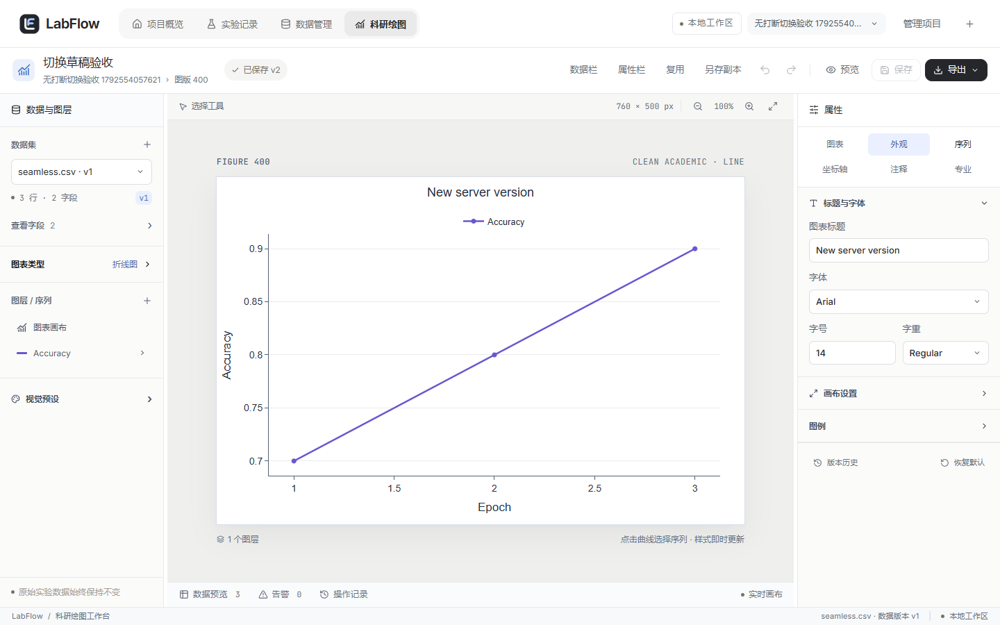
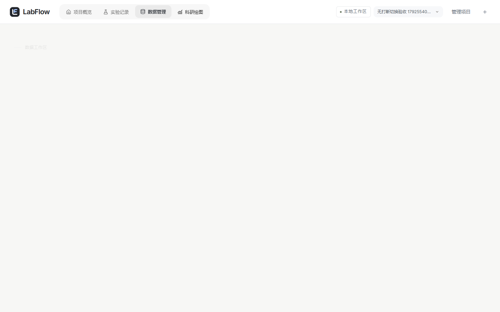

# 模块切换与草稿续接（2026-10-21）

## 解决的问题

新图表原先以空字符串作基线，刚打开也会被视为未保存；模块离开统一弹确认框，重新进入又弹恢复框。顶部绘图链接始终指向新建页，项目切换默认回首页，因此用户需要反复找回图表、数据和属性页签。

## 当前交互

- 新图表以实际初始配置作基线，未操作时不标记修改，也可直接保存默认图表。
- 输入按原有 250 ms 节流保留本机草稿；离开模块、切换项目、刷新和卸载前，同步写入最后一次修改。
- 普通离开不弹确认；重新打开同版本图表自动续接草稿。只有本机写入失败时才允许用户取消离开，保留当前编辑内容。
- 草稿属于不同服务端 revision 时仍要求明确选择，不自动覆盖新的保存版本。进入已保存图表前重新读取最新配置；对象字段顺序不同不会被误判为内容变化。
- 新建草稿按项目和起始数据版本隔离；已保存图表按项目和图表 ID 隔离。兼容旧版草稿键，读取时校验数据归属。
- 正式版本仍需点击“保存”。自动草稿没有向 MySQL 增加版本，也不修改 CSV、派生结果或统计数值。
- 保存期间保留原有编辑区锁定；后台请求完成后，不把已经离开工作台的用户强行带回编辑器。

## 连续工作与 UI

各项目分别记住数据页选中的版本与最后打开的图表；切换项目保留当前模块。恢复窗口滚动位置、编辑器属性页签及实验列表筛选条件，显式的“用于绘图”仍打开所选数据的新图表。

顶部导航增加图标与稳定的当前模块底色，移除重复模块标签，统一工作区标题、数据面板和草稿状态。页面使用轻微位移/淡入，保留系统减少动画偏好。懒加载绘图模块在导航悬停/聚焦时预热，加载时使用完整工作台骨架。

普通查询复用 30 秒缓存，已有写入操作仍主动失效相关查询；图表配置在重新进入时始终请求最新版本，以保留冲突保护。

没有使用浏览器原生 View Transition：开发回归曾发现快速导航取消过渡时出现未处理异常，最终使用不阻塞导航的 CSS 过渡。底部统计报告的展开/收起保持原有行为，属性页签才在模块间续接。

## 验证内容

- 单测：新建草稿隔离、旧键兼容、数据归属、损坏草稿、等价 JSON、模块路径隔离、无效目的地址、同步写入与失败重试。
- 浏览器：普通模块离开无确认、刷新时最后输入保留、自动续接、服务端版本未被静默修改、存储配额失败时取消、重试后成功、跨版本冲突、新数据集独立草稿、属性与筛选记忆、正式保存及恢复。
- 原有完整科研绘图浏览器验收包含 CSV/XLSX、统计处理、评估、SVG/PNG/PDF、项目备份恢复和真实 Java/MySQL 保存。
- Java/SQL 源码没有修改，本轮不重复运行 Java 测试。

运行命令（`frontend` 目录）：

```powershell
npm run test
npm run e2e
npm run build
```





最终次数与运行结果见 `TEST-RESULTS.md` 最新增量。
