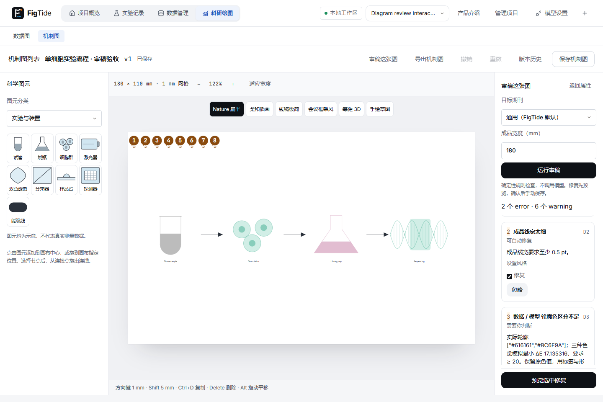
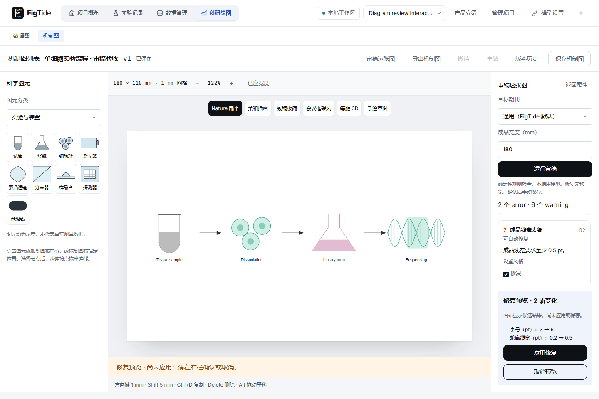

# 任务19-5：机制图审稿与确认式修复

改动文件：review/diagram、DiagramPaletteAudit/Catalog、collectFacts/DiagramReview、Canvas/Editor/Export及渲染器，兼容扩展共享ReviewIssues/ReviewResult；配套测试和文档。

验证：后端H2 449通过/1跳过，MySQL454通过/1跳过；前端587/587、构建通过；桌面完整101通过/3迁移专用跳过，真实JVM重启通过。跳过原因和实际命令详见[总验收](../diagram-19-A-acceptance/README.md)。

与任务文件的偏差：按主人新规则只审角色轮廓，不审浅填充；默认Okabe–Ito失败仅给意见，待主人判断。分区/P默认小字提高到6pt并随字号缩放；仅安全有效的操作才标记可修复，不能猜测科学关系。数据图类型切换移到主顶栏，保留旧布局和全部断言。

需要人决定：Okabe–Ito当前五个色对低于20，原值和阈值保留，具体色对见总验收。

原视觉问题对应05 #5/#12、08 #5、02–04 #1–#3及配色章节；已完成新收尾1–6项，没有未实现的返工编号。原先标“未完成”的19-5现已实现：面板、编号、忽略/恢复、只读候选、取消/确认、一次撤销、显式保存、导出error提示、迟到响应保护、D1–D7与几何隐私校验。

gif-frames/保留首轮运行历史帧；最终操作以review-repair.gif和总验收目录为准。
