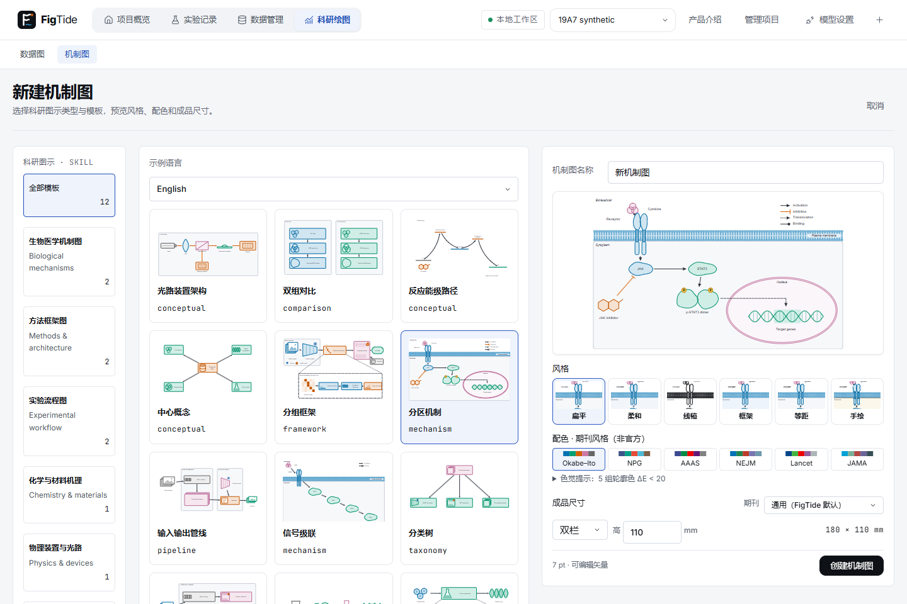
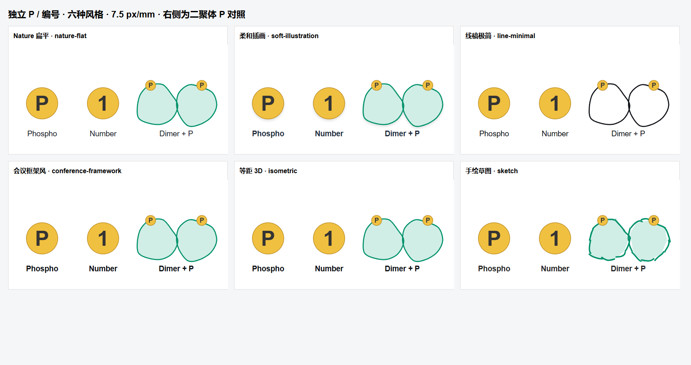
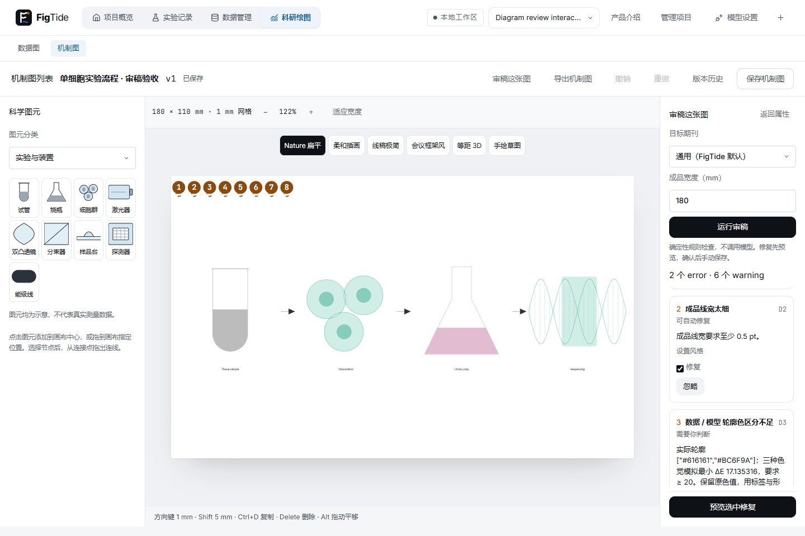

# 19-A-7补充与19-A最终回归 · 2026-10-31

任务：19-A-7本轮四项补充完成，19-5确认式修复链路复验通过，19-A本地自动总验收完成。模板部分已由主人通过；本轮新图供主人复核，不代替人工视觉验收。应用功能提交cd1be48，仅feature/diagrams本地提交，不推送/不开PR，19-B不开始。

改动文件：DiagramWizard、PaletteSelect、diagram.css；architecture/signal-cascade/workflow/pipeline模板；Catalog与前端几何/配色测试；视口E2E；六风格标记与Java色觉证据脚本。compose-diagram-comparisons追加三个模板的大图输出。无业务API、迁移、原始数据、模型或预算改动。

## 本轮要求落实

1. 1440×960右栏一屏完整：预览260px；同一受体+膜局部的6个风格缩略图一行；6套配色色块芯片一行；单栏/双栏/自定义和高度一行，自定义时宽度同排；名称与创建按钮完整可见，底部操作区独占空间。真实视口测试逐项检查控件均在屏内、两行芯片各6项同高、右栏无滚动/溢出、按钮不遮挡字段。默认和自定义截图均为**fullPage:false，1440×960**。
2. 光路模板pattern=conceptual，模板id仍为architecture以兼容引用；科学图元和光路语义保留。
3. 信号级联斜向排到胞质下方，图例移到右上；实验步骤图元从30×27增为38×44mm；Visual encoder标签置于右侧，输出线在标签下方离开，补几何断言并通过真实浏览器审稿。
4. OKABE-ITO-CHECK.md列出四个实际角色的全部六个色对及protan/deutan/tritan和最小ΔE；默认仍常显五组不达标提示。原颜色、映射和ΔE≥20均未更改。markers-six-styles.png及6组PNG/SVG为生产渲染器的独立P/编号样张，附二聚体P对照，7.5px/mm、实心圆底+粗体字。

## 验证（实际执行）

| 项目 | 结果 | 命令 / 证据 |
| --- | --- | --- |
| 前端全量 | 589/589，71文件 | npm --prefix frontend test -- --run --maxWorkers=2；frontend.txt |
| H2后端全量 | 449通过、0失败、1跳过（450总数） | LABFLOW_TEST_DB=h2；mvn -B -f backend/pom.xml test；backend-h2.txt |
| MySQL后端全量 | 454通过、0失败、1跳过（455总数） | LABFLOW_TEST_DB=mysql；同上；backend-mysql.txt；33316为核验datadir的隔离实例 |
| 桌面构建 | 通过 | 精确源码副本npm ci→tsc/vite→desktop JAR；desktop.txt |
| 完整桌面E2E | 101通过、0失败、3跳过 | scripts/test-agent.ps1 -All -Desktop -FixturePort 18770；desktop-summary.json |
| JVM重启 | 通过 | 完整测试后新JVM验证审计持久与未完成运行恢复 |
| 模板真实几何 | 144/144均0 error | 12模板×6风格×2语言；template-review.json；保留D3意见 |
| 19-5修复 | 通过 | 审稿→忽略/恢复→只读候选→取消/确认→一次撤销→复查→手动保存；预览和确认前revision不变 |
| 导出 | 通过 | SVG、300/600dpi PNG、中英文PDF；实际180×110mm、0位图、中文嵌字/可提取，另经Poppler渲染；pdf-verification.json |

明确未执行：后端各1项ServerEvaluationTest.evaluateExistingConfiguredServer（未提供labflow.eval.server，不连接收费模型）；3项migration.spec.ts需专用已迁移夹具和LABFLOW_MIGRATION_E2E，普通-All按原条件跳过，未算通过；托盘/SmartScreen人工项本轮未执行。未删减原数据图测试或修改布局基线。

完整桌面捕获设置LABFLOW_CAPTURE=1、LABFLOW_DIAGRAM_CAPTURE_PHASE=diagram-19-A7-final、LABFLOW_CAPTURE_PREFIX为本目录，历史A–C及前轮验收图不覆盖。原始日志保留在.runtime；本目录文本副本统一LF并去除行尾空白，以便Git和校验清单复现。

## 图片、GIF与结果

- **new-page-1440.png**：请求的1440×960视口，非full-page；new-page-custom-1440.png为自定义尺寸，new-page-color-audit-1440.png为色觉明细。
- **markers-six-styles.png**、markers-*.png/svg：独立P/编号六风格样张与原二聚体P对照。
- **templates-overview.png**：本轮12模板总览；template-signal-cascade.png、template-workflow.png、template-pipeline.png为三个改动模板的大图。
- OKABE-ITO-CHECK.md、okabe-ito-all-pairs.json：四角色、六色对、三种模拟、阈值20及默认提示结论。
- mechanism-1440.png、framework-1440.png、compare-*.png：旗舰编辑器与设计稿对照。
- review-panel.png、repair-preview.png、review-fixed.png、export-reviewed.png：19-5审稿、候选、复查和导出。
- operations.gif：21张真实截图生成的拖动/连线/风格/配色/撤销/保存操作；review-repair.gif：7张实际审稿与确认修复截图。
- exports/：实际中英文PDF及7.5px/mm渲染PNG。

与任务书的偏差：按主人最新要求，光路改conceptual，12个内置模板覆盖8种当前模式；旧architecture枚举仍兼容，测试明确断言光路模式。D3只比较实际角色轮廓，不检查浅填充。其余按最新要求执行。

对应原VISUAL-REVIEW：02–04 #1–#3（模板、三栏、完整右栏）、05 #5（P/编号一致）、线宽与配色章节；本轮新增四项无未实现项。快照仅用于稳定性，实际布局和图元图片均已附上。

需要人决定：默认Okabe–Ito仍有5对低于20，保留原色与提示；参与者/注释最小ΔE48.258967达标。具体不达标五对见OKABE-ITO-CHECK.md，未自行改色或降阈值。

