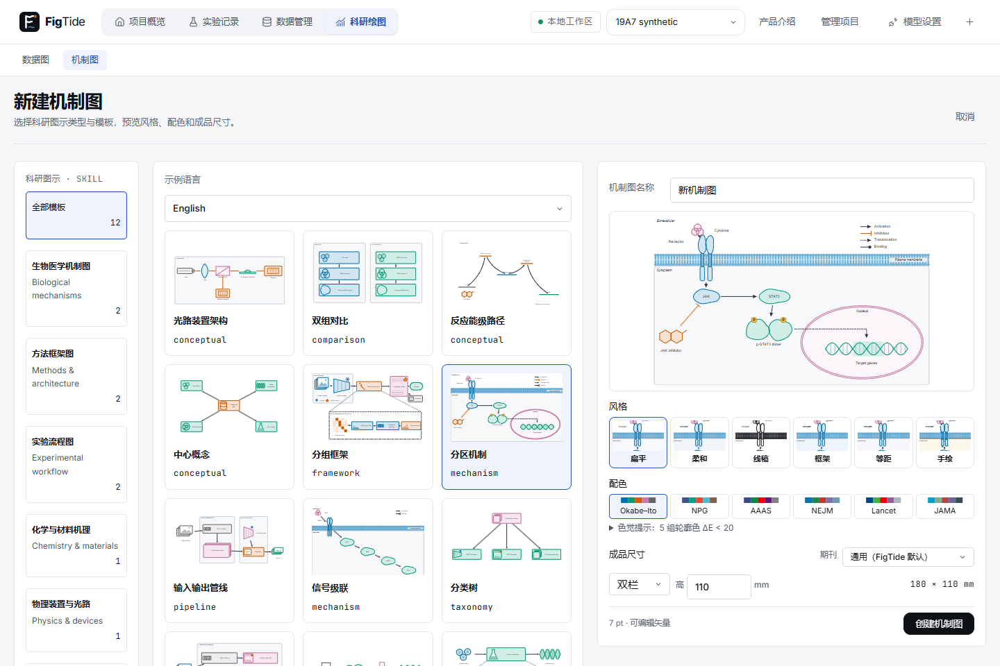
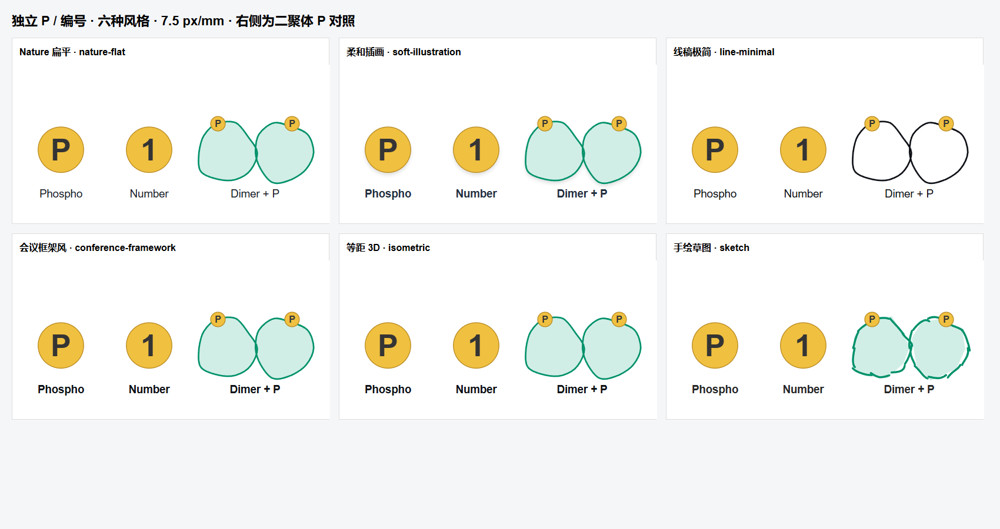

# 19-A-7 补充收尾 · 2026-10-31

任务19-A-7：按主人“模板部分通过”后的四项要求补充。

改动文件：DiagramWizard.tsx/PaletteSelect.tsx/diagram.css；architecture、signal-cascade、workflow、pipeline四模板；DiagramCatalogTest、PaletteSelect/渲染器测试、diagram-cleanup/visual-rework E2E；独立P/编号及色觉证据脚本。

实现：右栏260px预览、6个相同局部风格缩略图一行、6套色块芯片一行、尺寸/高度同一行、自定义宽度同排、底部固定操作区。1440×960无需滚动右栏，名称、全部风格、配色、尺寸、创建按钮均在视口内；测试同时检查控件位置、无内部溢出和自定义规格。截图均为fullPage:false。

光路模板的pattern改为conceptual，id和科学图元/光路语义不改。信号级联斜向布满胞质区域，图例移到右上；实验步骤节点由30×27增为38×44mm；Visual encoder标签放在右侧，输出连线从图元底部离开，不经过标签区。旧文档兼容及固定配色值不变。

验证：前端全量589/589（71文件）；构建通过；H2机制图相关19/19、H2全量449通过/1个真实服务评测条件跳过；相关桌面E2E10/10，最终视口专项1/1，两个运行均通过独立JVM重启。MySQL及完整桌面总验收尚在本轮后续执行，未在此预写通过。

与任务书的偏差：按主人最新要求把光路模式设为conceptual，因此内置模板保留12个、覆盖8种当前模式，旧architecture枚举仍兼容；原9模式覆盖测试等价更新为8模式，并显式断言光路=conceptual。其余按最新要求执行。

需要人决定：默认Okabe–Ito仍提示5组实际角色轮廓色对低于20；原值/阈值保持不变，详见OKABE-ITO-CHECK.md，未自行决定改色。

对应原VISUAL-REVIEW：02–04 #2/#3三栏与完整右栏、#1模板；05 #5标记及“线宽与配色”；本轮四项均已实现，无未实现项。19-5已在前轮本地实现，本次收尾后继续其回归及19-A完整验收，不重写、不推送。

## 附图

- new-page-1440.png：1440×960真实视口，未使用full-page。
- new-page-custom-1440.png：同视口自定义宽度/高度。
- new-page-color-audit-1440.png：同视口展开实际色觉明细。
- templates-overview.png：修正后的12模板总览。
- markers-six-styles.png：独立P/编号六风格总览，右侧为原二聚体P对照；每种markers-*.png/svg来自生产renderDiagram，7.5px/mm、实心圆和粗体字。
- OKABE-ITO-CHECK.md、okabe-ito-all-pairs.json：四个实际角色全部6个色对、三种模拟和最小ΔE。

