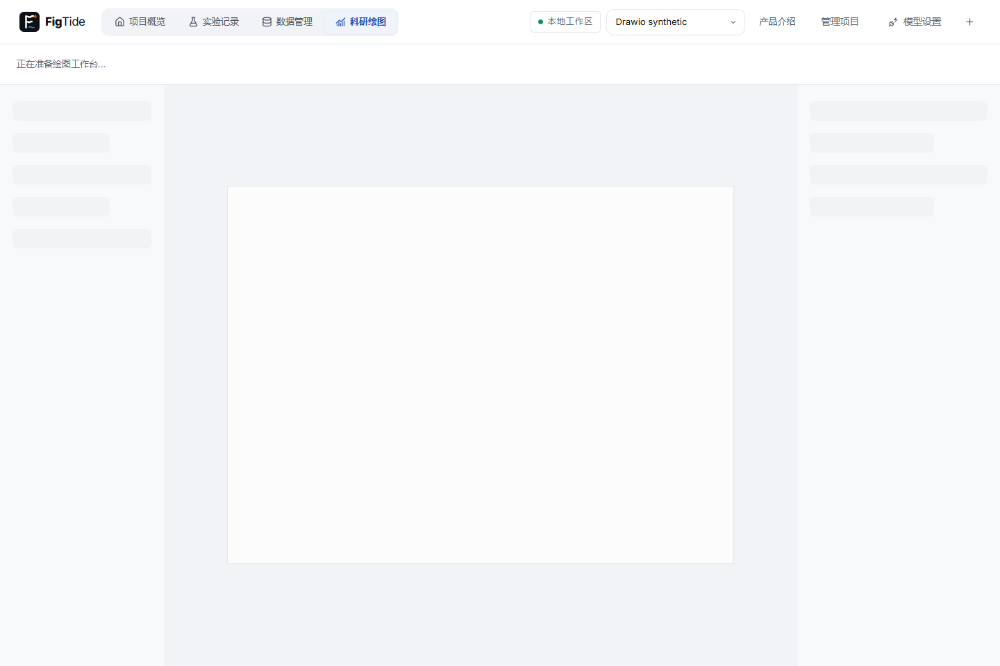

# 任务19-C · 素材与外部连接

2026-11-02收尾。当前产品代码98e3047；验收材料/报告随后单独提交。当前分支feature/diagram-agent-assets，仅本地提交，未推送B/C。19-A已由PR #6经CI普通合并main c62f3dd；没有上传我们自己的真实模型评测结果。

## 完成范围

- 19-12作为19-11前置先完成：JDK共享SvgSanitizer，禁止DTD/实体、脚本、事件、外部URL、位图和foreignObject；2MB/20000元素/64层边界，安全CSS扁平化、本地引用与递归检查。导入、入库、直接文档保存和备份恢复使用同一边界。
- 19-11：150个科研SVG（131 CC0-1.0、19 CC-BY-4.0），逐项来源/作者/许可/固定提交/SHA；搜索中英文/标签、按skill推荐、点击和拖入、随角色改色、D9署名及TXT/图注选项。
- 19-13：浏览器本地PNG/JPG主色与SVG线宽/圆角/字体提取；预览当前实际角色轮廓的D3，确认后只保存参数。复用style_templates和备份，不上传图片、文件名或原图内容。
- 19-14：七个MCP工具、Markdown/JSON简报、revision保护、净化SVG独立artwork图层、整体编辑/锁定/隐藏/删除和历史恢复。原生图层保留；内部文字不能单独编辑。
- 19-15：未压缩.drawio XML、分区容器、节点分组、独立可编辑标签、激活/抑制/间接连线、内嵌科研SVG与整体artwork。导出不保存新版本。

## 验证

最终全量结果（产品代码98e3047，后续仅报告/证据）：

| 范围 | 实际结果 |
| --- | --- |
| 前端全量 / 构建 | 652/652，76文件；tsc+Vite通过 |
| H2全量 | 470总，468通过、2跳过、0失败 |
| MySQL全量 | 475总，473通过、2跳过、0失败 |
| MCP | check/build通过，18单测、4真实stdio集成通过 |
| 完整桌面E2E | 110总，107通过、3跳过、0失败、0 flaky |
| 真实JVM重启 | 终态审计不变、在途运行恢复，通过 |
| 模板实际几何 | 240组，0 error；D3意见如实保留 |

后端两项跳过：ServerEvaluationTest显式服务评测、DiagramEvaluationTest显式真实模型模式；桌面三项跳过：migration.spec.ts需预先准备独立迁移夹具并设置LABFLOW_MIGRATION_E2E=1。未将跳过计为通过。本次未重做托盘/SmartScreen人工项，没有新的EXE打包发布。

实际命令：`LABFLOW_TEST_DB=h2/mysql`分别执行`mvn -B -f backend/pom.xml test`；`npm --prefix frontend test -- --run --maxWorkers=2`；`npm --prefix frontend run build`；MCP的check/test/build/test:integration；`scripts/test-agent.ps1 -Desktop -All -FixturePort 18770`（capture启用）。原始本地日志的LF规范化SHA256见acceptance.json，不上传模型回放输出。

开发中draw.io专项首轮把data URI当作XML解析导致测试失败，修正测试的URI头解码后4/4；没有删除断言。最终全量全部无失败。相关专项：SvgSanitizer攻击/正常结构4项；外部接口/备份/锁定/所有权3项；前端artwork3项；draw.io导出4项。复杂手绘测试SVG（渐变、clip、use、文字和CSS）的净化前后200×120 RGBA逐像素一致。真实MCP stdio包含简报→预览/保存→导入→过期冲突→恢复，浏览器E2E另验证新图层可见、整体编辑及版本恢复。

真实收费模型未执行；协议夹具不是模型质量采样。自己的模型成绩、原始输出与费用继续只在忽略的.runtime目录；本目录仅是产品功能/视觉测试证据。

## 来源、接口和共享变更

图标固定于duerrsimon/bioicons提交d29e766ea7580b8063c4f47b29e872db40a4d979，按单项元数据筛选CC0/CC BY 4.0，排除许可冲突/ND/NC/SA/位图/不安全XML。全文许可、每项来源与修改说明见backend/src/main/resources/diagram/icons/licenses、manifest.json、SOURCES.md及根THIRD_PARTY_NOTICES.md。

B的规划方法仅参考MIT上游lgwrightlab/schematic-figure 09d8b6e98d04b91de6e8b6632b3356b9fc237417，独立中文提示词与40连续字符检查；上游副本仅测试资源。完整来源矩阵见DIAGRAMS.md与各skill/SOURCES.md。

C无新增依赖和迁移。新增GET /api/diagram-icons/{id}.svg、项目下diagram-style-templates列表/保存/preview、机制图brief与import-svg，细节见API.md。B唯一新增V11为MySQL/H2配对迁移，旧V1–V10未改。

C共享方法：StyleTemplateService.profile/validateProfile兼容kind:diagram分支，旧chart list筛除diagram风格，CLOB通过既有ReviewJson读取；MCP editorUrl添加可选diagrams路径并保持默认figures；AgentRunService仅修正diagram trace的prompt_version。B共享账本绑定与completeRun提取见19-B报告；默认图表预算/幂等/取消/恢复/确认保存语义不变。原数据图测试和旧快照基线未刷新，已纳入全量回归。

## 图片与实际操作

- icon-library.png：150图标搜索/添加。
- icon-export-attribution.png、exports/licensed-icon-attribution.txt：默认署名及真实导出。
- reference-style.png：本地提取和精确角色配色检查。
- external-artwork.png：原图层保留，外部SVG整体编辑。
- drawio-export.png、exports/editor-mechanism.drawio：真实下载。
- exports/jak-stat.drawio、exports/jak-stat-drawio.png：本机draw.io.exe实际打开并CLI渲染，自行查看过图。
- 新建/旗舰编辑器/审稿全图：new-page-1440.png、mechanism-1440.png、framework-1440.png、review-panel.png、repair-preview.png；operations.gif和review-repair.gif来自实际拖动/连线/审稿流程。
- assets-operations.gif：operation-frames/的8张真实浏览器操作，展示插图标、切风格、撤销/重做、保存和导出；非模型生成画面。

## 人工项与局限

- **待主人确认**：在draw.io打开样例，修改标签、移动节点/分区、保存并重开；清单见desktop/SMOKE-14-5.md。CLI渲染成功不冒充主人交互确认。
- 本次不重发Windows EXE/Release，使用desktop生产JAR完整浏览器测试；托盘/SmartScreen等旧人工项未重做。
- artwork内部文字不能单独编辑，D4/D5不会审核其内部文字/科学含义；MCP无渲染事实时这两项跳过。
- D3按主人2026-11-02要求分档：<10 warning、10–20仅审稿info；数据图R3仍为20。默认分区机制图最小11.724817，0 warning/5 info，配色区不提示。同色角色仍按0如实报告，不改色、不去重。
- SVG只支持安全白名单，非支持效果会被删除；字体依赖本机。draw.io保留可编辑结构，细节受其渲染器影响。
- 图标SVG改为通过原接口按需获取/缓存，导出等待并内联；活动机制图chunk 2,709,712→206,946 bytes（−92.36%），gzip606,989→74,503 bytes（−87.73%）。其他旧数据图chunk体积提示保留。

## 2026-11-02视觉验收包

逐项索引见VISUAL-PACKAGE.md，文件摘要见VISUAL-SHA256SUMS.txt；打包脚本scripts/package-diagram-19C-evidence.py只收指定清单并断言1440×960（非full-page）。包内有10张指定界面图、3段实际操作GIF、助手3张流程图及一张应用后补图、正确acceptance.json、完整色对/体积复核和draw.io样例。ZIP只在本地交付，不推送。

本轮失败如实保留：专项旧创建页一屏断言发现无风险状态文案造成滚动，已移除该文案；首轮前端全量遇到150 SVG安全遍历5秒超时、该状态文案拼接错误与旧助手异步断言竞争，修正本轮代码/遍历时限，保留旧助手断言后重新全量652/652通过。专项桌面12/13不算通过；最终完整桌面107通过/3迁移跳过、0失败/0 flaky，JVM审计重启通过。原失败日志仅本地保留。

无新接口、迁移或依赖；原R3/ColorVision、预算、幂等、取消、恢复及手动确认保存语义未改变。未调用收费模型。完成主人要求的1–3后停下，等待视觉验收、draw.io人工确认和另行推送/PR授权。
